# PROJECT.md — OpenClone Product Specification & Source of Truth

**Canonical Product:** OpenClone  
**Product Category:** Universal AI Software Engineering Framework  
**Tagline:** *Build with Any AI. Governed by One Engineering Standard.*  
**Canonical Repository:** [https://github.com/MK-1603/OpenClone](https://github.com/MK-1603/OpenClone)  
Version: 2.0.0  
**Project Classification:** Open-Source Engineering Framework & Deterministic Control Plane  
**Maturity Status:** `GOVERNED_LOCAL_CONTROL_PLANE` (Deterministic gates and interfaces verified; untrusted code execution requires container isolation)  
**License:** [MIT License](LICENSE)  
**Maintainer:** MK-1603 & OpenClone Core Maintainers  

---

## 1. Executive Summary & Problem Statement

Modern AI coding agents (Claude Code, Cursor, Google Antigravity, OpenAI Codex, ChatGPT, and standalone LLM CLI tools) generate software at unprecedented velocity. However, autonomous generation without rigorous software engineering governance triggers **AI Slope**:
- **Scope Bloat & Architectural Drift:** LLMs silently introduce unvetted libraries, unrequested refactors, duplicate patterns, and unneeded external services.
- **Hallucinated & Fake Verifications:** Agents claim tests pass or verification succeeded without executing commands or capturing reproducible evidence.
- **Broken Auditability & Security Gaps:** Prompt injection attacks, privilege escalations, unmonitored secrets, and untracked code modifications compromise codebase integrity.
- **Host Fragmentation:** Every IDE and tool enforces disparate rule formats, prompt styles, and execution paradigms without an interoperable engineering baseline.

**OpenClone** solves these structural failures by providing a self-hostable, host-neutral, and deterministic software engineering framework. OpenClone decouples product specifications, task DAG scheduling, human approval digest binding, cryptographic audit logging, and release gates from the underlying LLM models and host environments.

---

## 2. Product Mission, Principles & Boundaries

### 2.1 Mission Statement
Provide a unified, host-agnostic, and reproducible engineering operating system governed by a single deterministic standard:
> *"Build with Any AI. Governed by One Engineering Standard."*

### 2.2 Core Architectural Principles
1. **Human Authority by Design:** AI models propose changes; authorized humans and deterministic code make binding decisions. Critical operations (data migrations, requirements shifts, releases) strictly require human approval.
2. **Deterministic Governance:** LLMs cannot grant themselves permissions, mark tasks completed, or alter approvals. Task state transitions and dependency ordering are strictly evaluated by deterministic Python code.
3. **Evidence-Based Truthful Maturity:** Every milestone, capability, and test claim requires verifiable command execution logs and SHA-256 evidence digests. No feature is marked complete without evidence.
4. **Strict Anti-AI-Slop:** Minimal viable diffs only. No unvetted dependencies, no premature abstractions, no placeholder implementations, and no visual or architectural clichés.

### 2.3 Scope Boundaries: Inclusions vs. Exclusions
- **What OpenClone Is:**
  - A deterministic local control plane enforcing task state transitions and dependency DAGs.
  - A cryptographic, hash-chained SQLite event audit ledger.
  - An interactive approval system with SHA-256 digest binding.
  - A Model Context Protocol (MCP) server providing 11 standard inspection, execution, and guidance tools.
  - A 4-tier configuration precedence engine (`project rule > project .openclone > ~/.openclone global > framework defaults`).
  - An encyclopedic engineering foundation comprising 31 domains, 56 execution engines, 15 workflows, and 72 specialist roles.
- **What OpenClone Is Not:**
  - OpenClone is **not** an LLM model and does not bundle model weights.
  - OpenClone is **not** a secure OS sandbox; command execution relies on process limits and path containment, while untrusted code requires external container/VM isolation.
  - OpenClone does **not** perform autonomous production deployment without human-in-the-loop authorization.
  - OpenClone does **not** auto-approve task plans or self-certify release gates.

---

## 3. Users, Personas & Operating Stakeholders

| Persona | Primary Needs & Responsibilities | Key OpenClone Interfaces Used |
|---|---|---|
| **Individual Developers & Open-Source Maintainers** | Enforce disciplined AI generation, prevent scope drift, generate structured project specifications, and maintain reproducible git commits. | `openclone init`, `PROJECT.md`, `AGENTS.md`, `openclone check`, MCP tools |
| **Enterprise Engineering Leads & Architects** | Enforce standard task DAGs, require human approval sign-offs, inspect tamper-evident audit ledgers, and mandate independent verification. | `openclone gate`, SQLite audit ledger, `WF-009`, `WF-010`, `vault-template/` |
| **Security & DevSecOps Engineers** | Enforce deny-by-default execution boundaries, verify pinned security scanners, audit license matrices, and manage findings schema. | `security/scanners.lock.json`, `security/operations/`, `openclone findings` |
| **AI Coding Agents (Antigravity, Claude, Codex, Cursor)** | Receive unambiguous task constraints, adhere to project contracts, execute within allowed directories, and report reproducible evidence. | Global host rules, MCP server (`openclone_get_status`, `openclone_explain_concept`) |

---

## 4. Verified Capability Metrics & Repository Inventory

All metrics below are verified directly against the active repository filesystem and automated test suites:

| Capability Category | Verified Quantity | Implementation Location | Verification Evidence |
|---|---|---|---|
| **Engineering Domains** | **31** | [`framework/domains/`](framework/domains/) (`00-GOVERNANCE` to `30-AGENT-RULES-AND-VERIFICATION`) | Verified by `tools/validate_repository.py` |
| **Execution Engines** | **56** | [`framework/engines/`](framework/engines/) (`E-001` through `E-056`) | Verified by `tests/test_repository.py` |
| **Executable Workflows** | **15** | [`framework/workflows/`](framework/workflows/) (`WF-001` through `WF-015`) | Filesystem count & schema checks |
| **Specialist Roles** | **72** | [`framework/workforce/registry/workers/`](framework/workforce/registry/workers/) | Verified by `tests/test_workforce_runtime.py` |
| **Specialist Teams** | **12** | [`framework/workforce/registry/teams.json`](framework/workforce/registry/teams.json) | Verified by `tests/test_workforce_registry.py` |
| **MCP Tools** | **11** | [`src/openclone/mcp/server.py`](src/openclone/mcp/server.py) | Verified by `tests/test_mcp_server.py` (13 tests) |
| **Security Scanners & Tools Locked** | **14** | [`security/scanners.lock.json`](security/scanners.lock.json) (12 scanners + 2 CI actions) | Verified by `tools/validate_repository.py` |
| **Supported Host Environments** | **7** | [`adapters/`](adapters/) and [`global/hosts/`](global/hosts/) | Verified by `tests/test_host_packaging.py` |
| **JSON Schemas** | **10** | [`framework/schemas/`](framework/schemas/) (Draft 2020-12) | Meta-validated by `tools/validate_repository.py` |
| **Automated Tests (Python pytest)** | **118** | [`tests/`](tests/) (118 passed in ~14s) | `pytest tests/` (100% pass) |
| **Automated Tests (Node.js Governance)** | **13** | [`framework/skills/taste-skill/tests/`](framework/skills/taste-skill/tests/) | `node framework/skills/taste-skill/tests/test-governance.mjs` |
| **Total Automated Tests** | **131** | Automated test harnesses | **131 passed, 0 failed** |
| **Relative Markdown Links** | **479** | Repository-wide across 746 files | Verified by `tools/check_links.py` (**0 broken**) |

---

## 5. System Architecture & Topology

The OpenClone architecture enforces strict separation between host environments, the global installation layer, the project contract layer, the deterministic local runtime, and the underlying engineering knowledge base:

```mermaid
flowchart TD
    subgraph HostLayer["Host Layer (IDEs & AI Agents)"]
        AG["Google Antigravity"]
        CC["Claude Code"]
        CX["OpenAI Codex"]
        CR["Cursor"]
        VC["VS Code"]
        CP["ChatGPT Custom GPT"]
        GM["Generic MCP Client"]
    end

    subgraph GlobalLayer["Global Layer (~/.openclone / global/)"]
        GI["Global Installer & CLI (install-global.cmd / .sh)"]
        GV["Integrity Verifier (verify-global.py)"]
        GC["Neutral Core Governance (OPENCLONE-GLOBAL.md)"]
        GH["Pre-Packaged Host Adapters (global/hosts/)"]
    end

    subgraph ProjectLayer["Project Layer (.openclone / project/)"]
        PTR["Project Contract (PROJECT.md)"]
        ATR["Operating Contract (AGENTS.md)"]
        HRU["Host Project Rules (project/host-rules/)"]
        PSD["Project State Ledger (.openclone/)"]
    end

    subgraph RuntimePlane["Deterministic Runtime Control Plane (src/openclone/runtime/)"]
        CLI["OpenClone CLI (src/openclone/cli.py)"]
        MCP["Shared MCP Server (src/openclone/mcp/server.py)"]
        LSM["Finite State Machine (DRAFT -> SUCCEEDED)"]
        DAG["Topological Task DAG Scheduler"]
        ADB["SHA-256 Approval Digest Binder"]
        LED["Hash-Chained SQLite Audit Ledger"]
        EXH["Governed Subprocess Harness & Redaction"]
        RLG["Deterministic Release Quality Gate"]
    end

    subgraph FrameworkKnowledge["Governed Framework Foundation (framework/)"]
        DOM["31 Engineering Domains"]
        ENG["56 Capability Engines (E-001..E-056)"]
        WFS["15 Executable Workflows (WF-001..WF-015)"]
        WFR["72 Specialist Roles Across 12 Teams"]
        TST["Taste Skill Anti-Slop Governance"]
        SCH["10 JSON Schemas (Draft 2020-12)"]
    end

    HostLayer --> GlobalLayer
    GlobalLayer --> ProjectLayer
    ProjectLayer --> RuntimePlane
    RuntimePlane --> FrameworkKnowledge
```

---

## 6. Formal Functional Requirements Audit

Every requirement is audited against actual source implementation and test evidence:

| Req ID | Title & Specification | Priority | Status | Verification Method | Implementation Reference | Acceptance Condition |
|---|---|:---:|:---:|---|---|---|
| `REQ-CORE-001` | **Deterministic Task State Machine:** Enforce strict task state transitions (`DRAFT` $\rightarrow$ `PLANNED` $\rightarrow$ `APPROVED` $\rightarrow$ `READY` $\rightarrow$ `RUNNING` $\rightarrow$ `SUCCEEDED`/`FAILED`) rejecting illegal or self-promoted jumps. | `MUST` | `VERIFIED` | Unit Test | `src/openclone/runtime/workforce.py` (`TRANSITIONS`) | `test_state_machine_blocks_self_run_from_approved_without_ready` passes |
| `REQ-CORE-002` | **Cycle-Free Topological Task DAG:** Reject circular task dependencies and ensure all prerequisite tasks are in terminal `SUCCEEDED` status before marking a dependent task `READY`. | `MUST` | `VERIFIED` | Unit Test | `src/openclone/runtime/workforce.py` (`topo()`) | `test_dependency_order`, `test_cycle_rejected` pass |
| `REQ-CORE-003` | **Immutable Approval Digest Binding:** Bind task execution approval to a cryptographic SHA-256 digest of task parameters (`worker`, `action`, `command`, `cwd`, `env`). Any parameter modification revokes approval. | `MUST` | `VERIFIED` | Unit Test | `src/openclone/runtime/workforce.py` (`approve()`, `ready()`) | `ApprovalTests` in `tests/test_runtime_hardening.py` pass |
| `REQ-CORE-004` | **Hash-Chained Audit Ledger:** Record all task creations, state transitions, human approvals, and execution outputs in a tamper-evident SQLite database chained by SHA-256 hashes. | `MUST` | `VERIFIED` | Integration Test | `src/openclone/runtime/workforce.py` (`Ledger`) | `test_ledger_tampering_detected` fails gate on modified records |
| `REQ-CORE-005` | **Governed Subprocess Execution & Redaction:** Execute approved task commands within project root with real-time regex credential redaction (AWS, GitHub, API keys) and isolated standard streams (`stdin=DEVNULL`). | `MUST` | `VERIFIED` | Subprocess Test | `src/openclone/runtime/workforce.py` (`_execute_command`) | `test_run_records_evidence_and_redacts`, `test_secret_env_is_not_inherited` pass |
| `REQ-CORE-006` | **Deterministic Release Gate:** Evaluate release readiness by blocking on uncompleted tasks, open findings, missing evidence, unverified test checks, and non-interactive approvers. | `MUST` | `VERIFIED` | Quality Gate Test | `src/openclone/runtime/workforce.py` (`gate()`) | `GateAndFindingTests` in `tests/test_runtime_hardening.py` pass |
| `REQ-CORE-007` | **Structured Review Findings Validation:** Validate design and code review findings against JSON Schema (`design-review-finding.schema.json`). High/Critical findings require human resolution or explicit waiver. | `MUST` | `VERIFIED` | Schema & Gate Test | `src/openclone/runtime/workforce.py` (`findings()`) | `test_findings_are_schema_validated`, `test_open_high_finding_blocks...` pass |
| `REQ-CORE-008` | **Persistent Memory Vault Validation:** Audit persistent memory records for provenance, timestamp, sensitivity, and prompt injection attempts before allowing memory recall. | `MUST` | `VERIFIED` | Security Test | `src/openclone/runtime/workforce.py` (`memory_check()`) | `test_memory_check_flags_missing_provenance_and_injection` passes |
| `REQ-MCP-001` | **Multi-Tool Model Context Protocol Service:** Provide a standard JSON-RPC MCP server exposing 11 tools (`openclone_get_status`, `search_knowledge`, `explain_concept`, `run_workflow`, `validate_project`, `get_guidance`, `list_capabilities`, `plan_feature`, `implement_task`, `verify_feature`, `security_review`). | `MUST` | `VERIFIED` | Protocol Test | `src/openclone/mcp/server.py` | 13 test methods in `tests/test_mcp_server.py` pass |
| `REQ-GLO-001` | **Transactional Global Installation:** Detect installed AI hosts on developer machine, copy global core governance, record installed SHA-256 file manifest, create backups on overwrite, and verify parity. | `MUST` | `VERIFIED` | Installer Test | `src/openclone/installer/`, `global/installer/` | `tests/test_installer.py`, `tests/test_global_install.py` pass |
| `REQ-GLO-002` | **Standardized Host Packaging:** Pre-package native manifests, plugin declarations, and rule files for Antigravity, Claude Code, Codex, Cursor, VS Code, ChatGPT, and Generic MCP. | `MUST` | `VERIFIED` | Packaging Test | `global/hosts/`, `adapters/` | `tests/test_host_packaging.py` passes 7/7 test suites |
| `REQ-PRJ-001` | **Project Source-of-Truth Contract:** Initialize and validate project lifecycle assets (`PROJECT.md`, `AGENTS.md`, `.openclone/`) without overwriting existing user-owned content. | `MUST` | `VERIFIED` | CLI Test | `tools/openclone_runtime/project.py` | `tests/test_project_lifecycle.py` passes 5/5 test suites |
| `REQ-UX-001` | **Anti-AI-Slop Visual Governance:** Detect and flag generic visual clichés (unwarranted purple gradients, excessive blur blobs, meaningless buzzword pills) before frontend code generation. | `MUST` | `VERIFIED` | Node.js Test | `framework/skills/taste-skill/` | `test-governance.mjs` passes 13/13 test cases |
| `REQ-UX-002` | **User-Choice Design Token Patterns:** Provide token specifications and WCAG 2.2 AA compliant guidelines for Glassmorphism, Neumorphism, Minimal Swiss, and Brutalism. | `SHOULD` | `VERIFIED` | Specification Inspection | `framework/domains/05-UX-UI-ENGINEERING/` | File exists, links valid, referenced in MCP guidance |
| `REQ-DEP-001` | **Application Build-to-Deployment Pipeline:** Formalize standard 6-stage lifecycle for application compilation, container build, preview validation, and governed production deployment. | `SHOULD` | `PARTIALLY_IMPLEMENTED` | Schema & Spec Inspection | `framework/workflows/WF-014-*.md`, `framework/schemas/deployment-profile.schema.json` | Schema valid; actual execution delegated to external cloud CLIs |
| `REQ-SEC-001` | **Pinned Security Scanners Policy:** Maintain immutable 40-character commit SHA pins for 14 security analyzers and CI actions in `security/scanners.lock.json`. | `MUST` | `VERIFIED` | Integrity Test | `security/scanners.lock.json`, `.github/workflows/security.yml` | `tools/validate_repository.py` verifies all 14 pins |
| `REQ-MIG-001` | **Legacy State Directory Migration (`.aisdf` $\rightarrow$ `.openclone`):** Automate discovery and in-place upgrade of historical `.aisdf/` state directories to canonical `.openclone/` without data loss. | `COULD` | `PLANNED` | Protocol Specification | `openclone.manifest.json` (`openclone-upgrade-v1`) | Runtime maintains backward-compatibility reads; automated tool scheduled for v2.1.0 |

---

## 7. Non-Functional Requirements & Measurable Invariants

| Invariant ID | Dimension | Target Specification | Actual Measured Status | Evidence Reference |
|---|---|---|---|---|
| `NFR-DEP-001` | **Core Zero-Dependency** | Core runtime MUST run on Python 3.10+ standard library without mandatory pip dependencies. | **0 external dependencies required for core runtime.** Optional dev packages (`pytest`, `jsonschema`). | `pyproject.toml` (`dependencies = []`), verified by clean stdlib imports |
| `NFR-VAL-001` | **Repository Validation Performance** | Complete repository validation MUST execute in $< 30$ seconds. | **16.45 seconds** (measured across 2,640 tracked files, 746 markdown files). | Execution output of `tools/validate_repository.py` |
| `NFR-SCH-001` | **Schema Conformance** | All schemas in `framework/schemas/` MUST conform to JSON Schema Draft 2020-12. | **10 of 10 schemas conform** with Draft 2020-12 meta-validation. | `tools/validate_repository.py` JSON Schema meta-validator |
| `NFR-SEC-001` | **Credential & Token Redaction** | Sensitive tokens (AWS keys, GitHub tokens, API keys, private keys) MUST be redacted before disk logging. | **100% regex match redaction** verified across stdout and stderr. | `tests/test_runtime_hardening.py::ExecutionTests` |
| `NFR-ENC-001` | **Clean UTF-8 Encoding** | All repository source, documentation, and data files MUST be UTF-8 encoded without BOM. | **100% compliant** across all tracked files. | Verified during link and repository scans |
| `NFR-PRC-001` | **4-Tier Precedence Order** | Configuration directives MUST resolve strictly in order: `project rule > project .openclone > ~/.openclone global > framework defaults`. | **Formally ratified standard.** Programmatic enforcement in runtime and installer. | `framework/rules/RULE-PRECEDENCE-AND-CONFLICT-RESOLUTION.md` |

---

## 8. Legacy Identity Migration Strategy

### 8.1 Active vs. Historical Identity Rule
- **Active Canonical Identity:** **OpenClone** is the exclusive identity across all code, packages, CLI commands, documentation, manifests, and adapters.
- **Historical Identity Isolation:** The historical name AISDF is preserved exclusively in historical provenance records ([`archive/legacy-aisdf/`](archive/legacy-aisdf/)), external repository reports ([`docs/compliance/`](docs/compliance/)), third-party license notices, and compatibility alias shims ([`runtime/openclone_runtime/`](runtime/openclone_runtime/)).

### 8.2 State Migration Protocol
1. **Existing Projects:** OpenClone runtime maintains non-destructive backward-compatibility by recognizing existing `.aisdf/` directories when `.openclone/` is absent.
2. **New Projects:** All new project initializations (`openclone init` or `project/` templates) exclusively generate `.openclone/`.
3. **Migration Integrity:** Automated in-place SQLite ledger and checkpoint migration (`openclone-upgrade-v1`) is planned for v2.1.0; no user data will be altered without explicit human consent and backup snapshots (`.bak-<timestamp>`).

---

## 9. Acceptance Criteria & Definition of Done

A release or milestone in OpenClone is declared complete **only** when all of the following conditions are independently verified:
- [x] Repository validator ([`tools/validate_repository.py`](tools/validate_repository.py)) reports **0 errors and 0 warnings**.
- [x] All 118 Python unit and integration tests pass cleanly via pytest (`pytest tests/`).
- [x] All 13 Taste Skill governance tests pass cleanly (`node framework/skills/taste-skill/tests/test-governance.mjs`).
- [x] All 479 relative Markdown links across 746 files are verified valid by [`tools/check_links.py`](tools/check_links.py) (**0 broken links**).
- [x] Global installation and uninstallation verified with temporary home isolation and SHA-256 manifest parity ([`global/installer/verify-global.py`](global/installer/verify-global.py)).
- [x] All 14 security scanner entries in [`security/scanners.lock.json`](security/scanners.lock.json) remain pinned to valid 40-character commit SHAs.
- [x] Root directory contains strictly 18 canonical files, with zero transient logs, audit reports, or pycache artifacts.
- [x] Git working tree is completely clean on branch `chore/premium-structure`.

---

## 10. Traceability Matrix & Authoritative Documentation Map

| Topic / Concern | Authoritative Specification File |
|---|---|
| **Project Source of Truth** | [`PROJECT.md`](PROJECT.md) (This document) |
| **Agent Operating Contract** | [`AGENTS.md`](AGENTS.md) |
| **Global Layer Specification** | [`global/core/OPENCLONE-GLOBAL.md`](global/core/OPENCLONE-GLOBAL.md) · [`global/README.md`](global/README.md) |
| **Rule Precedence Hierarchy** | [`framework/rules/RULE-PRECEDENCE-AND-CONFLICT-RESOLUTION.md`](framework/rules/RULE-PRECEDENCE-AND-CONFLICT-RESOLUTION.md) |
| **Project Integration Templates** | [`project/PROJECT.md.template`](project/PROJECT.md.template) · [`project/AGENTS.md.template`](project/AGENTS.md.template) |
| **Framework Workforce Model** | [`framework/workforce/README.md`](framework/workforce/README.md) · [`docs/guides/WORKFORCE-MODEL.md`](docs/guides/WORKFORCE-MODEL.md) |
| **22-Phase Lifecycle Catalogue** | [`docs/engineering-lifecycle/MASTER_LIFECYCLE_CATALOGUE.md`](docs/engineering-lifecycle/MASTER_LIFECYCLE_CATALOGUE.md) |
| **Security Operations & Baselines** | [`security/README.md`](security/README.md) · [`docs/security/saas-security-baseline.md`](docs/security/saas-security-baseline.md) |
| **Host Compatibility & Packaging** | [`global/docs/HOST-COMPATIBILITY.md`](global/docs/HOST-COMPATIBILITY.md) · [`adapters/COMPATIBILITY.md`](adapters/COMPATIBILITY.md) |
| **Third-Party IP & Licenses** | [`NOTICE`](NOTICE) · [`docs/legal/THIRD_PARTY_LICENSES.md`](docs/legal/THIRD_PARTY_LICENSES.md) · [`docs/compliance/README.md`](docs/compliance/README.md) |
