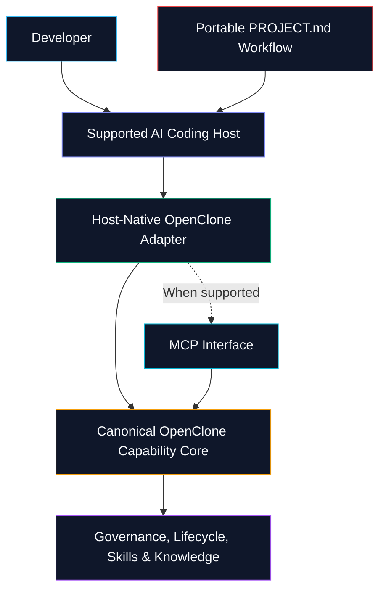
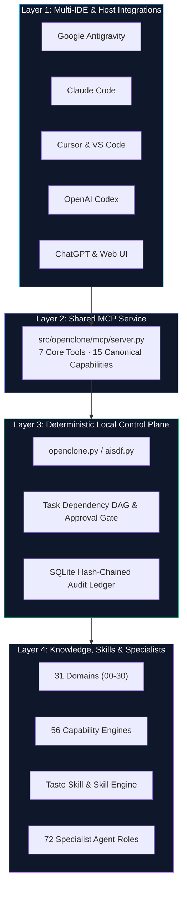

<p align="center">
  
</p>

<p align="center">
  <a href="https://github.com/MK-1603/OpenClone/releases" title="Version 2.0.0"></a>
  &nbsp;
  <a href="https://python.org"></a>
  &nbsp;
  <a href="LICENSE"></a>
  &nbsp;
  <a href="tests/"></a>
  &nbsp;
  <a href="security/scanners.lock.json"></a>
  &nbsp;
  <a href="adapters/INTEGRATION-MATRIX.md"></a>
</p>

<p align="center">
  <strong>Provider-Neutral · IDE-Independent · Deterministic Engineering Standard · Anti-AI-Slop Governance</strong><br />
  <em>Build with Any AI. Governed by One Engineering Standard. (OpenClone Release 2.0.0 · AISDF Standard 1.0.0)</em>
</p>

<p align="center">
  <!-- Demo / Workflow Preview -->
  <a href="#quickstart-under-60-seconds">
    
  </a>
</p>

<p align="center">
  <a href="#why-openclone">Why OpenClone</a> ·
  <a href="#feature-grid">Features</a> ·
  <a href="#openclone-global-plugin">Global Plugin</a> ·
  <a href="#quickstart-under-60-seconds">Quickstart</a> ·
  <a href="#usage-examples">Usage</a> ·
  <a href="#architectural-topology">Architecture</a> ·
  <a href="#the-22-phase-engineering-lifecycle">22-Phase Lifecycle</a> ·
  <a href="#anti-ai-slop-governance-taste-skill-v260">Anti-Slop UX</a> ·
  <a href="#configuration">Configuration</a> ·
  <a href="#roadmap">Roadmap</a> ·
  <a href="CONTRIBUTING.md">Contributing</a> ·
  <a href="#license">License</a>
</p>

---

## Why OpenClone?

Modern generative AI synthesizes code with remarkable velocity. However, software engineering is not raw text synthesis: it demands immutable requirements, defensive security baselines, reproducible automated tests, dependency-ordered rollouts, and independent release verification.

Without a unifying engineering framework, AI-assisted development suffers from **AI Slope**:

| Engineering Dimension | Ad-Hoc AI Coding ("AI Slope") | OpenClone Governed Engineering |
|---|---|---|
| **Context & Memory** | Chat amnesia; context resets erase architectural decisions. | **Durable Filesystem State:** `PROGRESS.md` & `HANDOFF.md` survive restarts. |
| **Verification & Testing** | AI hallucinates test passes and claims completion unverified. | **Deterministic Evidence Verification:** V0–V5 levels require real files on disk. |
| **UI / UX Design** | Repetitive purple gradients, ambient blur blobs, and AI clichés. | **[Taste Skill v2.6.0](domains/05-UX-UI-ENGINEERING/ANTI-AI-SLOP-STANDARDS.md):** Strict anti-slop rules, tokens, and contrast checks. |
| **Security & Tooling** | Unmonitored lateral tool privileges and credential leakage. | **19-Point SaaS Baseline:** Sandboxing, secret redaction, and pinned scanners. |
| **Scope Control** | Uncontrolled mass refactors and unprompted dependency bloat. | **Cryptographic Binding:** SHA-256 digest invalidates approvals on scope shift. |
| **IDE Portability** | Vendor lock-in to a single proprietary coding assistant. | **Provider-Neutral:** Works identically in Antigravity, Claude Code, Cursor, Codex. |

---

## Feature Grid

### 🛡️ Deterministic Governance & Approval Binding
AI models propose code; deterministic code and authorized humans decide. All task state transitions, scope expansions, and destructive commands require cryptographic SHA-256 human sign-off. Any unauthorized change to the plan or task scope automatically invalidates prior approvals.

### 🚀 22-Phase Lifecycle & Independent Verification
Covers the entire software development lifecycle across 22 structured phases—from initial Problem Discovery and Slop Auditing to Dynamic Pentesting, Staged Rollout, and Production Observability. Enforces 6 rigorous verification levels (V0 to V5) with automated quality gates.

### 🎨 Anti-AI-Slop Standards (Taste Skill v2.6.0)
Halts visual AI clichés before they reach production. Prohibits generic centered card layouts, neon blur blobs, meaningless decorative badges, and illegible contrast. Mandates functional typography, intentional whitespace, and full dark/light theme tokens.

### 🔌 Shared MCP Service (JSON-RPC 2.0)
Exposes 7 canonical tools (`openclone_get_status`, `openclone_search_knowledge`, `openclone_explain_concept`, `openclone_run_workflow`, `openclone_validate_project`, `openclone_get_guidance`, `openclone_list_capabilities`) over stdio and Server-Sent Events (SSE) compatible with the Model Context Protocol (2024-11-05).

### 📦 100% Portable `PROJECT.md` Package Workflow
Zero required local installs for application builders. Use ChatGPT or Claude as the project architect to turn an initial brief into a self-contained instruction package, then hand off the package to Antigravity, Claude Code, or Cursor to execute locally.

### 🧠 Exhaustive Engineering Catalogues & 31 Domains
Includes 31 engineering domains, 56 capability engines, 15 executable workflows, 72 specialist agent roles, 86 UI visual styles, 365 motion tokens, 580 backend topics, and 1,095 AI engineering topics catalogued and cross-indexed.

---

## OpenClone Global Plugin

**OpenClone Global Plugin** delivers one consistent software engineering standard across the AI coding environments you use daily. It provides a shared canonical capability foundation, with native host adapters that expose the supported OpenClone instructions, skills, workflows, and tools in each environment.

### Core Architecture & Capability Separation

Instead of forcing a single non-portable manifest across disparate IDEs, OpenClone combines a single canonical core with native host adapters:



- **Global Experience:** Identical engineering standard, capability contracts, and anti-slop guidelines everywhere.
- **Canonical Core:** Shared Python/SQLite deterministic engine enforcing task dependencies and cryptographic approval digests.
- **Native Host Adapters:** Tailored manifests, rules, and skills for Google Antigravity, Claude Code, OpenAI Codex, Cursor, and ChatGPT.
- **Transactional Installer:** Safe installation, backup creation, health diagnostics, and clean uninstallation without repository cloning.

### Host Support & Capability Parity Matrix

| AI Coding Environment | Adapter / Package Path | Integration Type | Install Scope | Skills & Rules | MCP & Tools | Lifecycle & Verification | Status |
|---|---|---|---|---|---|---|---|
| **Google Antigravity** | Root `plugin.json` / `agents/` / `rules/` | Native Plugin (`agy`) & Workspace | User & Workspace | Native Skills + 16 Agents + Rules | **YES** (stdio MCP) | V0–V5 Deterministic Evidence | `INTEGRATED & VERIFIED` |
| **Claude Code** | `.claude-plugin/` / `.claude/skills/` | Marketplace Plugin & Workspace | User & Workspace | Native Skills + `CLAUDE.md` | **YES** (stdio `.mcp.json`) | V0–V5 Deterministic Evidence | `INTEGRATED & VERIFIED` |
| **OpenAI Codex** | `.agents/plugins/` / `mcp.json` | Marketplace Plugin & Workspace | User & Workspace | Codex Skills + Rules | **YES** (stdio MCP) | V0–V5 Deterministic Evidence | `INTEGRATED & VERIFIED` |
| **Cursor** | `.cursor/rules/` / `.cursor/mcp.json` | Workspace Rules & MCP Config | Workspace | `.cursorrules` + MDC Rules | **YES** (stdio MCP) | V0–V5 Deterministic Evidence | `INTEGRATED & VERIFIED` |
| **ChatGPT** | `adapters/chatgpt/` | Custom GPT & OpenAPI / SSE | Remote | Custom Instructions | Remote HTTP / SSE | Hand-off via Package | `INTEGRATED & DOCUMENTED` |
| **Generic MCP** | `src/openclone/mcp/server.py` | Stdio / SSE JSON-RPC 2.0 | Workspace / CLI | Standard MCP Tools | 7 Core Tools + 15 Canonical | JSON-RPC Inspection | `INTEGRATED & VERIFIED` |

### OpenClone Installer CLI Commands

Manage OpenClone adapters across any workspace using the built-in installer engine:

```bash
# 1. Check system diagnostics and prerequisites
python -m src.openclone.cli doctor

# 2. Inspect detected hosts and currently active adapters
python -m src.openclone.cli status

# 3. Install adapter for a specific host (workspace or user scope)
python -m src.openclone.cli install antigravity --scope user
python -m src.openclone.cli install cursor --scope workspace
python -m src.openclone.cli install claude_code
python -m src.openclone.cli install codex

# 4. Dry-run installation to preview planned files without writing
python -m src.openclone.cli install cursor --dry-run

# 5. Clean uninstall (removes ONLY OpenClone files and restores original backups)
python -m src.openclone.cli uninstall cursor
```

---

## Quickstart (Under 60 Seconds)

### 1. Direct GitHub Plugin Installation (No Manual Clone Required)

OpenClone installs directly into your preferred AI coding environment without manual git cloning or local Python builds:

#### A. Google Antigravity
Install the plugin directly from GitHub:
```bash
agy plugin install https://github.com/MK-1603/OpenClone
```
Verify the installation:
```bash
agy plugin list
```
*(Antigravity automatically retrieves, stages, and registers the 16 native specialist agents, always-on governance rules, and MCP tools.)*

#### B. Claude Code
Add the marketplace source and install:
```text
/plugin marketplace add MK-1603/OpenClone
/plugin install openclone@openclone-marketplace
```

#### C. OpenAI Codex
Add the Git-backed marketplace source:
```bash
codex plugin marketplace add MK-1603/OpenClone
```
Then select **OpenClone Engineering** in your Codex Plugins Directory.

#### D. Cursor Composer
Add OpenClone to your `.cursor/mcp.json`:
```json
{
  "mcpServers": {
    "openclone": {
      "command": "python",
      "args": ["-m", "src.openclone.cli", "mcp"]
    }
  }
}
```

---

### 2. Application Developers: Portable Specification Workflow (Zero-Install)

If you are building your own application using ChatGPT or Claude, you **do not** need to clone or install OpenClone:

1. **Copy specification template:** Copy [templates/PROJECT.template.md](templates/PROJECT.template.md) into your application repo as `PROJECT.md`.
2. **Run the Master Prompt:** Paste [prompts/PORTABLE-PROJECT-INTELLIGENCE-MASTER-PROMPT.md](prompts/PORTABLE-PROJECT-INTELLIGENCE-MASTER-PROMPT.md) into [ChatGPT](https://chatgpt.com) or [Claude](https://claude.ai) along with your `PROJECT.md`.
3. **Build & Verify in IDE:** Hand off the generated instruction package (`BUILD_PROMPT.md`, `ACCEPTANCE_MATRIX.md`, `PROGRESS.md`, `HANDOFF.md`) to your AI coding IDE (Antigravity, Claude Code, Cursor, Codex).

---

### 3. Maintainers & Framework Contributors (Local Development & CI Only)

> 💡 **Notice:** This section is **ONLY** for maintainers contributing to OpenClone core or running CI pipelines.

```bash
# 1. Clone repository
git clone https://github.com/MK-1603/OpenClone.git
cd OpenClone

# 2. Install editable package with dev dependencies
pip install -e ".[dev]"

# 3. Verify repository integrity (31 domains, 56 engines, 15 workflows)
python tools/validate_repository.py

# 4. Run automated test suite (97 unit tests passing)
python -m unittest discover -s tests -v

# 5. Run anti-slop governance tests (13 tests passing)
node skills/taste-skill/tests/test-governance.mjs
# (Total: 110 automated tests passing with 0 failures)
```

### Responsibility & Operation Boundaries

| Operation | End user installing plugin | OpenClone maintainer |
|---|:---:|:---:|
| **Install via `agy plugin install <URL>`** | **Yes (Primary route)** | Optional |
| **Manually `git clone` OpenClone** | **No** | Yes, if developing locally |
| **Run `pip install -e ".[dev]"`** | **No** | Yes, for Python development |
| **Repository integrity validator (`validate_repository.py`)** | **No** | Yes, CI/maintenance |
| **Run full unit test suite (97 tests)** | **No** | Yes, CI/maintenance |
| **Run Taste governance tests (13 tests)** | **No** | Yes, CI/maintenance |
| **Verify with `agy plugin list`** | **Yes** | Yes |
| **Run `agy plugin validate --strict`** | **No routine need** | Yes, before release |

---

## Usage Examples

### 1. Generating a Tailored Lifecycle Checklist (CLI)
Instantiate a 22-phase checklist tailored to a specific project type:
```bash
# Generate checklist for a Web SaaS application
python tools/checklist_engine.py generate --project-type web_saas

# Inspect phase completion and verification status
python tools/checklist_engine.py status

# Filter pending items in Discovery & Architecture
python tools/checklist_engine.py list --phase PHASE_01_DISCOVERY --status NOT_STARTED
```

### 2. Transitioning Tasks with Observable Evidence
The lifecycle engine strictly prevents advancing to `VERIFIED` without physical proof:
```bash
# 1. Attach test run or code diff evidence
python tools/checklist_engine.py attach-evidence \
  --item-id PHASE_01_DISCOVERY_TASK_02 \
  --type test_run \
  --path tests/test_lifecycle_verification.py \
  --summary "Unit tests passing with 100% exit code 0"

# 2. Advance status to VERIFIED
python tools/checklist_engine.py transition \
  --item-id PHASE_01_DISCOVERY_TASK_02 \
  --status VERIFIED

# 3. Evaluate Phase Quality Gate
python tools/checklist_engine.py gate --phase PHASE_01_DISCOVERY
```

### 3. Launching the Shared MCP Server
Connect any MCP-compatible client (Antigravity, Claude Desktop, Cursor) to OpenClone:
```bash
# Start MCP server over stdio
openclone mcp

# Or invoke directly via module
python -m src.openclone.cli mcp
```

### 4. Querying Engineering Guidance (MCP Tool Invocation)
```json
{
  "jsonrpc": "2.0",
  "id": 1,
  "method": "tools/call",
  "params": {
    "name": "openclone_get_guidance",
    "arguments": {
      "topic": "anti_slop"
    }
  }
}
```

---

## Architectural Topology

For environments utilizing the optional local control plane, OpenClone decouples governance into 4 distinct layers:

<p align="center">
  
</p>



- **Layer 1: Multi-IDE & Chatbot Host Integrations:** Native plugins and configurations for Antigravity, Claude Code, Cursor, Codex, and ChatGPT.
- **Layer 2: Shared MCP Service (`src/openclone/mcp/server.py`):** JSON-RPC 2.0 stdio/SSE server exposing 7 core inspection tools and 15 canonical capabilities.
- **Layer 3: Deterministic Local Control Plane (`openclone.py`):** Cycle-free task DAG, SHA-256 approval binding, and hash-chained SQLite ledger.
- **Layer 4: Knowledge Repository & Specialist Workforce:** 31 engineering domains, 56 capability engines, 15 executable workflows, and 72 specialist roles.

---

## The 22-Phase Engineering Lifecycle

OpenClone halts low-quality AI code generation by enforcing a strict deterministic lifecycle:

```mermaid
flowchart LR
    D1["01 · DISCOVER<br/><small>Scan instructions & AGENTS.md</small>"] --> D2["02 · AUDIT SLOP<br/><small>Taste Skill anti-slop gate</small>"]
    D2 --> D3["03 · SPECIFY<br/><small>Tokens, contracts, tests</small>"]
    D3 --> D4["04 · GATE CHECK<br/><small>Human approval & scope binding</small>"]
    D4 --> D5["05 · BUILD<br/><small>Smallest diff & governed tools</small>"]
    D5 --> D6["06 · VERIFY<br/><small>Goldfish review & evidence ledger</small>"]
    D6 --> D7["07 · DEPLOY<br/><small>WF-014 cloud pipeline</small>"]

    style D1 fill:#0f172a,stroke:#38bdf8,stroke-width:2px,color:#f8fafc
    style D2 fill:#0f172a,stroke:#f59e0b,stroke-width:2px,color:#f8fafc
    style D3 fill:#0f172a,stroke:#818cf8,stroke-width:2px,color:#f8fafc
    style D4 fill:#0f172a,stroke:#ef4444,stroke-width:2px,color:#f8fafc
    style D5 fill:#0f172a,stroke:#10b981,stroke-width:2px,color:#f8fafc
    style D6 fill:#0f172a,stroke:#06b6d4,stroke-width:2px,color:#f8fafc
    style D7 fill:#0f172a,stroke:#a855f7,stroke-width:2px,color:#f8fafc
```

<p align="center">
  
</p>



### Full 22-Phase Master Taxonomy

| Group | Phase Identifier | Core Objective | Key Gate Criteria |
|---|---|---|---|
| **Foundation** | `PHASE_01_DISCOVERY` | Problem discovery & user definition | Core problem validated, non-goals documented |
| | `PHASE_02_REQUIREMENTS` | Functional & non-functional requirements | Traceable requirements matrix established |
| | `PHASE_03_ARCHITECTURE` | System topology & data models | Tech stack locked, schema migration path approved |
| **Design & Trust** | `PHASE_04_UI_UX_DESIGN` | Anti-slop UI tokens & responsive design | Taste Skill v2.6.0 anti-slop audit passed |
| | `PHASE_05_SECURITY` | 19-point SaaS security baseline | Secret scanning clean, least privilege enforced |
| | `PHASE_06_DATA_DESIGN` | Database schemas & persistence | ACID/eventual consistency boundary established |
| **Execution** | `PHASE_07_ENVIRONMENT` | Local workspace & container baseline | Reproducible build scripts verified |
| | `PHASE_08_CORE_LOGIC` | Backend domain models & business rules | Unit test coverage over critical branches |
| | `PHASE_09_API_PLATFORM` | REST/GraphQL/gRPC endpoints | Contract validation & status codes verified |
| | `PHASE_10_FRONTEND` | UI component implementation | No raw inline styles; tokens enforced |
| | `PHASE_11_INTEGRATION` | Inter-service & 3rd-party connectors | Mocked fallback tests passing |
| | `PHASE_12_STATE_MGMT` | Durable state & cache stores | Cache eviction policies and TTLs set |
| **Quality & Risk** | `PHASE_13_TESTING` | Unit, integration & E2E suites | Automated CI pass with 0 failures |
| | `PHASE_14_PERFORMANCE` | Latency, throughput & bundle audits | Core Web Vitals and load budgets met |
| | `PHASE_15_ACCESSIBILITY` | WCAG 2.1 AA compliance | Keyboard navigation & screen reader checks |
| | `PHASE_16_PENTESTING` | Strix dynamic AI pentesting | 0 High/Critical unmitigated vulnerabilities |
| **Deployment** | `PHASE_17_DEVOPS_CI_CD` | GitHub Actions / GitLab CI | Deterministic build pipeline configured |
| | `PHASE_18_CONTAINER` | Dockerfile & container isolation | Non-root user & minimal base images |
| | `PHASE_19_DEPLOYMENT` | Staged deployment (WF-014) | Zero-downtime rolling update verified |
| | `PHASE_20_OBSERVABILITY`| Metrics, distributed tracing & logs | Structured JSON logs & alert rules active |
| **Governance** | `PHASE_21_DOCUMENTATION`| Runbooks, API specs & architecture | Complete copy-pasteable documentation |
| | `PHASE_22_FEEDBACK` | User analytics & post-launch audit | Production telemetry verified |

---

## Anti-AI-Slop Governance (Taste Skill v2.6.0)

OpenClone integrates **Taste Skill v2.6.0** to eliminate low-effort generative aesthetics:

1. **Anti-Slop Prohibitions:** Prohibits purple-on-black hero gradients, meaningless decorative badges, ambient blur circles (`backdrop-filter: blur(20px)`), and generic card grids.
2. **Typography-First Hierarchy:** Requires strict 8-point typographic scales, functional whitespace, high-contrast text (`4.5:1` minimum for body copy), and native font stacks.
3. **Morphism Style Governance:** Classifies user-selected styling (Flat, Neo-Brutalism, Minimal, Glassmorphism, Industrial) and enforces design tokens across CSS variables.
4. **Automated Slop Scanning:**
   ```bash
   node skills/taste-skill/tests/test-governance.mjs
   ```

---

## Configuration

OpenClone is configured via environment variables and CLI parameters:

| Variable | CLI Flag | Default | Description |
|---|---|---|---|
| `OPENCLONE_STRICT` | `--strict` | `0` | Enforces all lint and repository warnings as fatal errors. |
| `OPENCLONE_PORT` | `--port` | `8000` | Port for the SSE transport of the shared MCP server. |
| `OPENCLONE_LEDGER_PATH` | `--ledger` | `.openclone/audit.db` | Filesystem location for the SQLite tamper-evident audit ledger. |
| `OPENCLONE_REDACT_SECRETS` | `--no-redact` | `1` | Automatically redacts API keys and sensitive tokens in logs and output. |
| `OPENCLONE_PROJECT_TYPE` | `--project-type` | `web_saas` | Default lifecycle project pack used during checklist generation. |

---

## Roadmap

- [x] **Universal Framework Standard (AISDF v1.0.0):** Unified specification across 31 engineering domains.
- [x] **Shared Model Context Protocol (MCP) Server:** JSON-RPC 2.0 stdio/SSE engine with 7 core tools and 15 canonical capabilities.
- [x] **Taste Skill v2.6.0 Anti-Slop Engine:** 13 automated governance tests and UI design tokens.
- [x] **Portable Specification Workflow (`WF-015`):** Zero-install `PROJECT.md` package generation.
- [x] **22-Phase Lifecycle Checklist & Verification Engine:** 8 unit tests, 6 verification levels (V0–V5).
- [x] **10 Specialized Project-Type Lifecycle Packs:** Tailored packs for SaaS, Mobile, SDKs, E-Commerce.
- [x] **12 Pinned Security Scanners Registry:** Cryptographic lockfile for reproducible static analysis.
- [ ] **Live Browser Extension Telemetry:** Real-time visual monitoring of IDE agent operations `{TODO: SPECIFIED}`.
- [ ] **Dynamic Multi-Region Sandboxing:** Ephemeral isolated VM runners for untrusted code execution `{TODO: PROPOSED}`.

---

## Documentation & Architecture

For comprehensive platform specifications, architectural designs, and governance guides:

- **Architecture:** [OpenClone 2.0 System Architecture](docs/architecture/OPENCLONE-2.0-ARCHITECTURE.md) · [Modular Distribution Guide](docs/architecture/REPOSITORY-AND-DISTRIBUTION-ARCHITECTURE.md)
- **Installation:** [Global Plugin Installation Guide](docs/installation/GLOBAL-PLUGIN-INSTALLATION.md) · [Capability Packs](docs/installation/INSTALLATION-AND-MODULES.md)
- **Compatibility:** [Multi-Host Compatibility Matrix](docs/compatibility/HOST-COMPATIBILITY.md) · [Host Setup Guides](docs/integrations/HOST_SETUP_GUIDES.md)
- **Security:** [Security Threat Model](docs/security/THREAT-MODEL.md) · [19-Point SaaS Security Baseline](docs/security/saas-security-baseline.md)
- **Documentation Map:** [Canonical Authority & Precedence Map](docs/DOCUMENTATION-MAP.md) · [Documentation Index](docs/README.md)
- **Audit & Upgrade Reports:** [OpenClone 2.0 Platform Upgrade Report](docs/reports/OPENCLONE-2.0-UPGRADE-REPORT.md) · [Baseline X-Ray](docs/reports/OPENCLONE-2.0-BASELINE-AUDIT.md) · [Cleanup Plan](docs/reports/OPENCLONE-2.0-CLEANUP-PLAN.md)

---

## Contributing

We welcome contributions from software engineers and maintainers! Please read our community guidelines before opening a pull request:

- [Contributing Guidelines](CONTRIBUTING.md) — Development setup, branch naming, and PR standards.
- [Code of Conduct](CODE_OF_CONDUCT.md) — Contributor Covenant v2.1 standards.
- [Security Policy](SECURITY.md) — Responsible vulnerability disclosure instructions.
- [Governance Model](GOVERNANCE.md) — Architectural decision registers and human approval rules.

---

## Star History

[](https://star-history.com/#MK-1603/OpenClone&Date)

---

## License & Third-Party Notices

OpenClone is licensed under the [MIT License](LICENSE).  
Copyright (c) 2026 OpenClone Contributors (formerly AISDF).

Third-party components, specifications, and integrated tools are subject to their respective open-source licenses:
- [NOTICE](NOTICE) — Third-party copyright, owners, and notices.
- [THIRD_PARTY_LICENSES.md](THIRD_PARTY_LICENSES.md) — Complete 28-repository license inventory.
- [THIRD_PARTY_NOTICES.md](THIRD_PARTY_NOTICES.md) — Comprehensive upstream attribution, commit SHAs, and modification records.
- [Legal Compliance Documentation](docs/legal/README.md) — Copyleft isolation policies and compliance audits.

<p align="center">
  <sub>OpenClone · Build with Any AI. Governed by One Engineering Standard.</sub>
</p>
