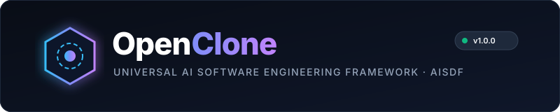
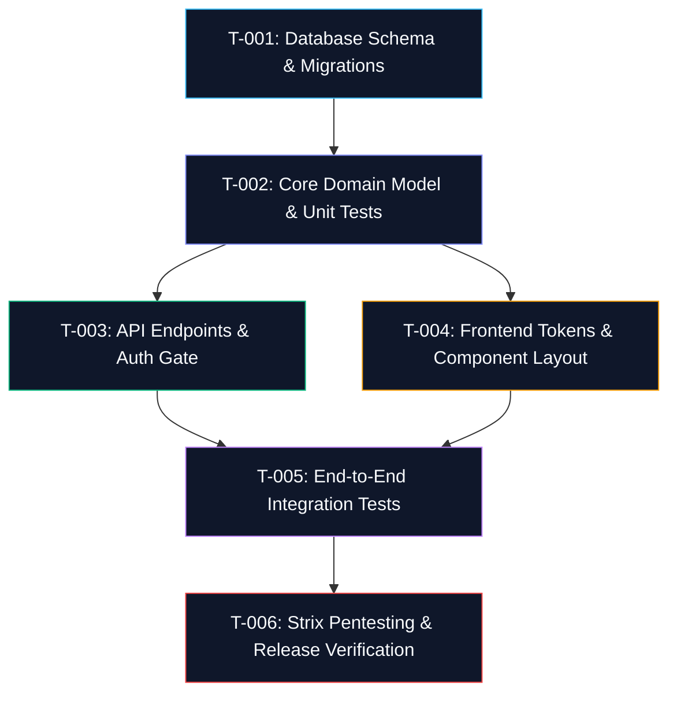
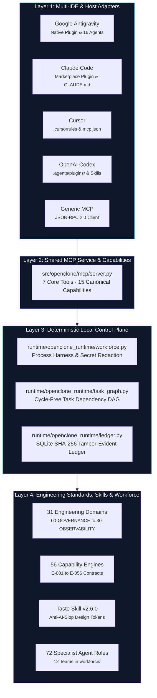
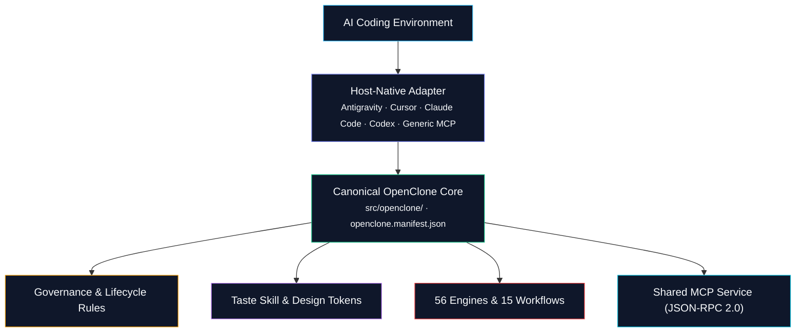
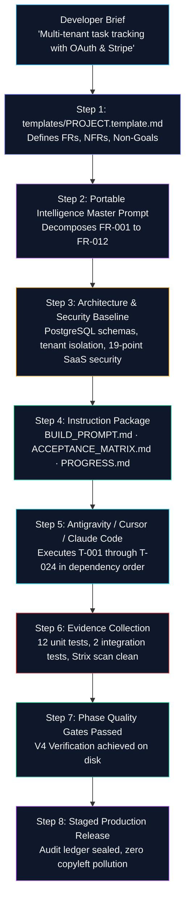

<p align="center">
  
</p>

<p align="center">
  <a href="https://github.com/MK-1603/OpenClone/releases" title="Version 2.0.0"></a>
  &nbsp;
  <a href="https://python.org"></a>
  &nbsp;
  <a href="LICENSE"></a>
  &nbsp;
  <a href="tests/"></a>
  &nbsp;
  <a href="security/scanners.lock.json"></a>
  &nbsp;
  <a href="src/openclone/mcp/server.py"></a>
</p>

<p align="center">
  <strong>Provider-Neutral · IDE-Independent · Deterministic Engineering Standard · Anti-AI-Slop Governance</strong><br />
  <em>Build with Any AI. Governed by One Engineering Standard. (OpenClone Release 2.0.0 · AISDF Standard 1.0.0)</em>
</p>

<p align="center">
  <a href="#how-it-works">
    
  </a>
</p>

<p align="center">
  <a href="#overview">Overview</a> ·
  <a href="#why-openclone">Why OpenClone</a> ·
  <a href="#how-it-works">How It Works</a> ·
  <a href="#from-projectmd-to-production">From PROJECT.md to Production</a> ·
  <a href="#core-architecture">Architecture</a> ·
  <a href="#global-plugin-ecosystem">Global Plugin</a> ·
  <a href="#the-22-phase-engineering-lifecycle">22-Phase Lifecycle</a> ·
  <a href="#governance-security-and-assurance">Governance & Security</a> ·
  <a href="#persistent-memory-and-continuity">Memory</a> ·
  <a href="#anti-ai-slop-governance">Anti-Slop UX</a> ·
  <a href="#mcp-integration">MCP</a> ·
  <a href="#installation-and-quickstart">Installation</a> ·
  <a href="#cli-reference">CLI</a> ·
  <a href="#configuration">Configuration</a> ·
  <a href="#project-examples">Examples</a> ·
  <a href="#documentation-index">Documentation</a> ·
  <a href="#roadmap">Roadmap</a> ·
  <a href="#contributing-and-security">Contributing</a> ·
  <a href="#license">License</a>
</p>

---

## Overview

### Build with Any AI. Governed by One Engineering Standard.

Modern generative AI models write code at superhuman speed. However, **software engineering is not raw text synthesis**. Production software requires immutable project specifications, defensive security baselines, reproducible automated tests, dependency-ordered rollouts, and evidence-backed quality verification.

Without a unifying engineering framework, AI-assisted development quickly deteriorates into **AI Slope**—where context resets erase past architectural decisions, hallucinated test passes bypass quality checks, uncontrolled model edits create unintended breaking changes, and generic visual clichés flood user interfaces.

**OpenClone** provides the structured engineering governance, reusable capability engines, persistent project continuity, controlled execution harnesses, and independent evidence verification needed to transform AI coding from unstructured text generation into a repeatable, high-reliability engineering discipline.

> **Central Positioning:**
> **OpenClone is the engineering framework around the AI coding agent, not simply another code-generation agent.**
> It does not replace your AI model or your preferred IDE. It equips Claude, ChatGPT, Gemini, Codex, Antigravity, and Cursor with a deterministic, provider-neutral control plane that keeps software development structured, traceable, and secure.

---

## Why OpenClone?

The table below contrasts uncontrolled AI-assisted development against software engineered under OpenClone governance:

| Engineering Dimension | Uncontrolled AI Development ("AI Slope") | OpenClone Governed Engineering |
|---|---|---|
| **Project Understanding** | Ephemeral; trapped in transient chat sessions. | **Canonical Single Source of Truth:** Structured [`PROJECT.md`](templates/PROJECT.template.md) defines immutable boundaries. |
| **Requirements Traceability**| Requirements easily lost, overlooked, or hallucinated. | **Traceable Contract Hierarchy:** Requirements map directly to tasks, code diffs, and verification artifacts. |
| **Architecture Drift** | Decisions drift silently across sessions and model turns. | **Documented Architectural Invariants:** 10 core concepts and normative standards in [`domains/`](domains/). |
| **Project Continuity** | Context window resets erase architecture and progress. | **Durable Filesystem Handoffs:** `PROGRESS.md` & `HANDOFF.md` ensure seamless session resumption. |
| **Execution Control** | Monolithic "one-shot" mass rewrites and fragile diffs. | **Deterministic Task DAG:** Cycle-free dependency graph enforces smallest reviewable units of work. |
| **Scope Governance** | Unprompted feature bloat, dependency creep, and rewrites. | **Cryptographic Digest Binding:** SHA-256 task digest invalidates prior human approvals upon scope shift. |
| **Verification & Quality** | AI hallucinates test passes and claims completion verbally. | **V0–V5 Observable Evidence Model:** Real test logs, diffs, and scanner outputs must exist on disk. |
| **Security & Isolation** | Unmonitored lateral tool privileges and host exposure. | **4-Tier Copyleft Isolation & Pinned Scanners:** Strict execution harnesses and secret redaction. |
| **IDE Portability** | Vendor lock-in to proprietary prompt formats and rules. | **Provider-Neutral Host Adapters:** Works identically in Antigravity, Cursor, Claude Code, and Codex. |
| **UI/UX Design Quality** | Ambient purple gradients, generic cards, blur blobs. | **[Taste Skill v2.6.0](domains/05-UX-UI-ENGINEERING/ANTI-AI-SLOP-STANDARDS.md):** 8-pt typography scale, tokens, WCAG 2.2 AA contrast. |

---

## How It Works

OpenClone orchestrates the full software engineering lifecycle through structured stages, separating human intent, AI proposal synthesis, and deterministic validation:

```mermaid
flowchart TD
    DEV["Developer<br/><small>Defines Intent & Retains Final Decision Authority</small>"] --> SPEC["PROJECT.md<br/><small>Canonical Project Specification & Scope</small>"]
    SPEC --> INTEL["Project Intelligence Engine<br/><small>Decomposes Requirements, Boundaries & Risks</small>"]
    INTEL --> REQ["Requirements & Architectural Design<br/><small>System Topology, Data Models & API Contracts</small>"]
    REQ --> PKG["Project Execution Package<br/><small>PROJECT.md · BUILD_PROMPT · ACCEPTANCE_MATRIX</small>"]
    PKG --> HOST["AI Coding Environment<br/><small>Google Antigravity · Cursor · Claude Code · Codex</small>"]
    HOST --> GOV["OpenClone Governance Control Plane<br/><small>Permission Allowlists & SHA-256 Digest Binding</small>"]
    GOV --> DAG["Task Planning & Dependency DAG<br/><small>Deterministic Task State Machine & Work Units</small>"]
    DAG --> IMPL["AI-Assisted Implementation<br/><small>Smallest Valid Change & Governed Tool Harness</small>"]
    IMPL --> EVID["Observable Evidence Collection<br/><small>Test Logs · Coverage · Build Output · Diffs</small>"]
    EVID --> GATE["Quality Gates & Assurance<br/><small>22-Phase Verification & Independent 'Goldfish' Review</small>"]
    GATE --> REL["Release & Staged Rollout<br/><small>Production Readiness & Audit Ledger Archival</small>"]

    style DEV fill:#0f172a,stroke:#38bdf8,stroke-width:2px,color:#f8fafc
    style SPEC fill:#0f172a,stroke:#818cf8,stroke-width:2px,color:#f8fafc
    style INTEL fill:#0f172a,stroke:#c084fc,stroke-width:2px,color:#f8fafc
    style REQ fill:#0f172a,stroke:#f59e0b,stroke-width:2px,color:#f8fafc
    style PKG fill:#0f172a,stroke:#10b981,stroke-width:2px,color:#f8fafc
    style HOST fill:#0f172a,stroke:#06b6d4,stroke-width:2px,color:#f8fafc
    style GOV fill:#0f172a,stroke:#ef4444,stroke-width:2px,color:#f8fafc
    style DAG fill:#0f172a,stroke:#6366f1,stroke-width:2px,color:#f8fafc
    style IMPL fill:#0f172a,stroke:#38bdf8,stroke-width:2px,color:#f8fafc
    style EVID fill:#0f172a,stroke:#10b981,stroke-width:2px,color:#f8fafc
    style GATE fill:#0f172a,stroke:#f59e0b,stroke-width:2px,color:#f8fafc
    style REL fill:#0f172a,stroke:#a855f7,stroke-width:2px,color:#f8fafc
```



### Division of Responsibilities

1. **Human Developer:** Retains ultimate authority. Defines problem statements, non-goals, and architectural boundaries. Approves sensitive tasks, security waivers, and release deployments.
2. **OpenClone Framework:** The deterministic control plane. Enforces dependency DAGs, approval digest matching, secret redaction, scanner lockfiles, and quality verification gates.
3. **AI Coding Agent:** The implementation engine. Proposes plans, drafts code diffs, writes unit tests, and formats documentation within authorized task boundaries.
4. **Verification Mechanisms:** Automated test suites, structural repository gates, and independent assurance agents evaluate tangible evidence on disk before tasks reach `VERIFIED`.

---

## From PROJECT.md to Production

OpenClone guides projects from initial concept to verified production release through twelve concrete steps:

### Step 01 — Project Definition (`PROJECT.md`)
Every OpenClone project begins with [`templates/PROJECT.template.md`](templates/PROJECT.template.md). This document anchors the project's vision, problem statement, target personas, functional requirements (FRs), non-functional requirements (NFRs), tech stack constraints, and non-goals.

### Step 02 — Project Intelligence
The framework ingests `PROJECT.md` using the [Portable Project Intelligence Prompt](prompts/PORTABLE-PROJECT-INTELLIGENCE-MASTER-PROMPT.md). It extracts discrete functional capabilities, detects implicit assumptions or conflicting requirements, flags technical risks, and defines strict scope boundaries.

### Step 03 — Requirements Engineering
Requirements are converted into traceable, numbered contracts:
```text
FR-001: User Authentication
   │
   ├── Architecture: Session Token & bcrypt Hashing
   ├── Backend: Auth Controller & Database Schema
   ├── Frontend: Accessible Login Form & Design Tokens
   ├── Tests: 12 Unit Tests & 2 Integration Tests
   └── Verification: V4 Observable Test Logs on Disk
```

### Step 04 — Architecture & Technical Design
The architecture is locked down before writing code: module boundaries, database schemas, REST/gRPC API contracts, and security perimeter definitions are documented in `docs/architecture/`.

### Step 05 — Execution Package Generation
For portable, zero-install workflows, OpenClone compiles a self-contained execution package:
- `PROJECT.md`: Immutable scope and architectural decisions.
- `BUILD_PROMPT.md`: Sequenced, actionable instructions for the AI coding environment.
- `ACCEPTANCE_MATRIX.md`: Pass/fail criteria for each functional requirement.
- `PROGRESS.md`: Current execution checkpoint and task status.
- `HANDOFF.md`: Next immediate action and context for the resuming agent.

### Step 06 — AI Coding Environment Ingestion
The execution package is loaded into the developer's preferred AI coding environment (Google Antigravity, Cursor, Claude Code, or OpenAI Codex) via native host adapters or standard MCP tool connections.

### Step 07 — Task Planning & Dependency DAG
Tasks are decomposed into an acyclic dependency graph:

Tasks progress through deterministic states: `PENDING` $
ightarrow$ `READY` $
ightarrow$ `IN_PROGRESS` $
ightarrow$ `VERIFIED`.

### Step 08 — Human Approval & Governance
Sensitive operations (destructive commands, schema migrations, third-party dependency additions) pause execution for human approval. The runtime computes a SHA-256 digest of the task specification and command. Any alteration to the task automatically revokes approval.

### Step 09 — AI-Assisted Implementation
The agent executes authorized tasks following the "Smallest Valid Change" principle. It implements the code, executes local unit tests, captures command outputs, and updates `PROGRESS.md`.

### Step 10 — Evidence-Based Verification (V0–V5 Model)
Verbal claims like *"I have implemented authentication"* are rejected by OpenClone. The task must provide observable evidence matching its required verification tier:

| Level | Identifier | Required Observable Evidence on Disk |
|:---:|---|---|
| **V0** | `UNVERIFIED` | AI verbal claim or conversational text only (Not accepted for completion). |
| **V1** | `SYNTACTIC` | Clean AST parse, zero lint errors, valid type checks. |
| **V2** | `UNIT_TESTED` | Local unit test suite executed with exit code 0 and captured stdout. |
| **V3** | `INTEGRATED` | Inter-service integration or API test passing in a staging container. |
| **V4** | `SECURITY_AUDITED` | Static scanner clean (`scanners.lock.json`), anti-slop gate passed. |
| **V5** | `INDEPENDENT_EGM` | Clean-context independent assurance review completed with signed report. |

### Step 11 — Quality Gates & Verification
Phase gates evaluate all completed tasks against phase criteria (e.g. `PHASE_01_DISCOVERY` through `PHASE_22_FEEDBACK`). If a required test or scanner finding is unresolved, the gate blocks progression.

### Step 12 — Release & Continuing Maintenance
The completed application is packaged with reproducible build configurations (Docker, CI/CD pipelines). Handoff notes are archived, and the tamper-evident audit ledger is sealed for long-term compliance.

---

## Core Architecture

OpenClone's foundation rests on ten unified architectural specifications documented in [`concepts/`](concepts/):

<p align="center">
  
</p>



### The 10 Unified Architectural Concepts

1. **[Governance & Authority](concepts/01-GOVERNANCE-AND-AUTHORITY.md):** Humans remain the ultimate authority for software requirements, architecture, and destructive operations. Incorporates both strict deny-by-default enterprise gating and agile self-sovereign developer mode with automated rollback checkpoints.
2. **[Project Source of Truth](concepts/02-PROJECT-SOURCE-OF-TRUTH.md):** Canonical `PROJECT.md` establishes immutable project boundaries. Supports distributed issue-centric micro-specs for agile workflows.
3. **[Specialist Workforce](concepts/03-SPECIALIST-WORKFORCE.md):** 72 specialist engineering worker roles across 12 teams, with support for adaptive generalist dynamic skill injection.
4. **[Task Graph & State Machine](concepts/04-TASK-GRAPH-AND-STATE-MACHINE.md):** Deterministic, cycle-free DAG scheduler preventing out-of-order execution, with reactive Kanban event scheduling.
5. **[Cryptographic Audit Ledger](concepts/05-CRYPTOGRAPHIC-AUDIT-LEDGER.md):** SQLite SHA-256 hash-chained event ledger (`runtime/openclone_runtime/ledger.py`) guaranteeing tamper-evident auditability.
6. **[Human Approval & Digest Binding](concepts/06-HUMAN-APPROVAL-AND-DIGEST-BINDING.md):** Interactive TTY digest binding where modifying task parameters automatically invalidates prior approvals; supports asynchronous PR webhooks.
7. **[Execution Harness & Sandboxing](concepts/07-EXECUTION-HARNESS-AND-SANDBOXING.md):** Governed process execution with real-time regex secret redaction and rootless container isolation boundaries.
8. **[Persistent Memory & AKIS](concepts/08-PERSISTENT-MEMORY-AND-AKIS.md):** 4-tier memory architecture (`PROJECT.md`, `PROGRESS.md`, `HANDOFF.md`, and markdown vault) supplemented by Autonomous Knowledge Ingestion & Synthesis (AKIS).
9. **[Independent Assurance / EGM](concepts/09-INDEPENDENT-ASSURANCE-EGM.md):** "Goldfish" clean-context review protocol ensuring code is verified by fresh reviewer agents with zero author bias.
10. **[Multi-Tool Adapter Ecosystem](concepts/10-MULTI-TOOL-ADAPTER-ECOSYSTEM.md):** Canonical capability contracts translated into native host formats across Antigravity, Cursor, Claude Code, and Codex.

---

## Global Plugin Ecosystem

OpenClone distributes its capabilities as a modular, host-agnostic global plugin. Developers get an identical engineering standard across all coding environments:



### Host Compatibility Matrix

| AI Coding Host | Integration Type | Install Scope | Skills & Instructions | MCP Tools | Verification Support | Maturity Status |
|---|---|---|---|---|---|:---:|
| **Google Antigravity** | Native Plugin (`agy`) | Workspace & User | 16 Specialist Agents + Rules | **YES** (stdio MCP) | V0–V5 Evidence Checks | `IMPLEMENTED & VERIFIED` |
| **Claude Code** | Marketplace Plugin | Workspace & User | Native Skills + `CLAUDE.md` | **YES** (stdio `.mcp.json`) | V0–V5 Evidence Checks | `IMPLEMENTED & VERIFIED` |
| **OpenAI Codex** | Marketplace Plugin | Workspace & User | Codex Skills + Rules | **YES** (stdio MCP) | V0–V5 Evidence Checks | `IMPLEMENTED & VERIFIED` |
| **Cursor** | Workspace Adapter | Workspace | `.cursorrules` + `.cursor/rules/*.mdc` | **YES** (stdio MCP) | V0–V5 Evidence Checks | `IMPLEMENTED & VERIFIED` |
| **ChatGPT** | Custom GPT / OpenAPI | Remote Session | Custom Instructions Pack | Remote HTTP / SSE | Hand-off via Package | `DOCUMENTED & VERIFIED` |
| **Generic MCP** | Stdio / SSE JSON-RPC 2.0 | Process / CLI | Standard Tool Registrations | 7 Core Tools | JSON-RPC Inspection | `IMPLEMENTED & VERIFIED` |

---

## The 22-Phase Engineering Lifecycle

OpenClone enforces the complete software development lifecycle across 22 phases, ensuring no critical stage is bypassed:



```mermaid
flowchart LR
    P1["01-03<br/>FOUNDATION<br/><small>Discovery · Reqs · Architecture</small>"] --> P2["04-06<br/>DESIGN & TRUST<br/><small>Anti-Slop UX · Security · Data</small>"]
    P2 --> P3["07-12<br/>EXECUTION<br/><small>Env · Logic · API · Frontend · State</small>"]
    P3 --> P4["13-16<br/>QUALITY & RISK<br/><small>Tests · Perf · A11y · Pentesting</small>"]
    P4 --> P5["17-20<br/>DEPLOYMENT<br/><small>CI/CD · Containers · Staged Rollout</small>"]
    P5 --> P6["21-22<br/>GOVERNANCE<br/><small>Documentation · Feedback</small>"]

    style P1 fill:#0f172a,stroke:#38bdf8,stroke-width:2px,color:#f8fafc
    style P2 fill:#0f172a,stroke:#f59e0b,stroke-width:2px,color:#f8fafc
    style P3 fill:#0f172a,stroke:#818cf8,stroke-width:2px,color:#f8fafc
    style P4 fill:#0f172a,stroke:#ef4444,stroke-width:2px,color:#f8fafc
    style P5 fill:#0f172a,stroke:#10b981,stroke-width:2px,color:#f8fafc
    style P6 fill:#0f172a,stroke:#a855f7,stroke-width:2px,color:#f8fafc
```

### Complete 22-Phase Master Taxonomy

| Group | Phase Identifier | Core Objective | Key Quality Gate Criteria |
|---|---|---|---|
| **Foundation** | `PHASE_01_DISCOVERY` | Problem discovery & user persona definition | Core problem validated, explicit non-goals documented |
| | `PHASE_02_REQUIREMENTS` | Functional & non-functional requirements | Traceable requirements matrix established |
| | `PHASE_03_ARCHITECTURE` | System topology, module boundaries & data models | Tech stack locked, schema migration path approved |
| **Design & Trust** | `PHASE_04_UI_UX_DESIGN` | Anti-slop design tokens & responsive layout | Taste Skill v2.6.0 anti-slop audit passed |
| | `PHASE_05_SECURITY` | 19-point SaaS security baseline | Secret scanning clean, least-privilege enforced |
| | `PHASE_06_DATA_DESIGN` | Database schemas, indexing & persistence | ACID/eventual consistency boundary established |
| **Execution** | `PHASE_07_ENVIRONMENT` | Workspace configuration & container baseline | Reproducible build scripts verified |
| | `PHASE_08_CORE_LOGIC` | Backend domain models & business rules | Unit test coverage over critical branches |
| | `PHASE_09_API_PLATFORM` | REST / GraphQL / gRPC endpoints | Contract validation & HTTP status codes verified |
| | `PHASE_10_FRONTEND` | UI component implementation | No raw inline styles; design tokens enforced |
| | `PHASE_11_INTEGRATION` | Inter-service connectors & 3rd-party APIs | Mocked fallback tests passing with 0 errors |
| | `PHASE_12_STATE_MGMT` | Durable state, caching & event pub/sub | Cache eviction policies and TTLs configured |
| **Quality & Risk** | `PHASE_13_TESTING` | Unit, integration & end-to-end suites | Automated CI pass with 0 failures |
| | `PHASE_14_PERFORMANCE` | Latency, throughput & bundle size audits | Core Web Vitals and load budgets met |
| | `PHASE_15_ACCESSIBILITY` | WCAG 2.2 AA compliance | Keyboard navigation & screen reader checks passed |
| | `PHASE_16_PENTESTING` | Dynamic security testing & injection defense | 0 High/Critical unmitigated vulnerabilities |
| **Deployment** | `PHASE_17_DEVOPS_CI_CD` | GitHub Actions / GitLab CI workflows | Deterministic, pinned build pipeline configured |
| | `PHASE_18_CONTAINER` | Dockerfile & rootless container isolation | Non-root user & minimal base images verified |
| | `PHASE_19_DEPLOYMENT` | Staged deployment & health probes | Zero-downtime rolling update verified |
| | `PHASE_20_OBSERVABILITY`| Metrics, distributed tracing & structured logs | JSON logs & Prometheus/OpenTelemetry active |
| **Governance** | `PHASE_21_DOCUMENTATION`| Runbooks, API specs & architecture records | Complete copy-pasteable documentation |
| | `PHASE_22_FEEDBACK` | User analytics & post-launch review | Production telemetry verified |

---

## Governance, Security and Assurance

OpenClone maintains an uncompromising separation between authorization, execution, and verification:

1. **Governance (Who authorizes?):**
   - Deny-by-default execution policy.
   - Cryptographic SHA-256 digest binding for human approvals.
   - Any modification to a plan or task contract revokes prior approvals immediately.
2. **Execution (How is work performed?):**
   - Subprocess execution harness with automatic regex secret redaction.
   - 4-Tier copyleft isolation boundary: Copyleft tools (`semgrep` LGPL-2.1, `trufflehog` GPL-3.0, `clamav` GPL-2.0) are accessed exclusively via external CLI processes or socket gateways. **Zero copyleft code is vendored into OpenClone core.**
3. **Assurance (How is work verified?):**
   - 7 security scanners pinned by 40-character commit SHAs in [`security/scanners.lock.json`](security/scanners.lock.json).
   - "Goldfish" clean-context independent assurance: Reviewer agents evaluate pull requests in isolated contexts without seeing conversational history.
   - Active dynamic prompt injection defense via `PyRITAdapter` ([`integrations/adapters/pyrit_adapter.py`](integrations/adapters/pyrit_adapter.py)).

---

## Persistent Memory and Continuity

AI coding sessions frequently suffer from "context amnesia" when token limits are reached or sessions reset. OpenClone ensures long-term project continuity through durable filesystem artifacts:

- **[`PROJECT.md`](templates/PROJECT.template.md):** The immutable project constitution defining architecture and requirements.
- **`PROGRESS.md`:** The live execution journal recording completed tasks, active blockers, and decisions.
- **`HANDOFF.md`:** Explicit structured handoff notes for the next agent session.
- **Autonomous Knowledge Ingestion & Synthesis (AKIS):** Ingests architectural decisions and project knowledge into persistent markdown records, allowing any resuming agent to recover context in seconds without conversational re-prompting.

---

## Anti-AI-Slop Governance

OpenClone bundles **Taste Skill v2.6.0** ([`domains/05-UX-UI-ENGINEERING/ANTI-AI-SLOP-STANDARDS.md`](domains/05-UX-UI-ENGINEERING/ANTI-AI-SLOP-STANDARDS.md)) to stop generic generative UI clichés before they reach production:

1. **Visual Anti-Slop Rules:** Prohibits ambient blur circles (`backdrop-filter: blur(20px)`), neon purple-on-black hero gradients, generic centered card grids, and meaningless decorative badges.
2. **Typography Hierarchy:** Mandates an 8-point typographic scale, functional whitespace, native font pairings, and a strict `4.5:1` minimum contrast ratio for body text (WCAG 2.2 AA).
3. **Design Tokens:** Enforces semantic CSS tokens for colors, spacing, borders, shadows, and duration across both light and dark themes.
4. **Automated Governance Gate:** Verified by 13 automated tests:
   ```bash
   node skills/taste-skill/tests/test-governance.mjs
   ```

---

## MCP Integration

OpenClone implements the Model Context Protocol (spec 2024-11-05), exposing its capabilities over stdio and Server-Sent Events (SSE):

### Core MCP Tools

| Tool Name | Purpose | Primary Inputs | Output |
|---|---|---|---|
| **`openclone_get_status`** | Real-time framework status, version, test counts, active branch. | None | JSON status report |
| **`openclone_search_knowledge`**| Search 31 domains, 56 engines, and blueprints by topic. | `query` (str), `category` (enum), `limit` (int) | List of matching sections |
| **`openclone_explain_concept`** | Retrieve authoritative contracts for any domain, engine, or concept. | `concept_id` (e.g. `'E-001'`, `'05-UX-UI-ENGINEERING'`) | Complete Markdown spec |
| **`openclone_run_workflow`** | Inspect or execute an authorized OpenClone lifecycle workflow. | `workflow_id` (e.g. `'WF-013'`), `action` (enum) | Workflow checklist / contract |
| **`openclone_validate_project`**| Run repository structural integrity and schema quality gates. | `strict` (bool) | Pass/Fail report with errors |
| **`openclone_get_guidance`** | Retrieve specialized guidance (anti-slop, security, architecture). | `topic` (enum: `'anti_slop'`, `'saas_security'`, etc.) | Markdown guidance profile |
| **`openclone_list_capabilities`**| List all domains, engines, workflows, workforce roles, and adapters. | `filter` (enum: `'all'`, `'domains'`, `'engines'`, etc.) | Comprehensive registry list |

### Sample JSON-RPC 2.0 Request & Response

**Request:**
```json
{
  "jsonrpc": "2.0",
  "id": 1,
  "method": "tools/call",
  "params": {
    "name": "openclone_get_guidance",
    "arguments": {
      "topic": "anti_slop"
    }
  }
}
```

**Response:**
```json
{
  "jsonrpc": "2.0",
  "id": 1,
  "result": {
    "content": [
      {
        "type": "text",
        "text": "# Taste Skill v2.6.0: Anti-AI-Slop Design Governance\n\nProhibited Patterns: generic purple glow, meaningless pill badges, low-contrast text...\nRequired Standards: 8-point type scale, semantic CSS tokens, WCAG 2.2 AA contrast."
      }
    ]
  }
}
```

---

## Installation and Quickstart

### Route A: Direct GitHub Plugin Installation (Recommended for End Users)

Install OpenClone directly into your AI coding environment without manual cloning:

#### 1. Google Antigravity
```bash
agy plugin install https://github.com/MK-1603/OpenClone
```
Verify:
```bash
agy plugin list
```

#### 2. Claude Code
```text
/plugin marketplace add MK-1603/OpenClone
/plugin install openclone@openclone-marketplace
```

#### 3. OpenAI Codex
```bash
codex plugin marketplace add MK-1603/OpenClone
```
Then select **OpenClone Engineering** in your Codex Plugins Directory.

#### 4. Cursor
Add OpenClone to `.cursor/mcp.json`:
```json
{
  "mcpServers": {
    "openclone": {
      "command": "python",
      "args": ["-m", "src.openclone.cli", "mcp"]
    }
  }
}
```

---

### Route B: Application Developers (Portable Zero-Install Workflow)

If you are building an application with ChatGPT or Claude, **no local installation is required**:

1. **Copy Specification:** Copy [`templates/PROJECT.template.md`](templates/PROJECT.template.md) into your project root as `PROJECT.md`.
2. **Execute Master Prompt:** Provide [`prompts/PORTABLE-PROJECT-INTELLIGENCE-MASTER-PROMPT.md`](prompts/PORTABLE-PROJECT-INTELLIGENCE-MASTER-PROMPT.md) and your `PROJECT.md` to ChatGPT or Claude.
3. **Execute in IDE:** Hand off the generated instruction package (`BUILD_PROMPT.md`, `ACCEPTANCE_MATRIX.md`, `PROGRESS.md`, `HANDOFF.md`) to your AI coding environment.

---

### Route C: Framework Maintainers & Contributors (Local Setup)

> 💡 **Notice:** This route is exclusively for developers contributing to the OpenClone framework itself.

```bash
# 1. Clone repository
git clone https://github.com/MK-1603/OpenClone.git
cd OpenClone

# 2. Install editable package with dev dependencies
pip install -e ".[dev]"

# 3. Verify repository integrity (56 engines, 31 domains, 10 schemas)
python tools/validate_repository.py

# 4. Run automated test suite (108 unit & integration tests)
pytest -s tests/

# 5. Run Taste Skill anti-slop governance tests (13 tests)
node skills/taste-skill/tests/test-governance.mjs
# (Total: 121 automated tests passing with 0 failures)
```

---

## CLI Reference

OpenClone provides unified CLI management through `src.openclone.cli`:

### Environment Diagnostics (`doctor`)
Inspect prerequisites, runtime versions, and workspace health:
```bash
python -m src.openclone.cli doctor
```

### Installation Status (`status`)
Inspect detected hosts and installed adapters:
```bash
python -m src.openclone.cli status
```

### Adapter Installation (`install`)
Install OpenClone instructions, rules, and skills into your workspace:
```bash
python -m src.openclone.cli install cursor --scope workspace
python -m src.openclone.cli install antigravity --scope user
python -m src.openclone.cli install claude_code
python -m src.openclone.cli install codex
```

### Dry-Run Installation (`--dry-run`)
Preview files that will be created without writing to disk:
```bash
python -m src.openclone.cli install cursor --dry-run
```

### Clean Uninstallation (`uninstall`)
Safely remove OpenClone files and restore backups:
```bash
python -m src.openclone.cli uninstall cursor
```

### Lifecycle Checklist Engine (`checklist_engine.py`)
Manage the 22-phase engineering lifecycle:
```bash
# 1. Generate checklist for a SaaS application
python tools/checklist_engine.py generate --type web_saas

# 2. Inspect phase status and completion metrics
python tools/checklist_engine.py status

# 3. Attach observable evidence to a task
python tools/checklist_engine.py attach-evidence \
  --item-id PHASE_01_DISCOVERY_TASK_02 \
  --type test_run \
  --ref tests/test_lifecycle_verification.py \
  --desc "Unit tests passing with exit code 0"

# 4. Transition task status to VERIFIED
python tools/checklist_engine.py transition \
  --item-id PHASE_01_DISCOVERY_TASK_02 \
  --status VERIFIED

# 5. Evaluate Phase Quality Gate
python tools/checklist_engine.py gate --phase PHASE_01_DISCOVERY
```

---

## Configuration

OpenClone is configured through CLI parameters and runtime options:

| Flag / Parameter | Default | Description |
|---|:---:|---|
| `--strict` | `False` | Enforces all lint and repository warnings as fatal exit code 1 errors. |
| `--port` | `8000` | Port for the Server-Sent Events (SSE) transport of the shared MCP server. |
| `--ledger` | `.openclone/audit.db` | Filesystem location for the SQLite tamper-evident audit ledger. |
| `--no-redact` | `False` (Redaction ON) | Disables automatic regex secret and API key redaction in command logs. |
| `--project-type` | `web_saas` | Default lifecycle project pack used during checklist generation. |
| `--scope` | `workspace` | Target scope for adapter installation (`workspace` or `user`). |
| `--dry-run` | `False` | Previews planned file operations without writing to disk. |

---

## Project Examples

### Illustrative End-to-End Walkthrough: `TaskFlow SaaS`

An illustrative walkthrough demonstrating how OpenClone governs a real-world multi-tenant project from brief to verified release:



For the complete reference implementation specification, inspect [`blueprints/EXAMPLE-AI-SAAS-PROJECT.md`](blueprints/EXAMPLE-AI-SAAS-PROJECT.md).

---

## Documentation Index

Explore the authoritative specifications across the OpenClone repository:

| Engineering Category | Key Documents |
|---|---|
| **Platform Standards & Rules** | [`AGENTS.md`](AGENTS.md) · [`PROJECT.md`](PROJECT.md) · [`domains/00-GOVERNANCE/OPENCLONE-RULEBOOK.md`](domains/00-GOVERNANCE/OPENCLONE-RULEBOOK.md) |
| **System Architecture** | [`docs/architecture/OPENCLONE-2.0-ARCHITECTURE.md`](docs/architecture/OPENCLONE-2.0-ARCHITECTURE.md) · [`blueprints/OPENCLONE-MASTER-BLUEPRINT.md`](blueprints/OPENCLONE-MASTER-BLUEPRINT.md) |
| **Methodology Reference** | [`blueprints/OPENCLONE-METHODOLOGY-REFERENCE.md`](blueprints/OPENCLONE-METHODOLOGY-REFERENCE.md) · [`docs/DOCUMENTATION-MAP.md`](docs/DOCUMENTATION-MAP.md) |
| **Operational Assessments** | [`assessments/current/REPOSITORY-HEALTH.md`](assessments/current/REPOSITORY-HEALTH.md) · [`assessments/current/SECURITY-STATUS.md`](assessments/current/SECURITY-STATUS.md) · [`assessments/current/RELEASE-READINESS.md`](assessments/current/RELEASE-READINESS.md) |
| **Host Integrations & Compatibility** | [`docs/installation/GLOBAL-PLUGIN-INSTALLATION.md`](docs/installation/GLOBAL-PLUGIN-INSTALLATION.md) · [`docs/compatibility/HOST-COMPATIBILITY.md`](docs/compatibility/HOST-COMPATIBILITY.md) |
| **22-Phase Lifecycle** | [`docs/engineering-lifecycle/MASTER_LIFECYCLE_CATALOGUE.md`](docs/engineering-lifecycle/MASTER_LIFECYCLE_CATALOGUE.md) · [`docs/engineering-lifecycle/VERIFICATION_AND_EVIDENCE.md`](docs/engineering-lifecycle/VERIFICATION_AND_EVIDENCE.md) |
| **Security & Compliance** | [`docs/security/saas-security-baseline.md`](docs/security/saas-security-baseline.md) · [`docs/security/THREAT-MODEL.md`](docs/security/THREAT-MODEL.md) · [`docs/legal/COMPLIANCE_MATRIX.md`](docs/legal/COMPLIANCE_MATRIX.md) |
| **Knowledge Catalogues (Master)** | [`docs/knowledge-catalogues/`](docs/knowledge-catalogues/) (UI, Backend, AI Engineering, Motion taxonomies) |
| **Runtime MCP Guidance Profiles** | [`docs/knowledge/`](docs/knowledge/) (Fast, prompt-injectable skills profiles <12KB) |
| **Third-Party Copyright & IP** | [`NOTICE`](NOTICE) · [`THIRD_PARTY_LICENSES.md`](THIRD_PARTY_LICENSES.md) · [`THIRD_PARTY_NOTICES.md`](THIRD_PARTY_NOTICES.md) |

---

## Roadmap

OpenClone tracks its ongoing evolution transparently:

### ✅ Completed & Verified (`2.0.0`)
- [x] **Universal Framework Standard:** Unified specification across 31 engineering domains and 56 capability engines.
- [x] **Shared MCP Server:** JSON-RPC 2.0 stdio/SSE engine with 7 core inspection tools and 15 canonical capabilities.
- [x] **Taste Skill v2.6.0:** Anti-AI-slop design tokens, typography scales, and 13 automated governance tests.
- [x] **Portable Specification Workflow:** Zero-install `PROJECT.md` execution package generation (`BUILD_PROMPT.md`, `ACCEPTANCE_MATRIX.md`, `PROGRESS.md`, `HANDOFF.md`).
- [x] **22-Phase Lifecycle Engine:** CLI checklist engine enforcing V0–V5 evidence tiers and automated phase quality gates.
- [x] **Global Plugin Installer:** Multi-host transactional installer supporting Antigravity, Cursor, Claude Code, and Codex.
- [x] **28 Upstream Open-Source Integrations:** Audited registry, declarative manifests, and strict 4-tier copyleft isolation.
- [x] **Repository Cleanup & Consolidation:** Unified 10 core concepts, single authoritative assessments structure in `assessments/current/`.

### 🔄 In Progress
- [ ] **Interactive IDE Diagnostic Extension:** Rich visual UI sidecar for inspecting live MCP state in Antigravity and Cursor.
- [ ] **Automated Dynamic Prompt Injection Evals:** Extended test suite exercising PyRIT adversarial boundary adapters.

### 📋 Planned & Proposed
- [ ] **Ephemeral Micro-VM Sandbox Runners:** Rootless container runners for untrusted third-party code execution `{PROPOSED}`.
- [ ] **Distributed Git-Native Signed Audit Streams:** Cryptographically signed commit hooks backing the SQLite audit ledger `{PLANNED}`.

---

## Contributing and Security

We welcome contributions from engineers, researchers, and tool builders:

- **[Contributing Guidelines](CONTRIBUTING.md):** Development setup, branch naming, testing requirements, and PR expectations.
- **[Code of Conduct](CODE_OF_CONDUCT.md):** Contributor Covenant v2.1 standards.
- **[Security Policy](SECURITY.md):** Responsible vulnerability disclosure protocol.
- **[Governance Model](GOVERNANCE.md):** Architectural decision registers and human approval rules.

---

## Star History

[](https://star-history.com/#MK-1603/OpenClone&Date)

---

## License

OpenClone is licensed under the [MIT License](LICENSE).  
Copyright (c) 2026 OpenClone Contributors (formerly AISDF).

Third-party open-source components and specifications are subject to their respective licenses:
- [`NOTICE`](NOTICE): Upstream copyright, authors, and notices.
- [`THIRD_PARTY_LICENSES.md`](THIRD_PARTY_LICENSES.md): Complete 28-repository license inventory.
- [`THIRD_PARTY_NOTICES.md`](THIRD_PARTY_NOTICES.md): Detailed upstream commit SHAs, modification records, and attribution.
- [`docs/legal/`](docs/legal/): Copyleft isolation policies and compliance audit matrix.

<p align="center">
  <sub>OpenClone · Build with Any AI. Governed by One Engineering Standard.</sub>
</p>
