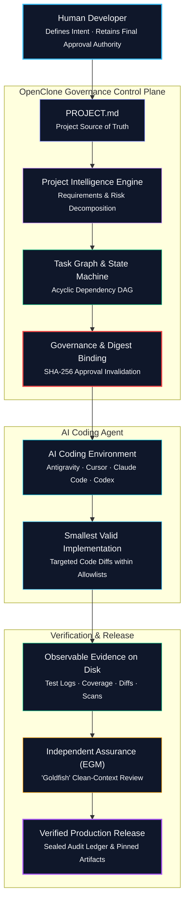
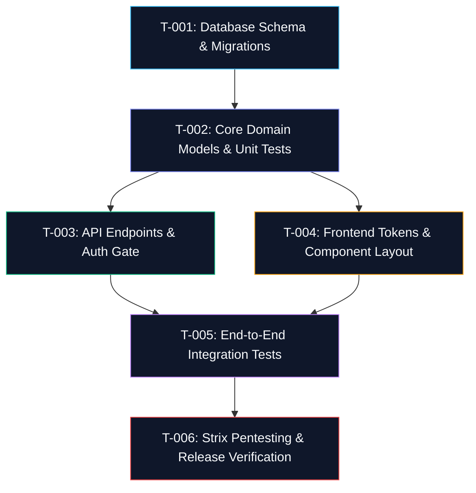
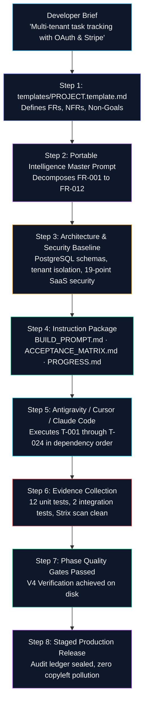

<p align="center">
  
</p>

<p align="center">
  <a href="https://github.com/MK-1603/OpenClone/releases" title="Version 2.0.0"></a>
  &nbsp;
  <a href="https://python.org"></a>
  &nbsp;
  <a href="LICENSE"></a>
  &nbsp;
  <a href="tests/"></a>
  &nbsp;
  <a href="security/scanners.lock.json"></a>
  &nbsp;
  <a href="src/openclone/mcp/server.py"></a>
</p>

<p align="center">
  <strong>Provider-Neutral · IDE-Independent · Deterministic Engineering Standard · Anti-AI-Slop Governance</strong><br />
  <em>One engineering standard for every AI-powered software development workflow.</em>
</p>

<p align="center">
  <a href="#02-what-is-openclone">02. What Is OpenClone?</a> ·
  <a href="#03-the-problem-openclone-solves">03. The Problem</a> ·
  <a href="#04-core-philosophy">04. Philosophy</a> ·
  <a href="#05-how-openclone-works">05. How It Works</a> ·
  <a href="#06-projectmd--the-project-source-of-truth">06. PROJECT.md</a> ·
  <a href="#07-complete-project-lifecycle">07. Lifecycle</a> ·
  <a href="#08-portable-project-execution-package">08. Execution Package</a> ·
  <a href="#09-global-plugin--ide-ecosystem">09. Global Plugin</a> ·
  <a href="#10-core-engineering-architecture">10. Architecture</a> ·
  <a href="#11-task-graph-and-execution-management">11. Task Graph</a> ·
  <a href="#12-governance-and-human-approval">12. Governance</a> ·
  <a href="#13-persistent-memory-and-knowledge">13. Memory</a> ·
  <a href="#14-engineering-lifecycle--22-phases">14. 22 Phases</a> ·
  <a href="#15-verification-and-independent-assurance">15. Verification</a> ·
  <a href="#16-security-and-anti-ai-slop">16. Security & Anti-Slop</a> ·
  <a href="#17-mcp-integration">17. MCP</a> ·
  <a href="#18-installation">18. Installation</a> ·
  <a href="#19-cli-reference">19. CLI</a> ·
  <a href="#20-practical-usage-example">20. Example</a> ·
  <a href="#21-configuration">21. Configuration</a> ·
  <a href="#22-documentation-hub">22. Documentation Hub</a> ·
  <a href="#23-roadmap">23. Roadmap</a> ·
  <a href="#24-contributing">24. Contributing</a> ·
  <a href="#25-security">25. Security</a> ·
  <a href="#26-license-and-acknowledgements">26. License</a>
</p>

---

## 02. What Is OpenClone?

### Build with Any AI. Governed by One Engineering Standard.

Modern generative AI models write code at superhuman speed. However, **software engineering is not raw text synthesis**. Production software requires immutable project specifications, defensive security baselines, reproducible automated tests, dependency-ordered rollouts, and evidence-backed quality verification.

Without a unifying engineering framework, AI-assisted development quickly deteriorates into **AI Slope**—where context resets erase past architectural decisions, hallucinated test passes bypass quality checks, uncontrolled model edits create unintended breaking changes, and generic visual clichés flood user interfaces.

**OpenClone** is a provider-neutral, IDE-independent AI software engineering framework that provides a consistent, deterministic engineering standard for planning, building, governing, validating, and maintaining software projects with AI coding agents.

> **Central Positioning:**
> **OpenClone is the engineering framework around the AI coding agent, not simply another code-generation agent.**
> It does not replace your AI model or your preferred IDE. It equips Claude, ChatGPT, Gemini, Codex, Antigravity, and Cursor with a deterministic, provider-neutral control plane that keeps software development structured, traceable, and secure.

---

## 03. The Problem OpenClone Solves

Uncontrolled AI-assisted software development faces widespread operational and architectural failure modes:

- **Inconsistent Engineering Practices:** Every AI model applies differing conventions, inconsistent directory structures, and incompatible patterns across sessions.
- **Missing Requirements & Scope Creep:** Implicit assumptions turn into uncontrolled feature bloat without recorded user authorization.
- **Architecture Drift:** Architectural decisions drift silently across conversational turns, leading to contradictory abstractions.
- **Context Loss ("AI Amnesia"):** Context window resets wipe out previous technical decisions, requiring developers to re-prompt and re-explain the system constantly.
- **Hallucinated Verification:** AI agents state *"All tests pass and the implementation is complete"* without actually executing test suites or producing verifiable test logs.
- **Security & Supply Chain Oversights:** Accidental credential exposure, unauthorized third-party packages, and missing least-privilege boundary enforcement.
- **Visual AI-Slop:** Monotonous dark purple gradients, meaningless pill badges, unstyled form elements, and substandard accessibility.

### The Contrast: Uncontrolled AI vs. OpenClone Governed Engineering

| Engineering Dimension | Uncontrolled AI Development ("AI Slope") | OpenClone Governed Engineering |
|---|---|---|
| **Project Understanding** | Ephemeral; trapped in transient chat sessions. | **Canonical Source of Truth:** Structured [`PROJECT.md`](templates/PROJECT.template.md) defines immutable boundaries. |
| **Requirements Traceability**| Requirements easily lost, overlooked, or hallucinated. | **Traceable Contract Hierarchy:** Requirements map directly to tasks, code diffs, and verification artifacts. |
| **Architecture Drift** | Decisions drift silently across sessions and model turns. | **Documented Architectural Invariants:** 10 core concepts and normative standards in [`domains/`](domains/). |
| **Project Continuity** | Context window resets erase architecture and progress. | **Durable Filesystem Handoffs:** `PROGRESS.md` & `HANDOFF.md` ensure seamless session resumption. |
| **Execution Control** | Monolithic "one-shot" mass rewrites and fragile diffs. | **Deterministic Task DAG:** Cycle-free dependency graph enforces smallest reviewable units of work. |
| **Scope Governance** | Unprompted feature bloat, dependency creep, and rewrites. | **Cryptographic Digest Binding:** SHA-256 task digest invalidates prior human approvals upon scope shift. |
| **Verification & Quality** | AI hallucinates test passes and claims completion verbally. | **V0–V5 Observable Evidence Model:** Real test logs, diffs, and scanner outputs must exist on disk. |
| **Security & Isolation** | Unmonitored lateral tool privileges and host exposure. | **4-Tier Copyleft Isolation & Pinned Scanners:** Strict execution harnesses and secret redaction. |
| **IDE Portability** | Vendor lock-in to proprietary prompt formats and rules. | **Provider-Neutral Host Adapters:** Works identically in Antigravity, Cursor, Claude Code, and Codex. |
| **UI/UX Design Quality** | Ambient purple gradients, generic cards, blur blobs. | **[Taste Skill v2.6.0](domains/05-UX-UI-ENGINEERING/ANTI-AI-SLOP-STANDARDS.md):** 8-pt typography scale, tokens, WCAG 2.2 AA contrast. |

---

## 04. Core Philosophy

OpenClone is governed by eight foundational engineering principles:

1. **Provider Neutrality:** The framework never locks you into a specific model provider. It operates identically whether powered by Anthropic, OpenAI, Google DeepMind, or open-weight models.
2. **IDE Independence:** Architecture, governance, and verification are portable across Google Antigravity, Cursor, Claude Code, OpenAI Codex, or standard terminal workflows.
3. **Engineering Governance:** LLMs propose; deterministic code and authorized humans decide. Critical operations require verifiable permissions.
4. **Deterministic Standards:** Architectural rules, task state machines, schema validations, and scanner lockfiles are enforced programmatically, not probabilistically.
5. **Evidence-Based Verification:** No task is declared complete without tangible evidence on disk—actual test execution logs, static analysis outputs, and reproducible diffs.
6. **Human Authority:** The developer maintains ultimate ownership of project direction, scope boundaries, architectural trade-offs, and production deployments.
7. **Project Continuity:** Context is preserved across token resets and multi-day sessions via durable, version-controlled filesystem artifacts.
8. **Anti-AI-Slop Engineering:** Rejection of low-effort generative tropes in both code (unnecessary abstractions, duplicate helpers) and design (generic purple gradients, unreadable contrast).

---

## 05. How OpenClone Works

OpenClone acts as a deterministic control plane between the human developer, the AI coding agent, and the underlying codebase:



### Division of Responsibilities

- **Developer:** Defines project purpose, business goals, and non-goals. Authorizes sensitive changes (destructive operations, external dependencies, deployments). Owns the final product.
- **OpenClone:** Coordinates available capabilities, maintains project context, calculates approval digests, enforces dependency order, and executes quality gates.
- **AI Coding Agent:** Interprets structured task specifications, writes clean modular code, runs local unit tests, and captures execution output within strictly allowed file paths.
- **Verification Engine:** Deterministically verifies that all claimed tests actually ran and exited with code 0 before transitioning tasks to `VERIFIED`.

---

## 06. PROJECT.md — The Project Source of Truth

At the heart of every OpenClone project is [`PROJECT.md`](templates/PROJECT.template.md). It serves as the immutable project constitution, ensuring that any AI agent in any session immediately understands the project boundaries:

### The Ten Elements of `PROJECT.md`

1. **Project Identity:** Official project name, version, repository URL, and license.
2. **Product Vision & Problem Statement:** What problem the software solves and for whom.
3. **Target Personas & User Journeys:** Explicit user roles and primary interaction flows.
4. **Functional Requirements (FRs):** Uniquely numbered, unambiguous functional capabilities (`FR-001`, `FR-002`, ...).
5. **Non-Functional Requirements (NFRs):** Latency budgets, concurrency targets, uptime SLAs, and browser/runtime support.
6. **Technology Stack & Constraints:** Explicit language versions, database engines, styling frameworks, and prohibited packages.
7. **Architecture & Data Boundaries:** Microservice vs. monolith topology, database schemas, and integration boundaries.
8. **Explicit Non-Goals (Scope Ceilings):** Features that must **not** be built, protecting against AI scope creep.
9. **Acceptance Criteria & Verification Tiers:** Concrete observable criteria required to declare each requirement done.
10. **Project-Specific Agent Instructions:** Custom allowlists, coding styles, and deployment constraints.

---

## 07. Complete Project Lifecycle

OpenClone governs the entire engineering trajectory across 15 structured stages:


1. **Project Idea:** Initial developer brief and problem concept.
2. **Project Intelligence:** Automated capability extraction and conflict analysis using [`prompts/PORTABLE-PROJECT-INTELLIGENCE-MASTER-PROMPT.md`](prompts/PORTABLE-PROJECT-INTELLIGENCE-MASTER-PROMPT.md).
3. **Requirements Engineering:** Traceable functional requirement definitions with unique identifiers.
4. **Architecture Design:** Module boundaries, schema designs, API contracts, and security perimeters.
5. **Technical Planning:** Verification level assignments (V0–V5) and execution sequence definition.
6. **Execution Package Generation:** Compiling `PROJECT.md`, `BUILD_PROMPT.md`, `ACCEPTANCE_MATRIX.md`, `PROGRESS.md`, and `HANDOFF.md`.
7. **AI IDE Integration:** Loading the package into Google Antigravity, Cursor, Claude Code, or Codex.
8. **Task Planning:** Decomposing requirements into an acyclic dependency graph (DAG).
9. **Implementation:** Smallest valid code changes within strict file allowlists.
10. **Evidence Collection:** Capturing raw terminal test outputs, coverage summaries, and git diffs on disk.
11. **Verification:** Validating test exit codes, AST syntax, and schema conformance.
12. **Security Review:** Running the 7 pinned security scanners and verifying secret redaction.
13. **Release Preparation:** Production build packaging, Dockerfile validation, and audit ledger sealing.
14. **Deployment:** Staged deployment rollout with zero-downtime health probes.
15. **Maintenance & Feedback:** Production telemetry monitoring, bug finding resolution, and iterative upgrades.

---

## 08. Portable Project Execution Package

For zero-install or cross-platform workflows, OpenClone compiles a portable 5-artifact execution package:

| Artifact | Responsibility & Purpose | Format & Location |
|---|---|---|
| **`PROJECT.md`** | **Project Source of Truth:** Immutable project constitution, architecture, tech stack, and scope boundaries. | Markdown (`./PROJECT.md`) |
| **`BUILD_PROMPT.md`** | **Actionable Instructions:** Step-by-step implementation prompt instructing the coding agent on sequence and standards. | Markdown (`./BUILD_PROMPT.md`) |
| **`ACCEPTANCE_MATRIX.md`** | **Acceptance Criteria:** Requirement-to-test mapping defining exact conditions for task completion. | Markdown Table (`./ACCEPTANCE_MATRIX.md`) |
| **`PROGRESS.md`** | **Execution Journal:** Live tracker of completed tasks, active blockers, test commands, and git commits. | Markdown (`./PROGRESS.md`) |
| **`HANDOFF.md`** | **Session Continuity:** Structured handoff note allowing a fresh agent to resume work with zero context amnesia. | Markdown (`./HANDOFF.md`) |

---

## 09. Global Plugin & IDE Ecosystem

OpenClone distributes its capabilities as a modular, host-agnostic global plugin. Developers get an identical engineering standard across all coding environments:


### Host Compatibility Matrix

| AI Coding Host | Integration Type | Install Scope | Skills & Instructions | MCP Tools | Verification Support | Implementation Status |
|---|---|---|---|---|---|:---:|
| **Google Antigravity** | Native Plugin (`agy`) | Workspace & User | 16 Specialist Agents + Rules | **YES** (stdio MCP) | V0–V5 Evidence Checks | `Fully Supported` |
| **Claude Code** | Marketplace Plugin | Workspace & User | Native Skills + `CLAUDE.md` | **YES** (stdio `.mcp.json`) | V0–V5 Evidence Checks | `Fully Supported` |
| **OpenAI Codex** | Marketplace Plugin | Workspace & User | Codex Skills + Rules | **YES** (stdio MCP) | V0–V5 Evidence Checks | `Fully Supported` |
| **Cursor** | Workspace Adapter | Workspace | `.cursorrules` + `.cursor/rules/*.mdc` | **YES** (stdio MCP) | V0–V5 Evidence Checks | `Fully Supported` |
| **ChatGPT** | Custom GPT / OpenAPI | Remote Session | Custom Instructions Pack | Remote HTTP / SSE | Hand-off via Package | `Partially Supported` |
| **Generic MCP** | Stdio / SSE JSON-RPC 2.0 | Process / CLI | Standard Tool Registrations | 7 Core Tools | JSON-RPC Inspection | `Fully Supported` |

---

## 10. Core Engineering Architecture

OpenClone's foundation rests on ten unified architectural concepts documented in [`concepts/`](concepts/):

1. **[Governance & Authority](concepts/01-GOVERNANCE-AND-AUTHORITY.md):** Humans remain the ultimate authority for software requirements, architecture, and destructive operations. Enforces deny-by-default execution gating. *(Status: Fully Supported)*
2. **[Project Source of Truth](concepts/02-PROJECT-SOURCE-OF-TRUTH.md):** Canonical `PROJECT.md` establishes immutable project boundaries. Prevents silent architectural drift. *(Status: Fully Supported)*
3. **[Specialist Workforce](concepts/03-SPECIALIST-WORKFORCE.md):** 72 specialist engineering worker roles across 12 teams, with support for adaptive dynamic skill injection. *(Status: Fully Supported)*
4. **[Task Graph & State Machine](concepts/04-TASK-GRAPH-AND-STATE-MACHINE.md):** Deterministic, cycle-free DAG scheduler preventing out-of-order execution, with reactive event scheduling. *(Status: Fully Supported)*
5. **[Cryptographic Audit Ledger](concepts/05-CRYPTOGRAPHIC-AUDIT-LEDGER.md):** SQLite SHA-256 hash-chained event ledger guaranteeing tamper-evident auditability. *(Status: Fully Supported)*
6. **[Human Approval & Digest Binding](concepts/06-HUMAN-APPROVAL-AND-DIGEST-BINDING.md):** Interactive digest binding where modifying task parameters automatically invalidates prior approvals. *(Status: Fully Supported)*
7. **[Execution Harness & Sandboxing](concepts/07-EXECUTION-HARNESS-AND-SANDBOXING.md):** Governed process execution with real-time regex secret redaction and rootless container isolation boundaries. *(Status: Fully Supported)*
8. **[Persistent Memory & AKIS](concepts/08-PERSISTENT-MEMORY-AND-AKIS.md):** 4-tier memory architecture (`PROJECT.md`, `PROGRESS.md`, `HANDOFF.md`, and markdown vault) supplemented by Autonomous Knowledge Ingestion & Synthesis (AKIS). *(Status: Fully Supported)*
9. **[Independent Assurance / EGM](concepts/09-INDEPENDENT-ASSURANCE-EGM.md):** "Goldfish" clean-context review protocol ensuring code is verified by fresh reviewer agents with zero author bias. *(Status: Fully Supported)*
10. **[Multi-Tool Adapter Ecosystem](concepts/10-MULTI-TOOL-ADAPTER-ECOSYSTEM.md):** Canonical capability contracts translated into native host formats across Antigravity, Cursor, Claude Code, and Codex. *(Status: Fully Supported)*

---

## 11. Task Graph and Execution Management

OpenClone prevents out-of-order execution and incomplete implementations by organizing all engineering tasks into an acyclic dependency graph (DAG):



### Deterministic State Machine

Every task transitions through strict lifecycle states:

$$\text{PENDING} \longrightarrow \text{READY} \longrightarrow \text{IN\_PROGRESS} \longrightarrow \text{COMPLETED} \longrightarrow \text{VERIFIED}$$

If any blocker or unexpected failure occurs, the task enters `BLOCKED` or `FAILED`. A task cannot transition to `VERIFIED` without physical evidence (test output, coverage report, or clean scanner exit code) recorded on disk.

---

## 12. Governance and Human Approval

OpenClone establishes clear authority boundaries to ensure that AI agents never exceed their approved remit:

- **Deny-by-Default Policy:** AI agents cannot execute destructive file commands, install unvetted dependencies, or alter system architecture without explicit human authorization.
- **Cryptographic Digest Binding:** When a human approves a task or plan, OpenClone generates a SHA-256 digest of the task specification, allowlisted files, and command string.
- **Automatic Invalidation:** If the agent or human alters the task description, modifies a dependency, or touches a file outside the allowlist, the digest mismatch **immediately revokes the approval**, halting execution until re-authorized.
- **Tamper-Evident Ledger:** All approval grants, revocations, and task transitions are written to an immutable SQLite hash-chained ledger.

---

## 13. Persistent Memory and Knowledge

To solve LLM context amnesia across long development cycles, OpenClone implements a durable 4-tier memory architecture:

1. **Constitutional Memory (`PROJECT.md`):** High-level architectural invariants, business goals, and non-goals.
2. **Operational Memory (`PROGRESS.md`):** Real-time task progress, git commit references, and active blockers.
3. **Session Handoff Memory (`HANDOFF.md`):** Compact, actionable briefing for the next agent session.
4. **Autonomous Knowledge Ingestion & Synthesis (AKIS):** Synthesizes cross-cutting domain insights, architectural decisions (ADRs), and bug resolutions into persistent, searchable Markdown records in `memory/`.

---

## 14. Engineering Lifecycle — 22 Phases

OpenClone defines a comprehensive 22-phase engineering lifecycle spanning foundation to post-launch governance:

```mermaid
flowchart LR
    P1["01-03<br/>FOUNDATION<br/><small>Discovery · Reqs · Architecture</small>"] --> P2["04-06<br/>DESIGN & TRUST<br/><small>Anti-Slop UX · Security · Data</small>"]
    P2 --> P3["07-12<br/>EXECUTION<br/><small>Env · Logic · API · Frontend · State</small>"]
    P3 --> P4["13-16<br/>QUALITY & RISK<br/><small>Tests · Perf · A11y · Pentesting</small>"]
    P4 --> P5["17-20<br/>DEPLOYMENT<br/><small>CI/CD · Containers · Staged Rollout</small>"]
    P5 --> P6["21-22<br/>GOVERNANCE<br/><small>Documentation · Feedback</small>"]

    style P1 fill:#0f172a,stroke:#38bdf8,stroke-width:2px,color:#f8fafc
    style P2 fill:#0f172a,stroke:#f59e0b,stroke-width:2px,color:#f8fafc
    style P3 fill:#0f172a,stroke:#818cf8,stroke-width:2px,color:#f8fafc
    style P4 fill:#0f172a,stroke:#ef4444,stroke-width:2px,color:#f8fafc
    style P5 fill:#0f172a,stroke:#10b981,stroke-width:2px,color:#f8fafc
    style P6 fill:#0f172a,stroke:#a855f7,stroke-width:2px,color:#f8fafc
```



### Complete 22-Phase Master Taxonomy

| Group | Phase Identifier | Core Objective | Key Quality Gate Criteria |
|---|---|---|---|
| **Foundation** | `PHASE_01_DISCOVERY` | Problem discovery & user persona definition | Core problem validated, explicit non-goals documented |
| | `PHASE_02_REQUIREMENTS` | Functional & non-functional requirements | Traceable requirements matrix established |
| | `PHASE_03_ARCHITECTURE` | System topology, module boundaries & data models | Tech stack locked, schema migration path approved |
| **Design & Trust** | `PHASE_04_UI_UX_DESIGN` | Anti-slop design tokens & responsive layout | Taste Skill v2.6.0 anti-slop audit passed |
| | `PHASE_05_SECURITY` | 19-point SaaS security baseline | Secret scanning clean, least-privilege enforced |
| | `PHASE_06_DATA_DESIGN` | Database schemas, indexing & persistence | ACID/eventual consistency boundary established |
| **Execution** | `PHASE_07_ENVIRONMENT` | Workspace configuration & container baseline | Reproducible build scripts verified |
| | `PHASE_08_CORE_LOGIC` | Backend domain models & business rules | Unit test coverage over critical branches |
| | `PHASE_09_API_PLATFORM` | REST / GraphQL / gRPC endpoints | Contract validation & HTTP status codes verified |
| | `PHASE_10_FRONTEND` | UI component implementation | No raw inline styles; design tokens enforced |
| | `PHASE_11_INTEGRATION` | Inter-service connectors & 3rd-party APIs | Mocked fallback tests passing with 0 errors |
| | `PHASE_12_STATE_MGMT` | Durable state, caching & event pub/sub | Cache eviction policies and TTLs configured |
| **Quality & Risk** | `PHASE_13_TESTING` | Unit, integration & end-to-end suites | Automated CI pass with 0 failures |
| | `PHASE_14_PERFORMANCE` | Latency, throughput & bundle size audits | Core Web Vitals and load budgets met |
| | `PHASE_15_ACCESSIBILITY` | WCAG 2.2 AA compliance | Keyboard navigation & screen reader checks passed |
| | `PHASE_16_PENTESTING` | Dynamic security testing & injection defense | 0 High/Critical unmitigated vulnerabilities |
| **Deployment** | `PHASE_17_DEVOPS_CI_CD` | GitHub Actions / GitLab CI workflows | Deterministic, pinned build pipeline configured |
| | `PHASE_18_CONTAINER` | Dockerfile & rootless container isolation | Non-root user & minimal base images verified |
| | `PHASE_19_DEPLOYMENT` | Staged deployment & health probes | Zero-downtime rolling update verified |
| | `PHASE_20_OBSERVABILITY`| Metrics, distributed tracing & structured logs | JSON logs & Prometheus/OpenTelemetry active |
| **Governance** | `PHASE_21_DOCUMENTATION`| Runbooks, API specs & architecture records | Complete copy-pasteable documentation |
| | `PHASE_22_FEEDBACK` | User analytics & post-launch review | Production telemetry verified |

---

## 15. Verification and Independent Assurance

Verbal claims made by an AI coding agent (*"I implemented authentication and all tests pass"*) are treated as untrusted data until backed by physical evidence on disk.

### The V0–V5 Verification Model

| Level | Identifier | Required Observable Evidence on Disk | Gate Action |
|:---:|---|---|---|
| **V0** | `UNVERIFIED` | Conversational text or verbal claim only. | **REJECTED** — Cannot close task. |
| **V1** | `SYNTACTIC` | Clean AST parse, 0 syntax errors, valid typecheck. | Allowed for preliminary drafts. |
| **V2** | `UNIT_TESTED` | Automated unit tests executed with exit code 0 and captured stdout. | Required for domain logic. |
| **V3** | `INTEGRATED` | Inter-service integration or API tests passing in staging container. | Required for subsystem completion. |
| **V4** | `SECURITY_AUDITED` | Pinned security scanners clean (`scanners.lock.json`), anti-slop pass. | Required for release candidates. |
| **V5** | `INDEPENDENT_EGM` | Clean-context review completed by fresh reviewer with signed report. | Required for production release. |

### "Goldfish" Clean-Context Independent Review

To eliminate author confirmation bias, OpenClone implements the **Goldfish Review Protocol**: a fresh reviewer subagent is launched with zero conversation history, given only the PR diff and requirement specification, and asked to rigorously critique architecture, test coverage, and security boundaries.

---

## 16. Security and Anti-AI-Slop

OpenClone enforces strict security baselines and quality controls:

- **19-Point SaaS Security Baseline:** Covers OWASP Top 10 defenses, SQL injection prevention, bcrypt password hashing, CSRF/CORS configurations, and strict rate limiting ([`docs/security/saas-security-baseline.md`](docs/security/saas-security-baseline.md)).
- **Secret Redaction Harness:** Real-time regex scanner scrubs API tokens, AWS keys, private certificates, and passwords before logging or storing tool outputs.
- **4-Tier Copyleft Isolation:** Upstream copyleft tools (`semgrep`, `trufflehog`, `clamav`) run in decoupled child processes. Zero copyleft code is vendored into OpenClone core.
- **Pinned Scanner Lockfile:** All security scanners pinned by 40-character commit SHAs in [`security/scanners.lock.json`](security/scanners.lock.json).
- **Taste Skill v2.6.0:** Anti-AI-slop design engine enforcing an 8-point typographic scale, semantic CSS tokens, WCAG 2.2 AA contrast ratios, and prohibiting ambient blur circles or neon purple clichés ([`domains/05-UX-UI-ENGINEERING/ANTI-AI-SLOP-STANDARDS.md`](domains/05-UX-UI-ENGINEERING/ANTI-AI-SLOP-STANDARDS.md)).

---

## 17. MCP Integration

OpenClone implements the Model Context Protocol (spec 2024-11-05), exposing its capabilities over stdio and Server-Sent Events (SSE):

### Core MCP Tools

| Tool Name | Purpose | Primary Inputs | Output |
|---|---|---|---|
| **`openclone_get_status`** | Real-time framework status, version, test counts, active branch. | None | JSON status report |
| **`openclone_search_knowledge`**| Search 31 domains, 56 engines, and blueprints by topic. | `query` (str), `category` (enum), `limit` (int) | List of matching sections |
| **`openclone_explain_concept`** | Retrieve authoritative contracts for any domain, engine, or concept. | `concept_id` (e.g. `'E-001'`, `'05-UX-UI-ENGINEERING'`) | Complete Markdown spec |
| **`openclone_run_workflow`** | Inspect or execute an authorized OpenClone lifecycle workflow. | `workflow_id` (e.g. `'WF-013'`), `action` (enum) | Workflow checklist / contract |
| **`openclone_validate_project`**| Run repository structural integrity and schema quality gates. | `strict` (bool) | Pass/Fail report with errors |
| **`openclone_get_guidance`** | Retrieve specialized guidance (anti-slop, security, architecture). | `topic` (enum: `'anti_slop'`, `'saas_security'`, etc.) | Markdown guidance profile |
| **`openclone_list_capabilities`**| List all domains, engines, workflows, workforce roles, and adapters. | `filter` (enum: `'all'`, `'domains'`, `'engines'`, etc.) | Comprehensive registry list |

### Sample JSON-RPC 2.0 Request & Response

**Request:**
```json
{
  "jsonrpc": "2.0",
  "id": 1,
  "method": "tools/call",
  "params": {
    "name": "openclone_get_guidance",
    "arguments": {
      "topic": "anti_slop"
    }
  }
}
```

**Response:**
```json
{
  "jsonrpc": "2.0",
  "id": 1,
  "result": {
    "content": [
      {
        "type": "text",
        "text": "# Taste Skill v2.6.0: Anti-AI-Slop Design Governance\n\nProhibited Patterns: generic purple glow, meaningless pill badges, low-contrast text...\nRequired Standards: 8-point type scale, semantic CSS tokens, WCAG 2.2 AA contrast."
      }
    ]
  }
}
```

---

## 18. Installation

### Route A: Global Plugin Installation (Recommended for End Users)

Install OpenClone directly into your AI coding environment:

#### 1. Google Antigravity
```bash
agy plugin install https://github.com/MK-1603/OpenClone
```

#### 2. Claude Code
```text
/plugin marketplace add MK-1603/OpenClone
/plugin install openclone@openclone-marketplace
```

#### 3. OpenAI Codex
```bash
codex plugin marketplace add MK-1603/OpenClone
```

#### 4. Cursor
Add OpenClone to `.cursor/mcp.json`:
```json
{
  "mcpServers": {
    "openclone": {
      "command": "python",
      "args": ["-m", "src.openclone.cli", "mcp"]
    }
  }
}
```

---

### Route B: Application Developers (Portable Zero-Install Workflow)

If you are developing an application using ChatGPT, Claude, or Gemini in your browser, **no local installation is required**:

1. **Copy Specification:** Copy [`templates/PROJECT.template.md`](templates/PROJECT.template.md) into your project root as `PROJECT.md`.
2. **Execute Master Prompt:** Provide [`prompts/PORTABLE-PROJECT-INTELLIGENCE-MASTER-PROMPT.md`](prompts/PORTABLE-PROJECT-INTELLIGENCE-MASTER-PROMPT.md) and your `PROJECT.md` to ChatGPT or Claude.
3. **Execute in IDE:** Hand off the generated instruction package (`BUILD_PROMPT.md`, `ACCEPTANCE_MATRIX.md`, `PROGRESS.md`, `HANDOFF.md`) to your AI coding environment.

---

### Route C: Framework Maintainers & Contributors (Local Setup)

```bash
# 1. Clone repository
git clone https://github.com/MK-1603/OpenClone.git
cd OpenClone

# 2. Install editable package with dev dependencies
pip install -e ".[dev]"

# 3. Verify repository integrity (56 engines, 31 domains, 10 schemas)
python tools/validate_repository.py

# 4. Run automated test suite (108 unit & integration tests)
pytest tests/

# 5. Run Taste Skill anti-slop governance tests (13 tests)
node skills/taste-skill/tests/test-governance.mjs
# (Total: 121 automated tests passing with 0 failures)
```

---

## 19. CLI Reference

OpenClone provides unified CLI management through `src.openclone.cli`:

### Environment Diagnostics (`doctor`)
Inspect prerequisites, runtime versions, and workspace health:
```bash
python -m src.openclone.cli doctor
```

### Installation Status (`status`)
Inspect detected hosts and installed adapters:
```bash
python -m src.openclone.cli status
```

### Adapter Installation (`install`)
Install OpenClone instructions, rules, and skills into your workspace:
```bash
python -m src.openclone.cli install cursor --scope workspace
python -m src.openclone.cli install antigravity --scope user
python -m src.openclone.cli install claude_code
python -m src.openclone.cli install codex
```

### Dry-Run Installation (`--dry-run`)
Preview files that will be created without writing to disk:
```bash
python -m src.openclone.cli install cursor --dry-run
```

### Clean Uninstallation (`uninstall`)
Safely remove OpenClone files and restore original backups:
```bash
python -m src.openclone.cli uninstall cursor
```

### Portable Workflow Runtime CLI (`openclone_runtime/openclone.py`)
Run portable EGM lifecycle operations:
```bash
python tools/openclone_runtime/openclone.py init --project .
python tools/openclone_runtime/openclone.py challenge --project . --title "Feature Concept"
python tools/openclone_runtime/openclone.py spec-create --project . --title "Feature Design" --id SPEC-001
python tools/openclone_runtime/openclone.py validate-spec --spec .openclone/specs/SPEC-001.md
python tools/openclone_runtime/openclone.py drift --project . --spec .openclone/specs/SPEC-001.md
```

---

## 20. Practical Usage Example

### Illustrative End-to-End Walkthrough: `TaskFlow SaaS`

An illustrative walkthrough demonstrating how OpenClone governs a real-world multi-tenant project from brief to verified release:



For the complete reference implementation specification, inspect [`blueprints/EXAMPLE-AI-SAAS-PROJECT.md`](blueprints/EXAMPLE-AI-SAAS-PROJECT.md).

---

## 21. Configuration

OpenClone is configured through standard environment variables and CLI parameters:

| Environment Variable / Flag | Default Value | Description |
|---|:---:|---|
| `OPENCLONE_STRICT` / `--strict` | `False` | Enforces all lint and repository warnings as fatal exit code 1 errors. |
| `OPENCLONE_PORT` / `--port` | `8000` | Port for the Server-Sent Events (SSE) transport of the shared MCP server. |
| `OPENCLONE_LEDGER_PATH` / `--ledger` | `.openclone/audit.db` | Filesystem location for the SQLite tamper-evident audit ledger. |
| `OPENCLONE_REDACT_SECRETS` / `--no-redact` | `True` (Redaction ON) | Automatically redacts API keys and secrets in execution command logs. |
| `OPENCLONE_PROJECT_TYPE` / `--project-type` | `web_saas` | Default lifecycle project pack used during checklist generation. |

---

## 22. Documentation Hub

Explore the authoritative specifications across the OpenClone repository:

| Engineering Category | Key Documents |
|---|---|
| **Platform Standards & Rules** | [`AGENTS.md`](AGENTS.md) · [`project.md`](project.md) · [`OPENCLONE-CORE-PRINCIPLES.md`](OPENCLONE-CORE-PRINCIPLES.md) |
| **System Architecture** | [`docs/architecture/OPENCLONE-2.0-ARCHITECTURE.md`](docs/architecture/OPENCLONE-2.0-ARCHITECTURE.md) · [`blueprints/OPENCLONE-MASTER-BLUEPRINT.md`](blueprints/OPENCLONE-MASTER-BLUEPRINT.md) |
| **Methodology Reference** | [`blueprints/OPENCLONE-METHODOLOGY-REFERENCE.md`](blueprints/OPENCLONE-METHODOLOGY-REFERENCE.md) · [`docs/DOCUMENTATION-MAP.md`](docs/DOCUMENTATION-MAP.md) |
| **Operational Assessments** | [`assessments/current/REPOSITORY-HEALTH.md`](assessments/current/REPOSITORY-HEALTH.md) · [`assessments/current/SECURITY-STATUS.md`](assessments/current/SECURITY-STATUS.md) · [`assessments/current/RELEASE-READINESS.md`](assessments/current/RELEASE-READINESS.md) |
| **Host Integrations & Compatibility** | [`docs/installation/GLOBAL-PLUGIN-INSTALLATION.md`](docs/installation/GLOBAL-PLUGIN-INSTALLATION.md) · [`docs/compatibility/HOST-COMPATIBILITY.md`](docs/compatibility/HOST-COMPATIBILITY.md) |
| **22-Phase Lifecycle** | [`docs/engineering-lifecycle/MASTER_LIFECYCLE_CATALOGUE.md`](docs/engineering-lifecycle/MASTER_LIFECYCLE_CATALOGUE.md) · [`docs/engineering-lifecycle/VERIFICATION_AND_EVIDENCE.md`](docs/engineering-lifecycle/VERIFICATION_AND_EVIDENCE.md) |
| **Security & Compliance** | [`docs/security/saas-security-baseline.md`](docs/security/saas-security-baseline.md) · [`docs/security/THREAT-MODEL.md`](docs/security/THREAT-MODEL.md) · [`docs/legal/COMPLIANCE_MATRIX.md`](docs/legal/COMPLIANCE_MATRIX.md) |
| **Design & Anti-Slop** | [`domains/05-UX-UI-ENGINEERING/ANTI-AI-SLOP-STANDARDS.md`](domains/05-UX-UI-ENGINEERING/ANTI-AI-SLOP-STANDARDS.md) · [`assets/branding/README.md`](assets/branding/README.md) |
| **Third-Party Copyright & IP** | [`NOTICE`](NOTICE) · [`THIRD_PARTY_LICENSES.md`](THIRD_PARTY_LICENSES.md) · [`THIRD_PARTY_NOTICES.md`](THIRD_PARTY_NOTICES.md) |

---

## 23. Roadmap

OpenClone tracks its ongoing evolution transparently:

### ✅ Completed & Verified (`2.0.0`)
- [x] **Universal Framework Standard:** Unified specification across 31 engineering domains and 56 capability engines.
- [x] **Official Brand Identity:** Integrated 3D isometric emblem and canonical tagline logo banner.
- [x] **Shared MCP Server:** JSON-RPC 2.0 stdio/SSE engine with 7 core inspection tools and 15 canonical capabilities.
- [x] **Taste Skill v2.6.0:** Anti-AI-slop design tokens, typography scales, and 13 automated governance tests.
- [x] **Portable Specification Workflow:** Zero-install `PROJECT.md` execution package generation (`BUILD_PROMPT.md`, `ACCEPTANCE_MATRIX.md`, `PROGRESS.md`, `HANDOFF.md`).
- [x] **22-Phase Lifecycle Engine:** CLI checklist engine enforcing V0–V5 evidence tiers and automated phase quality gates.
- [x] **Global Plugin Installer:** Multi-host transactional installer supporting Antigravity, Cursor, Claude Code, and Codex.
- [x] **28 Upstream Open-Source Integrations:** Audited registry, declarative manifests, and strict 4-tier copyleft isolation.
- [x] **Repository Cleanup & Consolidation:** Unified 10 core concepts, single authoritative assessments structure in `assessments/current/`.

### 🔄 In Progress
- [ ] **Interactive IDE Diagnostic Extension:** Rich visual UI sidecar for inspecting live MCP state in Antigravity and Cursor.
- [ ] **Automated Dynamic Prompt Injection Evals:** Extended test suite exercising PyRIT adversarial boundary adapters.

### 📋 Planned & Proposed
- [ ] **Ephemeral Micro-VM Sandbox Runners:** Rootless container runners for untrusted third-party code execution `{PROPOSED}`.
- [ ] **Distributed Git-Native Signed Audit Streams:** Cryptographically signed commit hooks backing the SQLite audit ledger `{PLANNED}`.

---

## 24. Contributing

We welcome contributions from software engineers, AI researchers, and open-source practitioners:

- **[Contributing Guidelines](CONTRIBUTING.md):** Development setup, branch naming, testing requirements, and PR expectations.
- **[Code of Conduct](CODE_OF_CONDUCT.md):** Contributor Covenant v2.1 standards.
- **[Governance Model](GOVERNANCE.md):** Architectural decision registers and human approval rules.

### Local Verification Before Submitting a PR
```bash
# 1. Structural repository quality gate
python tools/validate_repository.py

# 2. Automated Python test suite
pytest tests/

# 3. Taste Skill governance test suite
node skills/taste-skill/tests/test-governance.mjs
```

---

## 25. Security

OpenClone treats software supply chain and execution security as paramount:

- **Vulnerability Disclosure:** Please review [`SECURITY.md`](SECURITY.md) for our responsible disclosure policy and reporting channels.
- **Secret Redaction:** Subprocess outputs automatically scrub sensitive tokens before persistence.
- **Pinned Scanners:** All static analysis tools are pinned by commit hash in [`security/scanners.lock.json`](security/scanners.lock.json).

---

## 26. License and Acknowledgements

OpenClone is licensed under the [MIT License](LICENSE).  
Copyright (c) 2026 OpenClone Contributors.

Third-party open-source components and specifications are subject to their respective licenses:
- [`NOTICE`](NOTICE): Upstream copyright, authors, and notices.
- [`THIRD_PARTY_LICENSES.md`](THIRD_PARTY_LICENSES.md): Complete 28-repository license inventory.
- [`THIRD_PARTY_NOTICES.md`](THIRD_PARTY_NOTICES.md): Detailed upstream commit SHAs, modification records, and attribution.
- [`docs/legal/`](docs/legal/): Copyleft isolation policies and compliance audit matrix.

<p align="center">
  <sub>OpenClone · Build with Any AI. Governed by One Engineering Standard.</sub>
</p>
