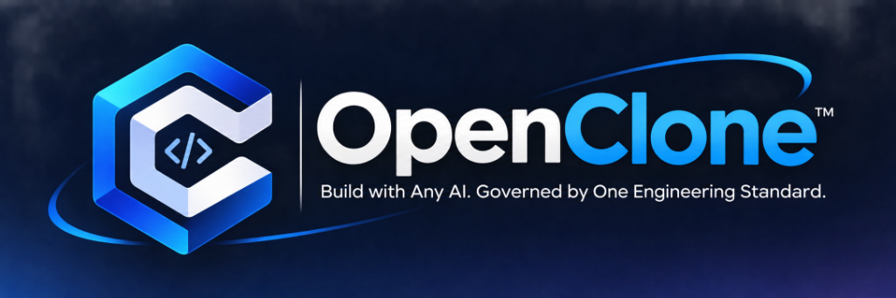
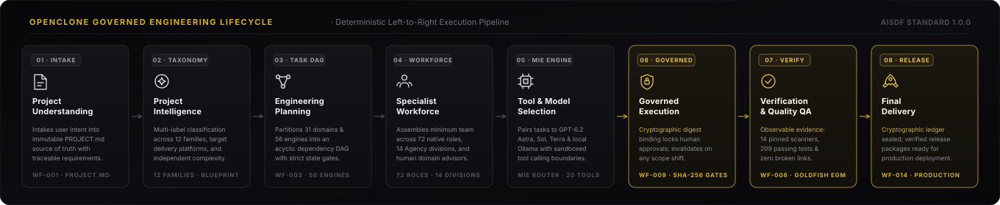
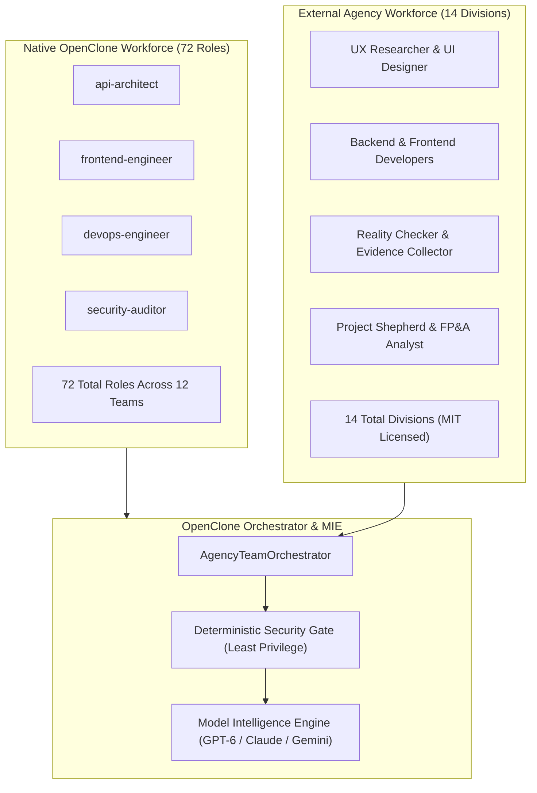

<p align="center">
  
</p>

<p align="center">
  <a href="https://github.com/MK-1603/OpenClone/releases" title="Version 2.0.0"></a>
  &nbsp;
  <a href="https://python.org"></a>
  &nbsp;
  <a href="LICENSE"></a>
  &nbsp;
  <a href="tests/"></a>
  &nbsp;
  <a href="security/scanners.lock.json"></a>
  &nbsp;
  <a href="src/openclone/mcp/server.py"></a>
</p>

<p align="center">
  <strong>Provider-Neutral · IDE-Independent · Deterministic Engineering Standard · Anti-AI-Slop Governance</strong><br />
  <em>One engineering standard for every AI-powered software development workflow.</em>
</p>

<p align="center">
  <a href="#01-what-is-openclone">01. Overview</a> ·
  <a href="#02-the-problem-and-the-solution">02. Problem & Solution</a> ·
  <a href="#03-core-philosophy">03. Philosophy</a> ·
  <a href="#04-how-openclone-works">04. How It Works</a> ·
  <a href="#05-platform-capabilities">05. Capabilities</a> ·
  <a href="#06-engineering-lifecycle">06. Lifecycle</a> ·
  <a href="#07-specialist-workforce">07. Workforce</a> ·
  <a href="#08-model-and-ide-ecosystem">08. Ecosystem</a> ·
  <a href="#09-architecture-overview">09. Architecture</a> ·
  <a href="#10-getting-started">10. Getting Started</a> ·
  <a href="#11-cli-reference">11. CLI Reference</a> ·
  <a href="#12-mcp-and-tool-integration">12. MCP Integration</a> ·
  <a href="#13-security-and-engineering-quality">13. Security & Quality</a> ·
  <a href="#14-real-world-demonstrations">14. Demonstrations</a> ·
  <a href="#15-documentation-hub">15. Documentation</a> ·
  <a href="#16-roadmap">16. Roadmap</a> ·
  <a href="#17-contributing-and-license">17. Community & License</a>
</p>

---

## 01. What Is OpenClone?

### Build with Any AI. Governed by One Engineering Standard.

Modern artificial intelligence generates code at superhuman speed. However, **software engineering is not raw text synthesis**. Production-grade software requires immutable requirements, defensive security baselines, reproducible automated tests, dependency-ordered rollouts, and evidence-backed quality verification.

Without a unifying engineering framework, AI-assisted development deteriorates into **AI Slope**—where context resets erase past architectural decisions, hallucinated test passes bypass quality checks, uncontrolled model edits create unintended breaking changes, and generic visual clichés flood user interfaces.

**OpenClone** is an AI Software Development Framework (AISDF) that brings structure, intelligence, governance, verification, and repeatable engineering practices to AI-assisted software development.

> **Central Positioning:**  
> **OpenClone is the engineering framework around the AI coding agent, not simply another code-generation agent.**  
> It does not replace your AI model or your preferred IDE. It equips Claude, ChatGPT, Gemini, Codex, Antigravity, and Cursor with a deterministic, provider-neutral control plane that keeps software development structured, traceable, and secure.

---

## 02. The Problem and the Solution

Uncontrolled AI-assisted software development suffers from recurring operational and architectural failure modes:

- **Missing Requirements & Scope Creep:** Implicit assumptions turn into uncontrolled feature bloat without recorded user authorization.
- **Architecture Drift:** Architectural decisions drift silently across conversational turns, leading to contradictory abstractions.
- **Context Loss ("AI Amnesia"):** Context window resets wipe out previous technical decisions, requiring developers to re-prompt and re-explain the system constantly.
- **Hallucinated Verification:** AI agents state *"All tests pass and the implementation is complete"* without actually executing test suites or producing verifiable test logs.
- **Security & Supply Chain Oversights:** Accidental credential exposure, unauthorized third-party packages, and missing least-privilege boundary enforcement.
- **Visual AI-Slop:** Monotonous dark purple gradients, meaningless pill badges, unstyled form elements, and substandard accessibility.

### The Contrast: Uncontrolled AI vs. OpenClone Governed Engineering

| Engineering Dimension | Uncontrolled AI Development ("AI Slope") | OpenClone Governed Engineering |
|---|---|---|
| **Project Understanding** | Ephemeral; trapped in transient chat sessions. | **Canonical Source of Truth:** Structured [`PROJECT.md`](project/PROJECT.md.template) defines immutable boundaries. |
| **Requirements Traceability**| Requirements easily lost, overlooked, or hallucinated. | **Traceable Contract Hierarchy:** Requirements map directly to tasks, code diffs, and verification artifacts. |
| **Architecture Drift** | Decisions drift silently across sessions and model turns. | **Documented Architectural Invariants:** 31 engineering domains and normative standards in [`framework/domains/`](framework/domains/). |
| **Project Continuity** | Context window resets erase architecture and progress. | **Durable Filesystem Handoffs:** `PROGRESS.md` & `HANDOFF.md` ensure seamless session resumption. |
| **Execution Control** | Monolithic "one-shot" mass rewrites and fragile diffs. | **Deterministic Task DAG:** Cycle-free dependency graph enforces smallest reviewable units of work. |
| **Scope Governance** | Unprompted feature bloat, dependency creep, and rewrites. | **Cryptographic Digest Binding:** SHA-256 task digest invalidates prior human approvals upon scope shift. |
| **Verification & Quality** | AI hallucinates test passes and claims completion verbally. | **V0–V5 Observable Evidence Model:** Real test logs, diffs, and scanner outputs must exist on disk. |
| **Security & Isolation** | Unmonitored lateral tool privileges and host exposure. | **4-Tier Copyleft Isolation & Pinned Scanners:** Strict execution harnesses and secret redaction. |
| **IDE Portability** | Vendor lock-in to proprietary prompt formats and rules. | **Provider-Neutral Host Adapters:** Works identically in Antigravity, Cursor, Claude Code, and Codex. |
| **UI/UX Design Quality** | Ambient purple gradients, generic cards, blur blobs. | **[Taste Skill v2.6.0](framework/domains/05-UX-UI-ENGINEERING/ANTI-AI-SLOP-STANDARDS.md):** 8-pt typography scale, tokens, WCAG 2.2 AA contrast. |

---

## 03. Core Philosophy

OpenClone is governed by eight foundational engineering principles:

1. **Provider Neutrality:** The framework never locks you into a specific model provider. It operates identically whether powered by OpenAI (GPT-6), Anthropic (Claude 3.5), Google DeepMind (Gemini 2.0), or open-weight models via Ollama.
2. **IDE Independence:** Architecture, governance, and verification are portable across Google Antigravity, Cursor, Claude Code, OpenAI Codex, or standard terminal workflows.
3. **Engineering Governance:** LLMs propose; deterministic code and authorized humans decide. Critical operations require verifiable permissions.
4. **Deterministic Standards:** Architectural rules, task state machines, schema validations, and scanner lockfiles are enforced programmatically, not probabilistically.
5. **Evidence-Based Verification:** No task is declared complete without tangible evidence on disk—actual test execution logs, static analysis outputs, and reproducible diffs.
6. **Human Authority:** The developer maintains ultimate ownership of project direction, scope boundaries, architectural trade-offs, and production deployments.
7. **Project Continuity:** Context is preserved across token resets and multi-day sessions via durable, version-controlled filesystem artifacts.
8. **Anti-AI-Slop Engineering:** Rejection of low-effort generative tropes in both code (unnecessary abstractions, duplicate helpers) and design (generic purple gradients, unreadable contrast).

---

## 04. How OpenClone Works

OpenClone operates as a deterministic, model-independent control plane between the human developer, autonomous coding agents, and the repository codebase. Work executes across an 8-stage left-to-right engineering lifecycle:

```mermaid
flowchart LR
    S1["<b>01 · Intake</b><br/><small>Project Understanding</small>"]
    S2["<b>02 · Intelligence</b><br/><small>Project Intelligence</small>"]
    S3["<b>03 · Planning</b><br/><small>Engineering Planning</small>"]
    S4["<b>04 · Workforce</b><br/><small>Specialist Workforce</small>"]
    S5["<b>05 · Routing</b><br/><small>Tool & Model Selection</small>"]
    S6["<b>06 · Governance</b><br/><small>Governed Execution</small>"]
    S7["<b>07 · Assurance</b><br/><small>Verification & QA</small>"]
    S8["<b>08 · Delivery</b><br/><small>Final Delivery</small>"]

    S1 --> S2 --> S3 --> S4 --> S5 ==> S6 ==> S7 ==> S8

    style S1 fill:#141418,stroke:#27272a,stroke-width:1px,color:#f4f4f5
    style S2 fill:#141418,stroke:#27272a,stroke-width:1px,color:#f4f4f5
    style S3 fill:#141418,stroke:#27272a,stroke-width:1px,color:#f4f4f5
    style S4 fill:#141418,stroke:#27272a,stroke-width:1px,color:#f4f4f5
    style S5 fill:#141418,stroke:#27272a,stroke-width:1px,color:#f4f4f5
    style S6 fill:#1a1710,stroke:#8a7334,stroke-width:2px,color:#fef08a
    style S7 fill:#1a1710,stroke:#8a7334,stroke-width:2px,color:#fef08a
    style S8 fill:#1a1710,stroke:#8a7334,stroke-width:2px,color:#fef08a
```

<p align="center">
  
</p>



### The 8-Stage Governed Engineering Lifecycle

| Stage | Operation | Core Responsibility | Primary Artifact |
| :--- | :--- | :--- | :--- |
| **01 · Project Understanding** | Developer Intake & Pre-flight | Clarifies requirements, scope boundaries, constraints, and non-goals with explicit human sign-off. | `PROJECT.md` |
| **02 · Project Intelligence** | Complexity & Risk Analysis | Deep codebase inspection, architecture classification, dependency discovery, and risk scoring. | `architecture_report.json` |
| **03 · Engineering Planning** | Acyclic Task DAG Generation | Decomposes goals into verifiable subtasks with strict file allowlists and acceptance criteria. | `active_task.json` (DAG) |
| **04 · Specialist Workforce** | Capability-Matched Assembly | Deploys vetted specialist personas across Engineering, QA, Security, and Architecture divisions. | `workforce_manifest.json` |
| **05 · Tool & Model Selection** | Multi-Provider MIE Routing | Selects optimal LLMs (GPT-6, Claude, Gemini, DeepSeek, Ollama) balancing reasoning, speed, and cost. | `routing_decision.json` |
| **06 · Governed Execution** | Sandboxed Least-Privilege Diffs | Agents execute scoped code edits restricted to allowed file boundaries; commands run in sandbox. | Isolated patch diffs |
| **07 · Verification & QA** | Deterministic Evidence Validation | Independent verification passes (tests, linters, link checks, security audits) with hash verification. | `audit_ledger.sqlite3` |
| **08 · Final Delivery** | Sealed Audit & Human Acceptance | Human owner reviews cryptographic audit digest and commits verified artifacts to release branch. | Release Tag & Commit |

### Division of Responsibilities

- **Developer:** Defines project purpose, business goals, and non-goals. Authorizes sensitive changes (destructive operations, external dependencies, deployments). Retains ultimate release authority.
- **OpenClone:** Coordinates available capabilities, maintains project context, calculates approval digests, enforces dependency order, and executes quality gates.
- **AI Coding Agent:** Interprets structured task specifications, writes clean modular code, runs local unit tests, and captures execution output within strictly allowed file paths.
- **Verification Engine:** Deterministically verifies that all claimed tests actually ran and exited with code 0 before transitioning tasks to `VERIFIED`.

---

## 05. Platform Capabilities

OpenClone organizes its platform capabilities into modular, verifiable engineering subsystems:

### 1. Project Intelligence & Canonical `PROJECT.md`
- **Constitutional Contract:** Canonical [`PROJECT.md`](project/PROJECT.md.template) establishes immutable project boundaries, non-goals, functional requirements (FRs), non-functional requirements (NFRs), and acceptance criteria.
- **Portable 5-Artifact Pack:** Zero-install execution package (`PROJECT.md`, `BUILD_PROMPT.md`, `ACCEPTANCE_MATRIX.md`, `PROGRESS.md`, `HANDOFF.md`) eliminating context amnesia across token resets.

### 2. Specialist Workforce Architecture
- **72 Native Engineering Roles:** Structured across 12 multidisciplinary teams in [`framework/workforce/`](framework/workforce/).
- **14 External Agency Divisions:** Seamless integration with the Agency Agents ecosystem across 14 divisions (`design`, `engineering`, `product`, `testing`, `spatial-computing`, etc.) with strict workforce boundary isolation.

### 3. Model Intelligence Engine (MIE)
- **Multi-Provider Intelligence:** Provider adapters for OpenAI (`gpt-6`, `gpt-6-mini`, `gpt-6-reasoning`), Anthropic (`claude-3-5-sonnet`), Google (`gemini-2.0-flash`), Ollama, and xAI.
- **7-Mode Performance Routing:** Evaluates task requirements across reasoning, speed, cost, and context constraints with high-availability circuit breakers.

### 4. 31 Engineering Domains & 56 Capability Engines
- **Structured Knowledge Domains:** 31 specialized engineering domains covering architecture, database design, API engineering, security, and cloud infrastructure in [`framework/domains/`](framework/domains/).
- **56 Reusable Capability Engines:** Uniquely numbered engines (`E-001` through `E-056`) governing problem discovery, requirement analysis, risk pre-mortems, and release gates in [`framework/engines/`](framework/engines/).

### 5. 15 Governed Engineering Workflows
- **Standardized Workflows:** Reusable operational execution procedures (`WF-001` through `WF-015`) in [`framework/workflows/`](framework/workflows/) covering project bootstrap, design reviews, specification drift analysis, and quality release gates.

### 6. Design & Anti-Slop Engineering
- **Taste Skill v2.6.0:** Strict design governance enforcing 8-point typographic scales, semantic CSS tokens, WCAG 2.2 AA contrast ratios, and blocking visual clichés ([`ANTI-AI-SLOP-STANDARDS.md`](framework/domains/05-UX-UI-ENGINEERING/ANTI-AI-SLOP-STANDARDS.md)).
- **Logo Engineering & Brand Identity System (LEBIS):** Automated vector brand identity generator producing verified SVG logos, lockups, and design guidelines ([`assets/branding/BRAND-GUIDELINES.md`](assets/branding/BRAND-GUIDELINES.md)).
- **Website Floorplan Engine (WFE):** Structural blueprinting layer planning routes, layouts, and component hierarchies before frontend implementation.

### 7. Governance, Security & Independent Assurance
- **Cryptographic Digest Binding:** SHA-256 task digest invalidates prior human approvals upon any scope or dependency modification.
- **Tamper-Evident Audit Ledger:** Cryptographically linked SQLite ledger tracking approvals, executions, and state transitions.
- **14 Pinned Security Scanners:** Security analysis tools pinned by 40-character commit hashes in [`security/scanners.lock.json`](security/scanners.lock.json).
- **V0–V5 Verification Model:** Observable evidence tiers requiring AST syntax validation, unit test logs, integration proofs, and clean-context independent reviews.

---

## 06. Engineering Lifecycle

OpenClone reconciles the complete trajectory of a software engineering project through the authoritative **22-Phase Master Engineering Lifecycle Catalogue** ([`docs/engineering-lifecycle/MASTER_LIFECYCLE_CATALOGUE.md`](docs/engineering-lifecycle/MASTER_LIFECYCLE_CATALOGUE.md)).

These 22 phases are orchestrated through **7 High-Level Lifecycle Gates** and mapped to the **15 Operational Workflows**:

```mermaid
flowchart LR
    G1["01-03<br/>FOUNDATION<br/><small>Discovery · Reqs · Architecture</small>"] --> G2["04-06<br/>DESIGN & TRUST<br/><small>Anti-Slop UX · Security · Data</small>"]
    G2 --> G3["07-12<br/>CORE EXECUTION<br/><small>Env · Logic · API · Frontend · State</small>"]
    G3 --> G4["13-16<br/>QUALITY & RISK<br/><small>Tests · Perf · A11y · Pentesting</small>"]
    G4 --> G5["17-19<br/>DELIVERY<br/><small>CI/CD · Containers · Release</small>"]
    G5 --> G6["20-22<br/>GOVERNANCE<br/><small>Monitoring · Feedback · Maintenance</small>"]

    style G1 fill:#0f172a,stroke:#38bdf8,stroke-width:2px,color:#f8fafc
    style G2 fill:#0f172a,stroke:#f59e0b,stroke-width:2px,color:#f8fafc
    style G3 fill:#0f172a,stroke:#818cf8,stroke-width:2px,color:#f8fafc
    style G4 fill:#0f172a,stroke:#ef4444,stroke-width:2px,color:#f8fafc
    style G5 fill:#0f172a,stroke:#10b981,stroke-width:2px,color:#f8fafc
    style G6 fill:#0f172a,stroke:#a855f7,stroke-width:2px,color:#f8fafc
```



### Complete 22-Phase Master Taxonomy

| Group | Phase Identifier | Core Objective | Key Quality Gate Criteria |
|---|---|---|---|
| **Foundation** | `PHASE_01_DISCOVERY` | Problem discovery & user persona definition | Core problem validated, explicit non-goals documented |
| | `PHASE_02_REQUIREMENTS` | Functional & non-functional requirements | Traceable requirements matrix established |
| | `PHASE_03_PLANNING` | Project planning & acyclic dependency graph | Dependency graph and task budget locked |
| **Design & Trust** | `PHASE_04_ARCHITECTURE` | System topology, module boundaries & ADRs | Module interfaces and data boundaries approved |
| | `PHASE_05_UI_UX_RESEARCH`| Route maps, navigation flows & wireframes | User journeys and screen hierarchy approved |
| | `PHASE_06_VISUAL_DESIGN` | Anti-slop design tokens & component states | Taste Skill v2.6.0 anti-slop audit passed |
| **Core Execution** | `PHASE_07_FRONTEND` | Responsive component implementation | 360px, 768px, 1440px breakpoints verified |
| | `PHASE_08_ANIMATION` | Meaningful micro-interactions & 60fps springs | Reduced-motion accessibility verified |
| | `PHASE_09_BACKEND` | Business logic & API endpoints | Request validation and auth gates enforced |
| | `PHASE_10_DATABASE` | Relational schemas, migrations & indexing | ACID boundaries and migration rollbacks verified |
| | `PHASE_11_AUTH` | Authentication, RBAC/ABAC & IDOR defense | Cross-tenant isolation verified |
| | `PHASE_12_SECURITY` | 19-point SaaS security baseline | Pinned scanner audit clean; 0 high findings |
| **Quality & Risk** | `PHASE_13_AI_INTELLIGENCE`| Governed model selection & prompt versioning | Tool sandboxing and token limits bounded |
| | `PHASE_14_INTEGRATIONS` | External APIs, webhooks & storage | Timeout handling and retry backoffs verified |
| | `PHASE_15_TESTING` | Unit, integration & regression suites | 100% critical test pass rate on disk |
| | `PHASE_16_PERFORMANCE` | Latency, bundle size & database query profiling| Core Web Vitals and N+1 query elimination verified |
| **Delivery** | `PHASE_17_DEVOPS` | CI/CD pipelines & pinned builds | Deterministic build scripts passing in CI |
| | `PHASE_18_DOCUMENTATION`| Accurate README, API contracts & runbooks | 100% valid relative links and verified commands |
| | `PHASE_19_RELEASE` | Version tagging, changelog & release approval | Staged rollout and smoke tests approved |
| **Governance** | `PHASE_20_OPERATIONS` | Telemetry, error logging & incident runbooks | Secrets redacted from production logs |
| | `PHASE_21_MAINTENANCE` | Dependency patching & tech debt management | Patching cadence and backup drills recorded |
| | `PHASE_22_FEEDBACK` | User metrics, friction analysis & iteration | Backlog prioritized for next milestone |

---

## 07. Specialist Workforce

OpenClone supports a dual-workforce model with strict boundary isolation:



- **Native Workforce (72 Roles):** Highly specialized technical workers (`framework/workforce/registry/workers/`) covering requirements engineering, domain logic, security auditing, and test generation.
- **External Agency Workforce (14 Divisions):** Integrated from the Agency Agents ecosystem ([`docs/integrations/AGENCY-AGENTS-INTEGRATION.md`](docs/integrations/AGENCY-AGENTS-INTEGRATION.md)), preserving unredacted personalities, workflows, and deliverable standards.
- **Automated Team Assembly:** Pre-configured specialist teams (e.g. Website Development Team, 5-stage UX Pro Team) assembled with topological dependency order:
  $$\text{UX Researcher} \longrightarrow \text{UX Architect} \longrightarrow \text{UI Designer} \longrightarrow \text{Frontend Developer} \longrightarrow \text{UI Finish-Gate Reviewer}$$

---

## 08. Model and IDE Ecosystem

OpenClone maintains strict provider neutrality and host independence:

### Model Provider Support (Model Intelligence Engine)

| Provider | Supported Models | Primary Specialization | Implementation Status |
|---|---|---|:---:|
| **OpenAI** | `gpt-6`, `gpt-6-mini`, `gpt-6-reasoning` | High-complexity reasoning, Responses API, structured outputs | `Fully Supported` |
| **Anthropic** | `claude-3-5-sonnet`, `claude-3-5-haiku` | Architectural analysis, clean code generation, refactoring | `Fully Supported` |
| **Google** | `gemini-2.0-flash`, `gemini-1.5-pro` | Multi-modal reasoning, high-throughput context processing | `Fully Supported` |
| **Ollama** | `llama3`, `deepseek-r1`, `qwen2.5-coder` | Local air-gapped execution, privacy-sensitive offline development | `Fully Supported` |
| **xAI** | `grok-beta` | Research synthesis, rapid exploration | `Fully Supported` |

### Host IDE Compatibility Matrix

| AI Coding Host | Integration Type | Install Scope | Skills & Rules | MCP Tools | Verification Support | Implementation Status |
|---|---|---|---|---|---|:---:|
| **Google Antigravity** | Native Plugin (`agy`) | Workspace & User | 16 Specialist Agents + Rules | **YES** (stdio MCP) | V0–V5 Evidence Checks | `Fully Supported` |
| **Claude Code** | Marketplace Plugin | Workspace & User | Native Skills + `CLAUDE.md` | **YES** (stdio `.mcp.json`) | V0–V5 Evidence Checks | `Fully Supported` |
| **OpenAI Codex** | Marketplace Plugin | Workspace & User | Codex Skills + Rules | **YES** (stdio MCP) | V0–V5 Evidence Checks | `Fully Supported` |
| **Cursor** | Workspace Adapter | Workspace | `.cursorrules` + `.cursor/rules/*.mdc` | **YES** (stdio MCP) | V0–V5 Evidence Checks | `Fully Supported` |
| **Generic MCP** | Stdio / SSE JSON-RPC 2.0 | Process / CLI | Standard Tool Registrations | 16 Tools | JSON-RPC Inspection | `Fully Supported` |

---

## 09. Architecture Overview

### Architectural Layers

```
┌───────────────────────────────────────────────────────────┐
│                    Developer Intent                       │
├───────────────────────────────────────────────────────────┤
│  Surface Adapters: Antigravity · Cursor · Claude · Codex  │
├───────────────────────────────────────────────────────────┤
│    OpenClone Control Plane (CLI & MCP Server - 16 Tools)   │
├───────────────────────────────────────────────────────────┤
│   Model Intelligence Engine (MIE) · Multi-Provider Routing│
├───────────────────────────────────────────────────────────┤
│  Specialist Workforce: 72 Native Workers + 14 Agency Divs │
├───────────────────────────────────────────────────────────┤
│ Framework Core: 31 Domains · 56 Engines · 15 Workflows    │
├───────────────────────────────────────────────────────────┤
│  Governance & Trust: SHA-256 Digest · SQLite Audit Ledger │
└───────────────────────────────────────────────────────────┘
```

### Repository Layout

```text
OpenClone/
├── .github/          # CI/CD workflows, issue templates, dependabot
├── global/           # Universal single-install global layer (core/, hosts/, installer/)
├── project/          # Project-level templates (PROJECT.md, AGENTS.md, host-rules/)
├── framework/        # Governed framework (domains/, engines/, workflows/, workforce/)
│   ├── domains/      # 31 specialized engineering knowledge domains
│   ├── engines/      # 56 uniquely numbered capability engines (E-001 to E-056)
│   ├── workflows/    # 15 governed operational workflows (WF-001 to WF-015)
│   └── workforce/    # 72 native worker roles + external Agency Agents catalog
├── src/openclone/    # Canonical Python runtime, CLI, MIE, branding, and MCP server
├── adapters/         # Host adapters (antigravity, claude-code, codex, cursor, vscode)
├── security/         # Security operations, threat modeling, and 14 pinned scanners
├── docs/             # Technical documentation, concepts, guides, lifecycle, legal
├── examples/         # Verified runnable demonstrations (NoteDigest SaaS, PULSE Frontend)
├── tests/            # 174 automated unit, integration, and lifecycle tests
├── tools/            # Repository validation, link checking, and checklist tooling
├── LICENSE           # Official MIT License
└── README.md         # Authoritative project homepage and documentation hub
```

---

## 10. Getting Started

### Route A: Global Plugin Installation (Recommended for End Users)

Install OpenClone directly into your AI coding environment:

#### 1. Google Antigravity
```bash
agy plugin install https://github.com/MK-1603/OpenClone
```

#### 2. Claude Code
```text
/plugin marketplace add MK-1603/OpenClone
/plugin install openclone@openclone-marketplace
```

#### 3. OpenAI Codex
```bash
codex plugin marketplace add MK-1603/OpenClone
```

#### 4. Cursor
Add OpenClone to `.cursor/mcp.json`:
```json
{
  "mcpServers": {
    "openclone": {
      "command": "python",
      "args": ["-m", "src.openclone.cli", "mcp"]
    }
  }
}
```

---

### Route B: Application Developers (Portable Zero-Install Workflow)

If you are developing an application using ChatGPT, Claude, or Gemini in your browser, **no local installation is required**:

1. **Copy Specification:** Copy [`project/PROJECT.md.template`](project/PROJECT.md.template) into your project root as `PROJECT.md`.
2. **Execute Master Prompt:** Provide [`framework/prompts/PORTABLE-PROJECT-INTELLIGENCE-MASTER-PROMPT.md`](framework/prompts/PORTABLE-PROJECT-INTELLIGENCE-MASTER-PROMPT.md) and your `PROJECT.md` to ChatGPT or Claude.
3. **Execute in IDE:** Hand off the generated instruction package (`BUILD_PROMPT.md`, `ACCEPTANCE_MATRIX.md`, `PROGRESS.md`, `HANDOFF.md`) to your AI coding environment.

---

### Route C: Framework Maintainers & Contributors (Local Setup)

```bash
# 1. Clone repository
git clone https://github.com/MK-1603/OpenClone.git
cd OpenClone

# 2. Install editable package with dev dependencies
pip install -e ".[dev]"

# 3. Verify repository integrity (56 engines, 31 domains, 100% case-accurate links)
python tools/validate_repository.py

# 4. Run automated test suite (174 unit & integration tests)
pytest tests/

# 5. Run Taste Skill anti-slop governance tests (13 tests)
node framework/skills/taste-skill/tests/test-governance.mjs
# (Total: 187 automated tests passing with 0 failures)
```

---

## 11. CLI Reference

OpenClone provides unified CLI management through `openclone` (or `python openclone.py`):

### Project Initialization & Governance
```bash
# Initialize a new governed project workspace
openclone init --project ./my-project --name "MySaaS" --owner "Developer" --non-interactive

# Plan a task dependency DAG
openclone plan --project ./my-project --tasks ./tasks.json

# Approve a task as a registered human approver
openclone approve --project ./my-project --task-id BUILD --approver Developer --non-interactive

# Transition task states
openclone transition --project ./my-project --task-id BUILD --to READY

# Verify cryptographic audit ledger integrity
openclone verify-ledger --project ./my-project
```

### Brand Engineering (LEBIS)
```bash
# Transform a brand brief into production vector SVGs and design guidelines
openclone brand engineer --name "NoteDigest" --category "Productivity" --primary-color "#2563EB" --out-dir ./assets

# Validate raw SVG markup against anti-slop QA rules
openclone brand validate --svg ./assets/logo-primary.svg
```

### Agency Agents Specialist Workforce
```bash
# List all 14 external specialist divisions
openclone agency divisions

# Discover specialist agents
openclone agency list --division design

# Assemble a multi-agent team with topological handoff chain
openclone agency team --type website --name "CustomerPortal"
```

### Universal Project Intelligence
```bash
# Display intelligence status & taxonomy families
openclone intelligence status

# Classify requirements or repository into project families
openclone intelligence classify "Offline Flutter mobile app with local RAG agent and FastAPI backend"

# Compute deterministic explainable domain, capability, and workforce routing
openclone intelligence route "Custom Linux distribution with initramfs and bootable ISO"

# List or view canonical project family blueprints (14 families)
openclone intelligence blueprint --list
openclone intelligence blueprint 10-LINUX-OS
```

---

## 12. MCP and Tool Integration

OpenClone implements the **Model Context Protocol (spec 2024-11-05)**, exposing 20 registered tools over stdio and Server-Sent Events (SSE):

### Registered MCP Tools (20)

| Tool Name | Purpose | Primary Inputs | Output |
|---|---|---|---|
| **`openclone_get_status`** | Real-time framework status, version, test counts, metrics. | None | JSON status report |
| **`openclone_search_knowledge`**| Search 31 domains, 56 engines, and blueprints by query. | `query` (str), `category` (enum) | List of matching sections |
| **`openclone_explain_concept`** | Retrieve authoritative contracts for any domain or engine. | `concept_id` (e.g. `'E-001'`) | Complete Markdown spec |
| **`openclone_run_workflow`** | Inspect or execute an authorized OpenClone workflow. | `workflow_id` (e.g. `'WF-013'`) | Workflow checklist / contract |
| **`openclone_validate_project`**| Run repository structural integrity and schema quality gates. | `strict` (bool) | Pass/Fail report with errors |
| **`openclone_get_guidance`** | Retrieve specialized guidance (anti-slop, security, architecture).| `topic` (enum: `'anti_slop'`) | Markdown guidance profile |
| **`openclone_list_capabilities`**| List all domains, engines, workflows, workforce roles, adapters. | `filter` (enum: `'all'`) | Comprehensive registry list |
| **`openclone_route_model`** | Multi-mode model routing across 7 modes with HA circuit-breaker. | `prompt` (str), `mode` (str) | Decision with candidate scores |
| **`openclone_list_models`** | List available models and active health states. | None | Active models & metrics |
| **`openclone_model_health`** | Check latency, error rate, and availability of model providers. | `provider` (str) | Real-time health metrics |
| **`openclone_engineer_brand`**| Transform a brand brief into an engineered brand package. | `name` (str), `primary_color` (str)| Vector SVGs & guidelines |
| **`openclone_validate_logo`** | Audit raw SVG logo markup against LEBIS QA standards. | `svg_content` (str) | Verification report |
| **`openclone_workforce_status`**| Workforce metrics across 72 native roles & 14 Agency divisions. | None | Workforce status overview |
| **`openclone_discover_agents`**| Discover external Agency specialist agents. | `query` (str), `division` (str) | Matching agent catalog list |
| **`openclone_get_agent_profile`**| Retrieve full agent persona, rules, workflow, and deliverables. | `division` (str), `agent` (str) | Unredacted agent profile |
| **`openclone_assemble_team`** | Assemble specialist teams and calculate topological execution order. | `team_type` (str), `name` (str) | Team composition & DAG |
| **`openclone_classify_project`** | Multi-label project classification across 12 families and 20+ types. | `text` (str) | Multi-label `ProjectProfile` |
| **`openclone_route_project`** | Deterministic domain, capability, workforce, and model routing. | `text` (str) | Explainable `RoutingDecision` |
| **`openclone_get_blueprint`** | Fetch canonical architecture blueprints across 14 project families. | `blueprint_id` (str) | Full blueprint Markdown |
| **`openclone_project_intelligence_status`** | Query metrics on supported families, delivery targets, and blueprints. | None | Taxonomy & blueprint summary |

---

## 13. Security and Engineering Quality

OpenClone enforces production-grade security and quality governance:

- **19-Point SaaS Security Baseline:** Covers OWASP Top 10 defenses, SQL injection prevention, bcrypt password hashing, CSRF/CORS configurations, and strict rate limiting ([`docs/security/saas-security-baseline.md`](docs/security/saas-security-baseline.md)).
- **Secret Redaction Harness:** Real-time regex scanner scrubs API tokens, AWS keys, private certificates, and passwords before logging or storing tool outputs.
- **14 Commit-Pinned Security Scanners:** Security analysis tools pinned by 40-character commit hashes in [`security/scanners.lock.json`](security/scanners.lock.json).
- **4-Tier Copyleft Isolation:** Upstream copyleft tools run in decoupled child processes. Zero copyleft code is vendored into OpenClone core.
- **Taste Skill v2.6.0:** Anti-AI-slop design engine enforcing an 8-point typographic scale, semantic CSS tokens, WCAG 2.2 AA contrast ratios, and prohibiting ambient blur circles or neon purple clichés ([`ANTI-AI-SLOP-STANDARDS.md`](framework/domains/05-UX-UI-ENGINEERING/ANTI-AI-SLOP-STANDARDS.md)).

---

## 14. Real-World Demonstrations

OpenClone includes verified, production-ready demonstration projects:

### Demo A: NoteDigest — Governed AI SaaS (`examples/demo-project/`)
A meeting and text digest application with rule-assisted extraction, brand assets generated by OpenClone LEBIS, specialist workforce handoffs, and live execution.
```bash
# Run the automated end-to-end governance lifecycle demo
python examples/demo-project/run_demo.py
```
*Exercises project initialization, human approval gates, state transitions, ledger hash-chain verification, and 7 unit tests (100% passing).*

### Demo B: PULSE — Project Command Center (`examples/pulse/`)
An interactive commercial-grade SaaS frontend built with **Next.js 15, React 19, TypeScript, and Tailwind CSS**.
- **8 Core Views:** Dashboard, Project Portfolio, Sprint Kanban Board, Schedule Calendar, Performance Analytics, Team Roster, Audit Stream, and Workspace Settings.
- **Dark Luxury Aesthetic:** Deep charcoal (`#0A0A0A`) and restrained gold (`#D6B36A`) design tokens adhering to Taste Skill anti-slop rules.
```bash
cd examples/pulse
npm install
npm run build   # Verified 100% type-safe build (124 kB first load JS)
npm run start   # Running on http://localhost:3000
```

---

## 15. Documentation Hub

Explore authoritative specifications across the repository:

| Engineering Category | Authoritative Documents |
|---|---|
| **Platform Standards & Rules** | [`AGENTS.md`](AGENTS.md) · [`PROJECT.md`](PROJECT.md) · [`docs/concepts/OPENCLONE-CORE-PRINCIPLES.md`](docs/concepts/OPENCLONE-CORE-PRINCIPLES.md) |
| **Universal Project Intelligence** | [`docs/intelligence/README.md`](docs/intelligence/README.md) · [`blueprints/README.md`](blueprints/README.md) · [`framework/registries/project-taxonomy.json`](framework/registries/project-taxonomy.json) |
| **System Architecture** | [`docs/architecture/OPENCLONE-2.0-ARCHITECTURE.md`](docs/architecture/OPENCLONE-2.0-ARCHITECTURE.md) · [`blueprints/OPENCLONE-MASTER-BLUEPRINT.md`](blueprints/OPENCLONE-MASTER-BLUEPRINT.md) |
| **Core Concepts (10)** | [`docs/concepts/01-GOVERNANCE-AND-AUTHORITY.md`](docs/concepts/01-GOVERNANCE-AND-AUTHORITY.md) · [`docs/concepts/02-PROJECT-SOURCE-OF-TRUTH.md`](docs/concepts/02-PROJECT-SOURCE-OF-TRUTH.md) · [`docs/concepts/03-SPECIALIST-WORKFORCE.md`](docs/concepts/03-SPECIALIST-WORKFORCE.md) |
| **22-Phase Lifecycle** | [`docs/engineering-lifecycle/MASTER_LIFECYCLE_CATALOGUE.md`](docs/engineering-lifecycle/MASTER_LIFECYCLE_CATALOGUE.md) · [`docs/engineering-lifecycle/VERIFICATION_AND_EVIDENCE.md`](docs/engineering-lifecycle/VERIFICATION_AND_EVIDENCE.md) |
| **Specialist Workforce** | [`docs/integrations/AGENCY-AGENTS-INTEGRATION.md`](docs/integrations/AGENCY-AGENTS-INTEGRATION.md) · [`framework/domains/30-AGENT-RULES-AND-VERIFICATION/`](framework/domains/30-AGENT-RULES-AND-VERIFICATION/) |
| **Operational Assessments** | [`docs/guides/REPOSITORY-HEALTH.md`](docs/guides/REPOSITORY-HEALTH.md) · [`docs/security/SECURITY-STATUS.md`](docs/security/SECURITY-STATUS.md) · [`docs/guides/RELEASE-READINESS.md`](docs/guides/RELEASE-READINESS.md) |
| **Host Integrations** | [`global/docs/GLOBAL-PLUGIN-INSTALLATION.md`](global/docs/GLOBAL-PLUGIN-INSTALLATION.md) · [`global/docs/HOST-COMPATIBILITY.md`](global/docs/HOST-COMPATIBILITY.md) |
| **Security & Compliance** | [`docs/security/saas-security-baseline.md`](docs/security/saas-security-baseline.md) · [`docs/security/THREAT-MODEL.md`](docs/security/THREAT-MODEL.md) · [`docs/legal/COMPLIANCE_MATRIX.md`](docs/legal/COMPLIANCE_MATRIX.md) |
| **Third-Party Copyright & IP** | [`NOTICE`](NOTICE) · [`docs/legal/THIRD_PARTY_LICENSES.md`](docs/legal/THIRD_PARTY_LICENSES.md) · [`docs/legal/THIRD_PARTY_NOTICES.md`](docs/legal/THIRD_PARTY_NOTICES.md) |

---

## 16. Roadmap

### ✅ Completed & Verified (`2.0.0`)
- [x] **Universal Framework Standard:** Unified specification across 31 engineering domains and 56 capability engines.
- [x] **Official Brand Identity:** Integrated 3D isometric emblem and canonical tagline logo banner.
- [x] **Shared MCP Server:** JSON-RPC 2.0 stdio/SSE engine with 16 registered inspection and orchestration tools.
- [x] **Model Intelligence Engine (MIE):** Multi-provider routing with OpenAI GPT-6 primary family, Claude 3.5, and Gemini 2.0.
- [x] **Agency Agents Workforce Integration:** 14 specialist divisions integrated with strict workforce boundary isolation.
- [x] **Taste Skill v2.6.0 & LEBIS:** Anti-slop design governance and automated vector brand engineering pipeline.
- [x] **22-Phase Lifecycle Engine:** CLI checklist engine enforcing V0–V5 evidence tiers and automated phase quality gates.
- [x] **Global Plugin Installer:** Multi-host transactional installer supporting Antigravity, Cursor, Claude Code, and Codex.
- [x] **Real-World Demonstration Projects:** NoteDigest governed AI SaaS (`run_demo.py`) and PULSE Command Center Next.js frontend.

### 🔄 In Progress
- [ ] **Interactive IDE Diagnostic Extension:** Rich visual UI sidecar for inspecting live MCP state in Antigravity and Cursor.
- [ ] **Automated Dynamic Prompt Injection Evals:** Extended test suite exercising PyRIT adversarial boundary adapters.

### 📋 Planned & Proposed
- [ ] **Ephemeral Micro-VM Sandbox Runners:** Rootless container runners for untrusted third-party code execution `{PROPOSED}`.
- [ ] **Distributed Git-Native Signed Audit Streams:** Cryptographically signed commit hooks backing the SQLite audit ledger `{PLANNED}`.

---

## 17. Contributing and License

### Contributing
We welcome contributions from software engineers, AI researchers, and open-source practitioners:
- **[Contributing Guidelines](CONTRIBUTING.md):** Development setup, branch naming, testing requirements, and PR expectations.
- **[Code of Conduct](CODE_OF_CONDUCT.md):** Contributor Covenant v2.1 standards.
- **[Governance Model](GOVERNANCE.md):** Architectural decision registers and human approval rules.

### License & Acknowledgements
OpenClone is licensed under the [MIT License](LICENSE).  
Copyright (c) 2026 OpenClone Contributors.

Third-party open-source components and specifications are subject to their respective licenses:
- [`NOTICE`](NOTICE): Upstream copyright, authors, and notices.
- [`docs/legal/THIRD_PARTY_LICENSES.md`](docs/legal/THIRD_PARTY_LICENSES.md): Complete third-party license inventory.
- [`docs/legal/THIRD_PARTY_NOTICES.md`](docs/legal/THIRD_PARTY_NOTICES.md): Detailed upstream commit SHAs, modification records, and attribution.

<p align="center">
  <sub>OpenClone · Build with Any AI. Governed by One Engineering Standard.</sub>
</p>
