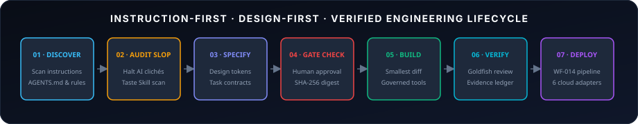
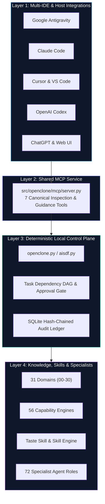

```mermaid
flowchart LR
    D1["01 · DISCOVER<br/><small>Scan instructions & AGENTS.md</small>"] --> D2["02 · AUDIT SLOP<br/><small>Taste Skill anti-slop gate</small>"]
    D2 --> D3["03 · SPECIFY<br/><small>Tokens, contracts, tests</small>"]
    D3 --> D4["04 · GATE CHECK<br/><small>Human approval & scope binding</small>"]
    D4 --> D5["05 · BUILD<br/><small>Smallest diff & governed tools</small>"]
    D5 --> D6["06 · VERIFY<br/><small>Goldfish review & evidence ledger</small>"]
    D6 --> D7["07 · DEPLOY<br/><small>WF-014 cloud pipeline</small>"]

    style D1 fill:#0f172a,stroke:#38bdf8,stroke-width:2px,color:#f8fafc
    style D2 fill:#0f172a,stroke:#f59e0b,stroke-width:2px,color:#f8fafc
    style D3 fill:#0f172a,stroke:#818cf8,stroke-width:2px,color:#f8fafc
    style D4 fill:#0f172a,stroke:#ef4444,stroke-width:2px,color:#f8fafc
    style D5 fill:#0f172a,stroke:#10b981,stroke-width:2px,color:#f8fafc
    style D6 fill:#0f172a,stroke:#06b6d4,stroke-width:2px,color:#f8fafc
    style D7 fill:#0f172a,stroke:#a855f7,stroke-width:2px,color:#f8fafc
```

<p align="center">
  
</p>

<p align="center">
  <a href="https://github.com/MK-1603/OpenClone/releases" title="Version 1.0.0"></a>
  &nbsp;
  <a href="https://python.org"></a>
  &nbsp;
  <a href="LICENSE"></a>
  &nbsp;
  <a href="tests/"></a>
  &nbsp;
  <a href="security/scanners.lock.json"></a>
  &nbsp;
  <a href="adapters/INTEGRATION-MATRIX.md"></a>
</p>

<p align="center">
  <strong>Provider-Neutral · IDE-Independent · Deterministic Engineering Standard · Anti-AI-Slop Governance</strong><br />
  <em>Build with Any AI. Governed by One Engineering Standard. (OpenClone v2.2.0 · AISDF Standard 1.0.0)</em>
</p>

<p align="center">
  <a href="#quick-start--use-openclone-in-5-steps">Quick Start</a> ·
  <a href="#how-openclone-works">How It Works</a> ·
  <a href="#do-i-need-to-clone-openclone">Do I Need to Clone?</a> ·
  <a href="#what-openclone-generates">Generated Package</a> ·
  <a href="#choose-your-ai-tools">AI Tools & IDEs</a> ·
  <a href="#the-instruction-first-engineering-lifecycle">Lifecycle</a> ·
  <a href="#anti-ai-slop-governance-taste-skill-v260">Anti-Slop UX</a> ·
  <a href="#security-and-quality-workflow">Security & QA</a> ·
  <a href="blueprints/README.md">31 Blueprints</a> ·
  <a href="#develop-openclone-maintainers--contributors-only">Maintainer Setup</a>
</p>

---

> ### Primary Call to Action: Start with your `PROJECT.md`
> **OpenClone is a portable, instruction-first software engineering framework.** It turns an initial project specification or brief into an implementation-ready, fully verified project package for your preferred AI coding IDE.
> 
> Use **ChatGPT** or **Claude** to clarify, stress-test, and plan the project, then provide the generated instruction package to your **AI Coding IDE** (Google Antigravity, Claude Code, Cursor, OpenAI Codex) to inspect, build, test, secure, and deliver your application.
> 
> 👉 **[Jump directly to the 5-Step Quick Start](#quick-start--use-openclone-in-5-steps)**

---

## What is OpenClone?

**OpenClone** (canonical framework standard: **AISDF** — AI Software Development Framework) provides a rigorous, universal engineering operating system that decouples **engineering governance** from **underlying AI models and IDEs**.

Modern generative AI synthesizes code with remarkable speed. However, real-world software engineering is not raw text synthesis: it demands rigorous problem discovery, immutable functional requirements, defensive security baselines, reproducible automated tests, dependency-ordered rollouts, and independent release verification.

Without a unifying engineering standard, AI-assisted development suffers from **AI Slope**:
- Hallucinated test passes and unverified completion claims.
- Scope creep and unprompted wholesale refactors.
- Unmonitored lateral tool privileges and secret leakage.
- Generic "AI slop" front-ends: repetitive purple gradients, ambient blur blobs, and meaningless badges.
- Catastrophic context loss when AI chats reset.

**OpenClone fixes this by establishing an Instruction-First, Design-First, Verified Engineering standard.** Whether work is planned in ChatGPT or Claude and executed in Antigravity, Claude Code, Cursor, or Codex, every milestone conforms to measurable criteria and verifiable evidence.

---

## How OpenClone Works

OpenClone organizes software delivery into a clean, decoupled pipeline:

```text
                 YOUR PROJECT IDEA
                        |
                        v
                  PROJECT.md
                        |
                        v
                CHATGPT OR CLAUDE
             Analyze • Clarify • Improve
                        |
                        v
             PORTABLE PROJECT PACKAGE
          Specification • Plan • Prompts
           Acceptance • Security • Handoff
                        |
                        v
              YOUR CHOSEN AI IDE
        Antigravity / Claude Code / Codex /
         Cursor / Other verified IDE agent
                        |
                        v
               YOUR PROJECT REPOSITORY
        Inspect • Implement • Test • Secure
             Verify • Document • Deliver
```

### Responsibility Boundaries

| Component | Responsibility |
|---|---|
| **OpenClone Framework** | Supplies engineering workflow (`WF-015`), quality standards, anti-slop rules, schemas, and portable templates. |
| **ChatGPT or Claude** | Acts as the Project Intelligence Architect. Analyzes `PROJECT.md`, clarifies ambiguities, and generates the complete portable project package. |
| **Portable Project Package** | Lives directly inside your project repository. Carries approved requirements, execution plan, safety constraints, and acceptance criteria. |
| **AI Coding IDE** | Inspects your real application repository and executes implementation, automated testing, static scanning, and verification. |
| **Human Engineer (You)** | Holds final authority. Approves material scope, architectural choices, security risk waivers, paid services, and releases. |

> ⚠️ **Critical Distinction:** ChatGPT and Claude cannot inspect your local filesystem or git repository unless you upload files or connect an authorized path. The AI coding IDE (Antigravity, Claude Code, Cursor, Codex) runs locally in your workspace and must inspect the real repository before writing code.

---

## Do I Need to Clone OpenClone?

### **NO. You do NOT need to clone or install the OpenClone repository to use the PROJECT.md-first workflow.**

- You **do not** need to `git clone` OpenClone to build software applications.
- You **do not** need to install OpenClone into your application's `package.json` or `requirements.txt`.
- You **do not** need to run a local daemon, server, or database to use OpenClone's engineering methodology.

The OpenClone project package is **100% portable and self-contained**. You copy or download the master prompt, run it in ChatGPT or Claude, and place the resulting markdown files directly into your own project directory.

*(Cloning OpenClone is only relevant if you want to develop OpenClone itself, run its internal test suite, or host the optional local SQLite control plane. See [Maintainer Setup](#develop-openclone-maintainers--contributors-only) below.)*

---

## Quick Start — Use OpenClone in 5 Steps

### Step 1 — Prepare your `PROJECT.md`
Create a `PROJECT.md` file in your project folder (or use our [PROJECT.template.md](templates/PROJECT.template.md)). Describe:
- The core problem solved and primary users.
- In-scope features and capabilities.
- Preferred technology stack (languages, frameworks, database).
- Any specific constraints, deadlines, or security requirements.

*(Your initial draft does not need to be exhaustive; the analysis stage will systematically identify gaps.)*

### Step 2 — Open ChatGPT or Claude
1. Open a conversation in [ChatGPT](https://chatgpt.com) or [Claude](https://claude.ai).
2. Copy and paste the **[OpenClone Portable Project Intelligence Master Prompt](prompts/PORTABLE-PROJECT-INTELLIGENCE-MASTER-PROMPT.md)**.
3. Paste or attach your `PROJECT.md` (or rough project description).

### Step 3 — Clarify and Approve
- The AI assistant acts as a Principal Architect: it conducts a gap and feasibility analysis.
- It asks 3–5 targeted, high-priority clarification questions (e.g. auth providers, data retention, deployment target).
- Confirm your choices. Assumptions are kept distinct from approved facts.

### Step 4 — Generate the Portable Project Package
The assistant generates 6 self-contained markdown documents. Save them directly into your project repository:
1. `PROJECT.md` — Normalized specification with stable requirement IDs (`FR-001`, `NFR-001`, `SEC-001`, `UX-001`).
2. `BUILD_PROMPT.md` — The master build prompt to supply to your coding IDE agent.
3. `AGENT_INSTRUCTIONS.md` — Project-level engineering rules, least privilege, and anti-slop constraints.
4. `IMPLEMENTATION_PLAN.md` — Phased roadmap broken into dependency-ordered milestones (M1–M6).
5. `SECURITY_PLAN.md` — Threat model, secret hygiene, dependency scanner locks, and dynamic testing boundaries.
6. `ACCEPTANCE_MATRIX.md` — Verification matrix linking requirements directly to automated tests and evidence logs.

### Step 5 — Build in Your AI Coding IDE
1. Open your project folder in your chosen AI coding IDE:
   - **Google Antigravity**
   - **Claude Code** (`claude` in your terminal)
   - **Cursor**
   - **OpenAI Codex**
2. Paste the contents of `BUILD_PROMPT.md` into the IDE agent chat.
3. The IDE agent:
   - Inspects your real codebase, existing files, and Git status before making changes.
   - Implements vertical slices milestone by milestone.
   - Runs automated unit and integration tests after every modification.
   - Maintains `PROGRESS.md` and `HANDOFF.md` to ensure state is never lost.
4. Review the final diff, verify test evidence in `ACCEPTANCE_MATRIX.md`, and ship with confidence.

---

## What You Need

To use OpenClone's primary workflow, you only need:
1. **A Planning Assistant:** An account on [ChatGPT](https://chatgpt.com) or [Claude](https://claude.ai).
2. **An AI Coding IDE or CLI:** Any modern AI coding environment installed on your machine (Google Antigravity, Claude Code, Cursor, or OpenAI Codex).
3. **Your Project Folder:** An existing or new Git repository for your application.

---

## What OpenClone Generates

The generated package is modular and tailored to project complexity:

| Generated File | Primary Purpose | Required For |
|---|---|---|
| **`PROJECT.md`** | Canonical product, functional, data, and technical requirements with stable IDs. | All projects |
| **`BUILD_PROMPT.md`** | Master execution instructions provided directly to the AI coding IDE agent. | All projects |
| **`AGENT_INSTRUCTIONS.md`** | Operating rules, file allowlists, safety constraints, and coding standards. | All projects |
| **`IMPLEMENTATION_PLAN.md`** | Phased milestone roadmap with testable vertical slices and dependency DAG. | All projects |
| **`ACCEPTANCE_MATRIX.md`** | Requirements mapped to automated test cases, verification commands, and evidence. | All projects |
| **`SECURITY_PLAN.md`** | Threat modeling (STRIDE), secrets management, and scanner baselines. | Software with security scope |
| **`PROGRESS.md`** | Real-time milestone tracker, active task log, and blocker register. | Multi-task projects |
| **`HANDOFF.md`** | Inter-session continuity protocol ensuring safe resumption across context resets. | Multi-session projects |
| **`ARCHITECTURE.md`** | Component topology, data flow diagrams, and interface boundaries. | Medium-to-large systems |
| **`DECISIONS.md`** | Architectural Decision Records (ADRs) documenting trade-offs and rationale. | Architectural changes |

---

## Choose Your AI Tools

OpenClone is completely provider-neutral. It works seamlessly across leading AI models, tools, and IDEs:

### 1. Planning & Specification Assistants
- **ChatGPT (GPT-4o, o1, o3-mini):** `TESTED & VERIFIED` — Excels at requirements extraction, feasibility audits, and specification packages.
- **Claude (Claude 3.5 Sonnet, Claude 3.7 Sonnet):** `TESTED & VERIFIED` — Exceptional architectural depth, security modeling, and nuanced prompt synthesis.

### 2. AI Coding IDEs & CLI Agents
- **Google Antigravity:** `VERIFIED NATIVE` — Auto-discovery via plugin, native workspace rules, full terminal sandbox integration.
- **Claude Code CLI:** `VERIFIED NATIVE` — Direct terminal workflow via `.mcp.json` or standalone prompt execution.
- **Cursor Composer:** `VERIFIED NATIVE` — Integration via `.cursorrules` and `.cursor/mcp.json`.
- **OpenAI Codex:** `VERIFIED NATIVE` — Direct workspace integration via `mcp.json`.
- **Qwen Code / Kiro:** `COMPATIBLE DOCUMENTED` — Standardized markdown instruction execution.

### 3. Model Gateways & Providers
- **Direct Providers:** Anthropic, OpenAI, Google Gemini, DeepSeek.
- **Unified Routers:** Evaluated across LiteLLM, OpenRouter, Portkey, and Cloudflare AI Gateway ([Router Comparison](docs/integrations/llm-router-comparison.md)).

---

## The Instruction-First Engineering Lifecycle

OpenClone halts low-quality AI code generation by enforcing a strict seven-phase deterministic lifecycle:

<p align="center">
  
</p>



1. **01 · DISCOVER:** Automatically scans repository context, project guidelines, and inherited rules (`AGENTS.md`, `CLAUDE.md`, `.cursorrules`).
2. **02 · AUDIT SLOP:** Evaluates UI against Taste Skill v2.6.0 anti-slop rules; halts decorative clichés, purple gradients, and floating blur blobs.
3. **03 · SPECIFY:** Establishes testable acceptance criteria (Given/When/Then), design tokens, and structured task contracts.
4. **04 · GATE CHECK:** Binds human approvals cryptographically to the specification. Any scope change invalidates approval.
5. **05 · BUILD:** Executes changes within bounded permissions, output redaction, and strict file allow-lists.
6. **06 · VERIFY:** Enforces independent code review in an isolated, clean context ("Goldfish" protocol) with evidence logging.
7. **07 · DEPLOY:** Manages the user application build-to-deployment pipeline (`WF-014`) across 6 cloud platforms with 21 non-reentrant lifecycle states.

---

## Anti-AI-Slop Governance (Taste Skill v2.6.0)

OpenClone integrates **Taste Skill v2.6.0** ([`skills/taste-skill/`](skills/taste-skill/)) as its standard for front-end visual engineering. It directly eliminates the generic "AI aesthetic" by mandating an **Instruction-First, Context-First, Design-First, Code-Second** lifecycle:

- **Static Slop Scanner (`audit-slop.mjs`):** Detects decorative glassmorphism, ambient background blur blobs, neon glows, purple/indigo gradients, and redundant card grids.
- **Pre-Build Gate (`plan-check.mjs`):** Blocks code generation until `.taste-skill/design-plan.md` passes validation (`GATE: READY`), scaling from Level 1 micro-fixes to Level 5 full products.
- **UI/UX Quality Audit Protocol (11 Dimensions, 100 Points):** Evaluates frontend implementation against the weighted scoring rubric in [`docs/knowledge/ui-ux-quality-audit.md`](docs/knowledge/ui-ux-quality-audit.md), requiring a passing score >= 85/100 to eliminate the "80–90% AI finish" trap.
- **The 6-Stage Premium Design Protocol:**
  1. *Understand:* Extract core utility and layout constraints from `PROJECT.md`.
  2. *Art Direction:* Select 1 of 86 visual directions from [`docs/knowledge/ui-ux-design-catalogue.md`](docs/knowledge/ui-ux-design-catalogue.md).
  3. *Tokens:* Define 7-token color, typography, radius, and elevation contracts.
  4. *Vertical Slice:* Build 1 core interactive component supporting all 9 states (default, hover, focus-visible, active, disabled, loading skeleton, empty, error, selected).
  5. *Multi-Viewport Critique:* Test at 360px mobile, 768px tablet, and 1440px desktop.
  6. *Polish:* Add physical spring easing (cubic-bezier) and reduce-motion support ([Motion Standards](docs/knowledge/motion-and-animation.md)).
- **Design-Skill Precedence Hierarchy:** Resolves conflicts deterministically: `PROJECT.md` -> Visual Extraction (`design-md-chrome`) -> Art Direction (`taste-skill`) -> Component Primitives (`shadcn/ui`) -> Typography (`typography-standards`) -> Usability Critique (`hallmark`/`impeccable`) -> Accessibility Verification (`a11y`).
- **User-Choice Aesthetics Supported ([Design Patterns Guide](domains/05-UX-UI-ENGINEERING/USER-CHOICE-DESIGN-PATTERNS.md)):** When explicitly requested, provides complete design tokens and WCAG 2.2 AA backing scrims for:
  - **Glassmorphism:** Frosted translucent surfaces with high-contrast backing scrims (`rgba(15,23,42,0.85)`).
  - **UI Morphism / Neumorphism:** Dual-source soft bevel lighting with tactile inset active states.
  - **Swiss International Style:** Asymmetric grid layout, Inter/Akzidenz-Grotesk typography, high-contrast monochrome.
  - **Industrial Brutalism:** Monospaced type, exposed borders, stark geometry, zero decorative fluff.

---

## Deterministic Skill Discovery & Execution Engine

OpenClone features an active skill discovery, selection, loading, and application engine (`tools/skill_engine.py` & `src/openclone/skills/engine.py`) that solves why skills are routinely ignored by AI agents:

```mermaid
flowchart LR
    S1["1. Register<br/><small>Metadata & Triggers</small>"] --> S2["2. Match<br/><small>Domain & Tech Stack</small>"]
    S2 --> S3["3. Negative Filter<br/><small>Strip Inapplicable</small>"]
    S3 --> S4["4. Precedence Sort<br/><small>Rank by Priority</small>"]
    S4 --> S5["5. Context Injection<br/><small>Load Prompt Snippets</small>"]
    S5 --> S6["6. Verification<br/><small>Audit Application Evidence</small>"]

    style S1 fill:#0f172a,stroke:#38bdf8,stroke-width:1px,color:#f8fafc
    style S2 fill:#0f172a,stroke:#818cf8,stroke-width:1px,color:#f8fafc
    style S3 fill:#0f172a,stroke:#ef4444,stroke-width:1px,color:#f8fafc
    style S4 fill:#0f172a,stroke:#f59e0b,stroke-width:1px,color:#f8fafc
    style S5 fill:#0f172a,stroke:#10b981,stroke-width:1px,color:#f8fafc
    style S6 fill:#0f172a,stroke:#a855f7,stroke-width:1px,color:#f8fafc
```



### CLI Skill Diagnostics
- **List Registered Skills:** `python tools/skill_engine.py list`
- **Context-Aware Skill Selection:** `python tools/skill_engine.py select --domain ui-design --tech react --features "dashboard, charts"`
- **Generate Selection & Application Reports:** `python tools/skill_engine.py report --project-path .`
- **Verify Registry Integrity:** `python tools/skill_engine.py verify`

---

## Security & Quality Workflow

OpenClone enforces risk-based defensive engineering across the entire software development lifecycle:

1. **Threat Modeling & Data-Flow Review:** Categorizes risks using STRIDE before architectural sign-off.
2. **19-Point SaaS Security Baseline ([Checklist](docs/security/saas-security-baseline.md)):** Strict pre-deployment security verification covering authentication (argon2id/bcrypt), RBAC/ABAC authorization, tenant row-level security, CSRF protection, cryptographic rate limiting, TLS 1.3, input sanitization, and tamper-evident audit logging.
3. **27 External Repositories Intake Audit ([Audit Matrix](docs/integrations/27-repositories-audit.md)):** Complete forensic assessment and integration model for 11 UI/UX, 12 Security, and 4 Development external repositories with clear licensing and isolation boundaries.
4. **Dependency & Secret Locks:** Fully pins 12 security scanners in `security/scanners.lock.json` and prevents secrets from leaking into logs or git commits.
5. **Static Security Analysis (SAST):** Scans for SQL injection, XSS, SSRF, and privilege escalation.
6. **Dynamic Penetration Testing (Strix Integration):**
   - *Optional & Strictly Bounded:* Used only when explicitly authorized in writing by the project owner.
   - Documented in [`docs/integrations/strix-dynamic-testing.md`](docs/integrations/strix-dynamic-testing.md) with strict target allowlists and Docker isolation.
   - Finding-to-remediation retest protocol: every confirmed vulnerability requires a test case proving its elimination before release.
7. **Release Gate:** Evaluates all automated checks and blocks deployment if any high/critical finding remains unaddressed.

---

## Global Knowledge Catalogues & Design Standards

OpenClone indexes comprehensive engineering standards and taxonomies across 5 knowledge documents:

| Catalogue | Scope | Taxonomy & Standards |
|---|---|---|
| **[UI/UX Design Catalogue](docs/knowledge/ui-ux-design-catalogue.md)** | Visual Styling & UI Taxonomy | 86 visual styles, 232 architecture taxonomy entries across 8 layers, component tokens, and CSS variables. |
| **[UI/UX Quality Audit](docs/knowledge/ui-ux-quality-audit.md)** | Quality Evaluation & Protocol | 11-dimension 100-point weighted quality audit and 6-stage premium design protocol. |
| **[Motion & Animation Standards](docs/knowledge/motion-and-animation.md)** | Animation & Micro-Interactions | Duration tokens (50ms–500ms), physics-based cubic-bezier easing curves, 60fps GPU compositor rules, and reduced motion. |
| **[Backend & System Design Catalogue](docs/knowledge/backend-system-design-catalogue.md)** | Production Backend Architecture | 580 topics across 23 core engineering domains (API protocols, databases, queuing, caching, observability). |
| **[AI Engineering & Context Catalogue](docs/knowledge/ai-engineering-catalogue.md)** | Model & Context Management | 1,095 topics across 18 domains (LLM routing, token optimization, prompt engineering, RAG, tool calling). |

---

## Session Continuity: The Goldfish Protocol

AI coding agents suffer from catastrophic amnesia when context windows reset or conversations get long. OpenClone solves this with **durable filesystem state**:

- **`PROGRESS.md` ([Template](templates/PROGRESS.template.md)):** Tracks milestone completion, active tasks, and open blockers. The file is updated after every successful task.
- **`HANDOFF.md` ([Template](templates/HANDOFF.template.md)):** When a session ends or context limits approach, the departing agent logs exact git commits, modified files, passing tests, and the exact next action.
- **The Goldfish Protocol:** Incoming AI agents in new sessions do not rely on chat memory. They perform a mandatory pre-flight check:
  1. Inspect `git status --short` and `git log -3`.
  2. Read `HANDOFF.md` and `PROGRESS.md`.
  3. Run existing automated tests to verify the baseline before touching a single line of code.

---

## Architectural Topology

For environments utilizing the optional local control plane, OpenClone decouples governance into 4 distinct layers:

<p align="center">
  
</p>



- **Layer 1: Multi-IDE & Chatbot Host Integrations:** Native plugins and configurations for Antigravity, Claude Code, Cursor, Codex, and ChatGPT.
- **Layer 2: Shared MCP Service (`src/openclone/mcp/server.py`):** JSON-RPC 2.0 stdio/SSE server exposing 7 canonical inspection and guidance tools.
- **Layer 3: Deterministic Local Control Plane (`openclone.py`):** Cycle-free task DAG, SHA-256 approval binding, and hash-chained SQLite ledger.
- **Layer 4: Knowledge Repository & Specialist Workforce:** 31 engineering domains, 56 capability engines, 15 executable workflows, and 72 specialist roles.

---

## The 31 Engineering Domains

OpenClone consolidates the entire discipline of software engineering into 31 standardized domains under [`domains/`](domains/):

| Domain | Area | Key Capabilities |
|---|---|---|
| **[00 · Governance](domains/00-GOVERNANCE/)** | Standards | Rulebook, precedence rules, human authority boundaries, tamper-evident audit standards. |
| **[01 · Methodology](domains/01-METHODOLOGY/)** | Process | Engineering methodologies, task lifecycle, and the venture-scale MK Framework. |
| **[02 · Project Intelligence](domains/02-PROJECT-INTELLIGENCE/)** | Discovery | Project profiling, source-of-truth ingestion, brownfield repository scanning. |
| **[03 · Requirements](domains/03-REQUIREMENTS-ENGINEERING/)** | Specs | Feature inventory, user stories, boundary definition, acceptance criteria contracts. |
| **[04 · Product](domains/04-PRODUCT-ENGINEERING/)** | Strategy | Roadmap phasing, user journeys, value metric mapping, feature prioritization. |
| **[05 · UX/UI Engineering](domains/05-UX-UI-ENGINEERING/)** | Design | Design systems, information architecture, WCAG 2.2 accessibility, Taste Skill. |
| **[06 · Tech Intelligence](domains/06-TECHNOLOGY-INTELLIGENCE/)** | Stack | Tech stack selection matrices, framework deprecation tracking, ecosystem audits. |
| **[07 · Knowledge & Memory](domains/07-ENGINEERING-KNOWLEDGE/)** | Memory | Persistent memory architecture, decision logs (ADRs), lesson capture, AKIS engine. |
| **[08 · Architecture](domains/08-SOFTWARE-ARCHITECTURE/)** | Systems | Component topologies, modular boundaries, cross-cutting concerns, data contracts. |
| **[09 · Platform](domains/09-PLATFORM-ENGINEERING/)** | Tooling | Internal developer platforms, build tools, packaging, dependency management. |
| **[10 · AI & Models](domains/10-AI-AND-MODEL-ENGINEERING/)** | ML/LLM | Prompt engineering, evaluation harnesses, fine-tuning specs, RAG architectures. |
| **[11 · Agent Engineering](domains/11-AGENT-ENGINEERING/)** | Agents | Agent lifecycle, subagent delegation constraints, tool use protocols, loop protection. |
| **[12 · Orchestration](domains/12-ORCHESTRATION-AND-CONTEXT/)** | Context | Task DAG generation, context window optimization, session handoff serialization. |
| **[13 · Execution Control](domains/13-HARNESS-AND-EXECUTION/)** | Sandbox | Local execution control, command allowlisting, stdout/stderr redaction, timeouts. |
| **[14 · Security & Privacy](domains/14-SECURITY-AND-PRIVACY/)** | Security | Threat modeling (STRIDE), static scanning lock, secrets hygiene, GDPR baselines. |
| **[15 · Data & Database](domains/15-DATA-AND-DATABASE-ENGINEERING/)** | Storage | Relational/NoSQL schemas, migration rollback scripts, transaction boundaries. |
| **[16 · APIs & Integration](domains/16-API-AND-INTEGRATION-ENGINEERING/)** | APIs | REST, GraphQL, gRPC contracts, OpenAPI specs, idempotency keys, rate limits. |
| **[17 · Testing & QA](domains/17-TESTING-AND-VERIFICATION/)** | Testing | Test pyramid specs, unit, integration, mutation, property-based testing suites. |
| **[18 · DevOps & Cloud](domains/18-DEVOPS-AND-CLOUD-ENGINEERING/)** | Infra | Infrastructure-as-Code (Terraform), container specs, GitOps deployment manifests. |
| **[19 · Deployment](domains/19-DEPLOYMENT-AND-OPERATIONS/)** | Releases | Application build-to-deploy engine (`WF-014`), 6 cloud adapters, zero-downtime rollouts. |
| **[20 · Reliability](domains/20-RELIABILITY-AND-OBSERVABILITY/)** | SRE | SLI/SLO definitions, structured logging, distributed tracing, alerting runbooks. |
| **[21 · Distributed Systems](domains/21-DISTRIBUTED-SYSTEMS-AND-SCALABILITY/)** | Scale | Consensus protocols, event-driven architectures, partitioning, caching topologies. |
| **[22 · Cost Governance](domains/22-COST-AND-RESOURCE-GOVERNANCE/)** | FinOps | Cloud finops, token budget consumption, compute limits, idle resource reclamation. |
| **[23 · Legal & Compliance](domains/23-LEGAL-AND-COMPLIANCE/)** | Legal | Open-source license attribution, intellectual property, regulatory compliance. |
| **[24 · Analytics & Support](domains/24-PRODUCT-ANALYTICS-AND-SUPPORT/)** | Analytics | Telemetry schemas, funnel metrics, customer feedback loops, incident post-mortems. |
| **[25 · Maintenance](domains/25-FRAMEWORK-MAINTENANCE/)** | Hygiene | Continuous hygiene, deprecation policy, schema migration, framework self-upgrades. |
| **[26 · Extensions](domains/26-DISTRIBUTION-AND-EXTENSIONS/)** | Plugins | Plugin packaging, SDK publishing, package manager distribution, extensions. |
| **[27 · Standards](domains/27-STANDARDS-AND-COMPATIBILITY/)** | Standards | Cross-IDE compatibility matrices, language style guides, protocol conformance. |
| **[28 · Templates](domains/28-TEMPLATES-AND-EXAMPLES/)** | Blueprints | Canonical template libraries, starter packs, reference project implementations. |
| **[29 · Benchmarks](domains/29-BENCHMARKS-AND-EVALUATION/)** | Evals | Deterministic benchmarks, LLM code eval harnesses, regression tracking. |
| **[30 · Agent Rules](domains/30-AGENT-RULES-AND-VERIFICATION/)** | Rules | Machine-readable rule engines, permission evaluators, verification hooks. |

---

## 15 Executable Workflows

OpenClone provides 15 structured workflows under [`workflows/`](workflows/):

- [`WF-001: New Project from Document`](workflows/WF-001-NEW-PROJECT-FROM-DOCUMENT.md) — Greenfield bootstrap from brief to verified architecture, tasks, and initial milestone.
- [`WF-002: Existing Project X-Ray`](workflows/WF-002-EXISTING-PROJECT-XRAY.md) — Comprehensive brownfield audit, mapping dependencies, tech debt, and security gaps.
- [`WF-003: Work Unit Handoff`](workflows/WF-003-WORK-UNIT-HANDOFF.md) — Protocol for transferring assignment, context, and evidence between specialist roles.
- [`WF-004: Quality & Release Gate`](workflows/WF-004-QUALITY-AND-RELEASE-GATE.md) — Multi-tier gating protocol enforcing test passage, scanner clearance, and human sign-off.
- [`WF-005: Security Assurance`](workflows/WF-005-SECURITY-ASSURANCE.md) — Continuous threat modeling, static security analysis, dependency vulnerability locks.
- [`WF-006: Persistent Memory Lifecycle`](workflows/WF-006-PERSISTENT-MEMORY-LIFECYCLE.md) — Capturing, validating, and recalling durable engineering knowledge.
- [`WF-007: Concept Challenge`](workflows/WF-007-CONCEPT-CHALLENGE.md) — Pre-implementation dialectic stress-testing of technical decisions.
- [`WF-008: Sectional Spec Draft`](workflows/WF-008-SECTIONAL-SPEC-DRAFT.md) — Standardized authoring of modular, implementation-grade specifications.
- [`WF-009: Independent Design Review`](workflows/WF-009-INDEPENDENT-DESIGN-REVIEW.md) — Clean-context architectural and security critique (Goldfish protocol).
- [`WF-010: Review Finding Resolution`](workflows/WF-010-REVIEW-FINDING-RESOLUTION.md) — Tracking, fixing, verifying, or obtaining authorized human risk waivers.
- [`WF-011: Codebase Context Bootstrap`](workflows/WF-011-CODEBASE-CONTEXT-BOOTSTRAP.md) — Rapid, bounded ingestion and structural indexing of active repositories.
- [`WF-012: Specification Drift Report`](workflows/WF-012-SPECIFICATION-DRIFT-REPORT.md) — Real-time comparison between working-tree git changes and approved specifications.
- [`WF-013: Project Definition & Assessment`](workflows/WF-013-PROJECT-DEFINITION-ASSESSMENT-AND-IMPLEMENTATION-PLANNING.md) — End-to-end orchestration uniting `PROJECT.md`, task planning, and evidence validation.
- [`WF-014: Application Build to Deployment`](workflows/WF-014-APPLICATION-BUILD-TO-DEPLOYMENT.md) — 7-phase build, preview verification, human approval gating, and production deployment across 6 cloud platforms.
- [`WF-015: Portable Project Specification to Build`](workflows/WF-015-PORTABLE-PROJECT-SPECIFICATION-TO-BUILD.md) — **Zero-install portable workflow** executing delivery from a single `PROJECT.md` in any AI IDE.

---

## Verified Capability Maturity Matrix

In strict adherence to OpenClone truthfulness standards, every capability's maturity is transparently disclosed:

| Capability / Subsystem | Maturity Status | Evidence & Test Verification |
|---|---|---|
| **Portable Specification Workflow (`WF-015`)** | `VERIFIED_IMPLEMENTED` | Tested in `test_mcp_server.py`, documented in `workflows/WF-015-PORTABLE-PROJECT-SPECIFICATION-TO-BUILD.md`. |
| **Portable Templates Package** | `VERIFIED_IMPLEMENTED` | Canonical markdown templates for `PROJECT.md`, `BUILD_PROMPT.md`, `ACCEPTANCE_MATRIX.md`, `PROGRESS.md`, `HANDOFF.md` in `templates/`. |
| **Taste Skill v2.6.0 (Anti-Slop UX)** | `VERIFIED_IMPLEMENTED` | 13 automated tests passing in `skills/taste-skill/tests/test-governance.mjs`. |
| **31 Engineering Domains** | `VERIFIED_DOCUMENTED` | 31 directories with standards and contracts in `domains/`. |
| **56 Capability Engines** | `VERIFIED_DOCUMENTED` | Validated by `tools/validate_repository.py`. |
| **15 Executable Workflows** | `VERIFIED_DOCUMENTED` | Documented in `workflows/` (WF-001 through WF-015). |
| **72 Specialist Roles** | `VERIFIED_DOCUMENTED` | 72 JSON manifests verified against schema in `test_workforce_registry.py`. |
| **12 Pinned Security Scanners** | `PINNED & LOCKED` | Hashes locked in `security/scanners.lock.json`, contracts in `docs/integrations/security-toolchain.md`. |
| **Deterministic Local Runtime (`openclone.py`)** | `VERIFIED_IMPLEMENTED` | 63 unit tests passing in `tests/` covering DAG, ledger, human approvals, and execution. |
| **Shared MCP Server (`src/openclone/mcp/`)** | `VERIFIED_IMPLEMENTED` | JSON-RPC 2.0 stdio/SSE server verified with 7 canonical tools in `tests/test_mcp_server.py`. |
| **Multi-IDE Host Adapters** | `VERIFIED_IMPLEMENTED` | Native configs for Antigravity, Claude Code, Cursor, Codex in `adapters/`. |
| **Strix Dynamic Pentesting** | `SPECIFIED & BOUNDED` | Architecture, authorization allowlist, and Docker pre-flight in `docs/integrations/strix-dynamic-testing.md`. |
| **Kernel-Level OS Sandbox** | `NOT_INCLUDED` | OpenClone provides process isolation; production sandboxing requires Docker or VM. |
| **Proprietary Cloud Backend** | `NOT_INCLUDED` | OpenClone is designed as a local-first, self-hostable control plane with zero cloud dependencies. |

---

## Limitations & Responsibility Boundaries

1. **AI Agents Propose; Humans Decide:** AI coding agents cannot approve their own scope, delete production databases, or authorize security risk waivers. Human-in-the-loop sign-off is mandatory.
2. **Claims Require Observable Evidence:** A test is only considered passed if it was actually executed with an observable command, zero exit code, and captured output logs.
3. **No Magic Autonomous Codebase Inspection:** ChatGPT and Claude cannot see your local drive without file uploads. The IDE agent must inspect your real repository before modifying files.
4. **Third-Party Costs:** External LLM APIs, cloud hosting platforms, and security tools may incur separate usage costs.

---

## Develop OpenClone (Maintainers & Contributors Only)

> 💡 **Notice:** This section is **ONLY** for contributors developing OpenClone itself or running the local deterministic SQLite control plane. If you are building your own application, follow the **[5-Step Quick Start](#quick-start--use-openclone-in-5-steps)** instead!

### 1. Prerequisites
- Python 3.10 or higher
- Node.js 18+ (for Taste Skill governance tests)
- Git

### 2. Clone and Validate Repository
```bash
# Clone the repository
git clone https://github.com/MK-1603/OpenClone.git
cd OpenClone

# Run repository integrity checks
python tools/validate_repository.py

# Run complete Python test suite (63 unit tests)
python -m unittest discover -s tests -v

# Run Taste Skill anti-slop governance tests (13 tests)
node skills/taste-skill/tests/test-governance.mjs
```

### 3. Launch the Shared MCP Server
```bash
# Start OpenClone MCP server for IDEs
python openclone.py mcp
```

### 4. Initialize a Local Governed Workspace
```bash
# Initialize a governed workspace with cryptographic SQLite ledger
python openclone.py init --project ../my-app --name "My App" --owner "Lead Architect"
```

---

## License & Community

OpenClone is released under the **MIT License**. Contributions are welcome! Please read [CONTRIBUTING.md](CONTRIBUTING.md), [CODE_OF_CONDUCT.md](CODE_OF_CONDUCT.md), and [GOVERNANCE.md](GOVERNANCE.md) before submitting pull requests.

For attribution and licenses of referenced specifications, see [THIRD_PARTY_NOTICES.md](THIRD_PARTY_NOTICES.md).

<p align="center">
  <sub>OpenClone · Built with Any AI. Governed by One Engineering Standard.</sub>
</p>
