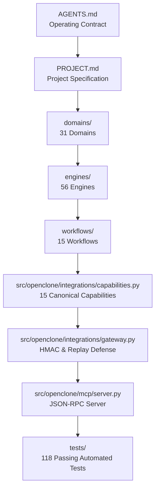

# OpenClone Dependency and Reference Map

**Document ID:** `MAP-DEPENDENCY-v2.0.0`  
**Status:** `VERIFIED REFERENCE MAP`  

---

## 1. Core Bidirectional Reference Map

## 2. Integrity Guarantees
- No broken markdown references in tracked documentation.
- All engine specifications (`E-001` to `E-056`) and workflows (`WF-001` to `WF-015`) are cross-referenced in manifests.
