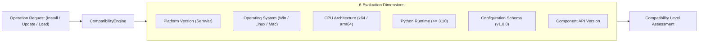

# Compatibility Architecture — OpenClone
## Multi-Dimensional Compatibility, Versioning & Migration Standards

**Canonical Package:** `openclone`  
**Primary CLI:** `openclone`  
**Legacy Alias:** `aisdf`  
**Version:** 1.0.0  
**Status:** `SPECIFIED & IN_IMPLEMENTATION`  

---

## 1. Overview & Compatibility Matrix

OpenClone implements a deterministic **Compatibility Engine** (`src/openclone/platform/compatibility/`) that evaluates operations across six independent dimensions before allowing installation, component activation, or updates:

---

## 2. Compatibility Levels

The engine evaluates operations into five explicit levels:

| Compatibility Level | Definition | Engine Action |
|---|---|---|
| **`FULLY_COMPATIBLE`** | All 6 dimensions match supported requirements. | Operation proceeds without restriction or warnings. |
| **`COMPATIBLE_WITH_MIGRATION`** | Target is compatible, but requires an automatic or approved schema/data migration. | Operation prompts for confirmation, creates a pre-migration backup, and applies migration. |
| **`COMPATIBLE_WITH_LIMITATIONS`** | Core engine is compatible, but optional features (e.g. ADB mobile lab) are unavailable due to missing host tools. | Operation proceeds with explicit capability limitation notice. |
| **`INCOMPATIBLE`** | Fundamental conflict (e.g. Python < 3.10, 32-bit architecture, major breaking API mismatch). | **Operation is safely blocked.** Rejects operation with clear remediation guidance. |
| **`UNKNOWN`** | Target manifest lacks required version or architecture metadata. | Operation requires explicit user override (`--force`) to proceed. |

---

## 3. Backward Compatibility & Migration Standards

1. **Package & Import Compatibility:**
   - Package name remains `openclone`.
   - Python code continues to `import openclone`.
   - Entry point remains `openclone` with `aisdf` legacy alias preserved.
2. **State Directory Compatibility:**
   - New initializations create `.openclone/`.
   - If an existing project contains `.aisdf/`, the runtime transparently reads from `.aisdf/` without breaking historical project data.
3. **Configuration Schema Migrations:**
   - Every configuration change is versioned (e.g. `v1.0.0` $\rightarrow$ `v1.1.0`).
   - If an older configuration schema is detected, the `ConfigurationManager` executes an idempotent migration function after snapshotting the previous configuration.
