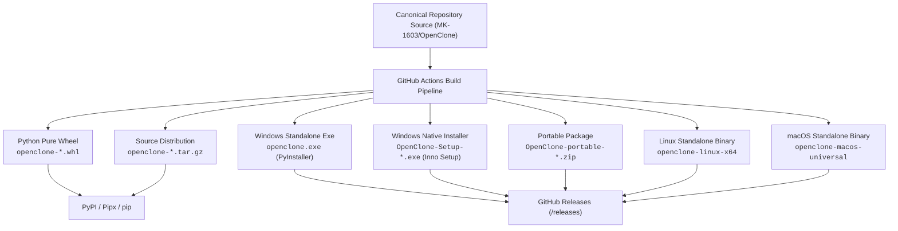

# Distribution Architecture — OpenClone
## Cross-Platform Distribution, Packaging & Build Infrastructure

**Canonical Package:** `openclone`  
**Primary CLI:** `openclone`  
**Legacy Alias:** `aisdf`  
**Version:** 1.0.0  
**Status:** `SPECIFIED & IN_IMPLEMENTATION`  

---

## 1. Distribution Ecosystem

OpenClone is engineered for cross-platform distribution across Windows, Linux, and macOS. The platform maintains strict separation between **packaging formats** and **runtime behavior**:

---

## 2. Artifact Specifications

| Target Platform | Distribution Format | Build Technology | Target Audience | Installation Footprint |
|---|---|---|---|---|
| **Universal (All OS)** | `.whl` (Wheel) | `python -m build --wheel` | Python developers, CI/CD, pipx | $\approx 300$ KB |
| **Universal (All OS)** | `.tar.gz` (Sdist) | `python -m build --sdist` | Package managers, source audit | $\approx 280$ KB |
| **Windows x64** | Standalone `.exe` | PyInstaller (`openclone.spec`) | Developers without Python | $\approx 18$ MB |
| **Windows x64** | Native Installer (`.exe`) | Inno Setup (`openclone_installer.iss`)| Desktop workstations, Start Menu | $\approx 19$ MB |
| **Windows x64** | Portable `.zip` | Build Script (`build_portable.py`) | Air-gapped, USB drives | $\approx 18$ MB |
| **Linux x64/arm64**| Standalone ELF binary | PyInstaller on Ubuntu runner | Linux servers, containers | $\approx 17$ MB |
| **macOS Universal** | Standalone Mach-O binary | PyInstaller on macOS runner | macOS workstations | $\approx 19$ MB |

---

## 3. Windows Native Packaging Details

### 3.1 PyInstaller Specification (`packaging/pyinstaller/openclone.spec`)
- **Entrypoint:** `src/openclone/cli.py:main`
- **Data Bundling:**
  - `src/openclone/templates/` $\rightarrow$ `openclone/templates/`
  - `src/openclone/workforce/registry/workers/` $\rightarrow$ `openclone/workforce/registry/workers/`
  - `framework/schemas/` $\rightarrow$ `framework/schemas/`
- **Hidden Imports:** Explicit inclusion of `sqlite3`, `json`, `argparse`, `pathlib`, `hashlib`, `urllib.request`.
- **Runtime Unpack:** Uses `sys._MEIPASS` during frozen execution with fallback to module parents.

### 3.2 Inno Setup Installer (`packaging/windows/openclone_installer.iss`)
- **Branding:** Displays OpenClone product identity, version 1.0.0, and MIT license.
- **Privilege Elevation:** `PrivilegesRequired=lowest` by default (installs to `%LOCALAPPDATA%\Programs\OpenClone` without UAC prompt); supports elevation if run as administrator.
- **Environment Integration:** Reversibly modifies `HKCU\Environment\Path` using defensive Pascal registry code that never truncates or duplicates existing PATH tokens.
- **Uninstaller:** Cleans all installed files, shortcuts, and registry entries.

---

## 4. Release Automation Pipeline (`.github/workflows/release.yml`)

The automated release workflow executes on tag push (`v*`):
1. **Validation Gate:** Runs 351 unit tests and verifies version parity between Git tag and package metadata.
2. **Package Build:** Builds pure Python wheel and source distribution.
3. **Multi-OS Matrix Smoke Tests:** Tests wheel installation and execution in clean temporary environments on Ubuntu, macOS, and Windows.
4. **Standalone Binary Builds:** Compiles native executables on their respective OS runners.
5. **Checksum & Manifest Generation:** Computes SHA-256 for all binaries and generates `release-manifest.json`.
6. **Publication:** Creates or refreshes the GitHub Release with attached binaries and publishes to PyPI via OIDC.
