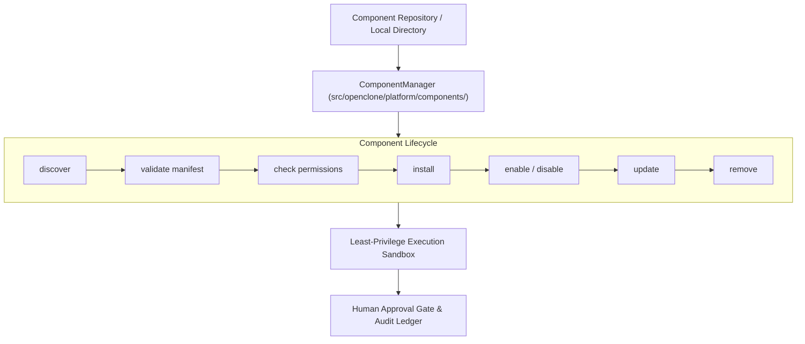

# Extension Architecture — OpenClone
## Component Manifest, Lifecycle & Sandboxing

**Canonical Package:** `openclone`  
**Primary CLI:** `openclone`  
**Legacy Alias:** `aisdf`  
**Version:** 1.0.0  
**Status:** `SPECIFIED & IN_IMPLEMENTATION`  

---

## 1. Overview & Objectives

OpenClone is architected for extensible growth without destabilizing the core platform. Optional components—such as specialist skills, MCP integrations, agent adapters, and workflow packs—are governed by a formal **Component Contract**:



---

## 2. Component Categories

1. **Engineering Skills (`skill`):** Reusable procedures, prompt templates, and domain analysis routines (e.g. Taste Skill anti-slop rules).
2. **MCP Tool Packs (`mcp-pack`):** External tool servers exposing JSON-RPC 2.0 tools to AI agents.
3. **Agent Adapters (`agent-adapter`):** Host-specific integration shims for Google Antigravity, Claude Code, Cursor, Codex.
4. **Workflow Packs (`workflow-pack`):** Declarative engineering workflow definitions (e.g. `WF-016-MOBILE-RELEASE`).
5. **Runtime Adapters (`runtime-adapter`):** Integration bridges to external execution engines (Docker, Podman, Firecracker).

---

## 3. Component Manifest Specification (`component.json`)

Every component must define a `component.json` manifest conforming to `framework/schemas/component-manifest.schema.json`:

```json
{
  "id": "openclone-mobile-lab",
  "name": "Mobile Device Testing & Compliance Lab",
  "version": "1.0.0",
  "publisher": "OpenClone Core",
  "description": "Sanitized ADB device testing and App Store compliance scanner",
  "category": "tool-pack",
  "min_platform_version": "1.0.0",
  "max_platform_version": null,
  "entrypoint": "mobile_lab.py",
  "permissions": [
    "filesystem:read:workspace",
    "subprocess:adb"
  ],
  "dependencies": []
}
```

---

## 4. Security & Isolation Boundaries

To prevent supply-chain compromises, the `ComponentManager` enforces:
1. **Pre-Execution Validation:** No downloaded component code is executed prior to manifest schema validation and hash verification.
2. **Permission Boundary:** Components must explicitly declare requested permissions (`filesystem:read`, `subprocess:exec`, `network:outbound`).
3. **Immutability of Governance:** Extensions are strictly prohibited from modifying core task state machines, auto-approving tasks, or bypassing human approval gates.
4. **Path Traversal Defense:** Extension package archives (`.tar.gz` / `.zip`) are validated during extraction to reject path traversal attacks (`../`).
