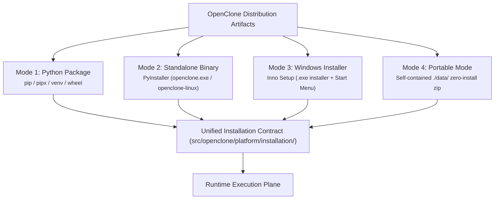

# Installation Architecture — OpenClone
## Multi-Mode Universal Installation System

**Canonical Package:** `openclone`  
**Primary CLI:** `openclone`  
**Legacy Alias:** `aisdf`  
**Version:** 1.0.0  
**Status:** `SPECIFIED & IN_IMPLEMENTATION`  

---

## 1. Overview & Installation Contracts

OpenClone supports multiple installation modes through a single, unified installation contract. Whether running as a Python package, a standalone single-file binary, a Windows native installer, or a zero-footprint portable application, OpenClone maintains identical CLI behavior, deterministic governance, and security boundaries.



---

## 2. Installation Modes

### 2.1 Mode 1: Python Package Installation (pip & pipx)
- **Target Audience:** Developers, CI/CD runners, and automated build pipelines.
- **Commands:**
  ```bash
  # Standard pip installation
  pip install openclone

  # Isolated CLI installation via pipx (recommended for developers)
  pipx install openclone

  # Editable local development installation
  pip install -e .[dev]
  ```
- **Requirements & Packaging Invariants:**
  - Build metadata defined in `pyproject.toml`.
  - Console scripts generate `openclone` and `aisdf` executable stubs in the Python `Scripts` directory.
  - Package data includes all templates (`src/openclone/templates/`) and worker contracts (`src/openclone/workforce/registry/workers/`).
  - Zero mandatory external runtime dependencies for core operations.

### 2.2 Mode 2: Standalone Binary (PyInstaller)
- **Target Audience:** Users without pre-installed Python environments or enterprise environments with locked-down Python installations.
- **Specification:**
  - Bundled using `packaging/pyinstaller/openclone.spec`.
  - Bundles an isolated, embedded Python interpreter and all frozen bytecodes into a single executable (`openclone.exe` on Windows, `openclone` on Linux/macOS).
  - Runtime resource resolution via `sys._MEIPASS` with fallback to `__file__` parents.
  - Startup time target: $< 350$ ms.
  - Exit codes: Strictly preserved from Python runtime (`0` for success, non-zero for failures).

### 2.3 Mode 3: Windows Native Installer (Inno Setup)
- **Target Audience:** Windows desktop developers and enterprise workstations.
- **Specification:**
  - Compiled using `packaging/windows/openclone_installer.iss`.
  - Supports both **Per-User Installation** (no administrator privileges required, installs to `%LOCALAPPDATA%\Programs\OpenClone`) and **System-Wide Installation** (`%ProgramFiles%\OpenClone`).
  - **PATH Integration:** Safely appends the installation folder to the user's `PATH` environment variable without truncating, duplicating, or overwriting existing entries.
  - **Start Menu & Shortcuts:** Registers OpenClone command prompt shortcut.
  - **Clean Uninstallation:** Completely removes installed binaries and PATH entries while preserving user configuration (`%APPDATA%\OpenClone`) and user projects.

### 2.4 Mode 4: Portable Mode
- **Target Audience:** USB drives, shared network drives, air-gapped environments, and temporary testing.
- **Specification:**
  - Triggered by `--portable` CLI flag or presence of a `./data/` directory adjacent to the binary.
  - User configuration routes to `./data/config.json`.
  - SQLite audit ledgers route to `./data/ledger.sqlite3`.
  - Temporary files route to `./data/tmp/`.
  - Zero writes to `%APPDATA%`, `~/.openclone`, or Windows registry.

---

## 3. Installation Detection & Inspection Matrix

The `InstallationManager` dynamically detects its active installation mode:

```python
from openclone.platform.installation.detector import detect_installation_mode

mode_info = detect_installation_mode()
print(mode_info.mode)           # e.g., 'python-pipx', 'standalone-binary', 'portable'
print(mode_info.executable)     # Full path to active binary
print(mode_info.is_portable)    # True/False
print(mode_info.is_writable)    # True/False
```

---

## 4. Uninstallation & Cleanup Rules

1. **Reversible PATH Changes:** Any PATH modification made by the native installer must be cleanly un-linked during uninstallation.
2. **User Data Protection:** User project directories, canonical `PROJECT.md` files, and custom audit ledgers are **never deleted** during uninstallation.
3. **Explicit User Prompting:** Uninstaller prompts whether to retain or purge user configuration (`~/.openclone/`).
