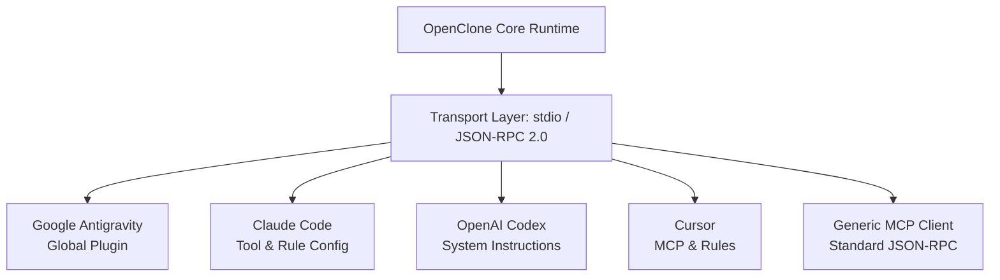
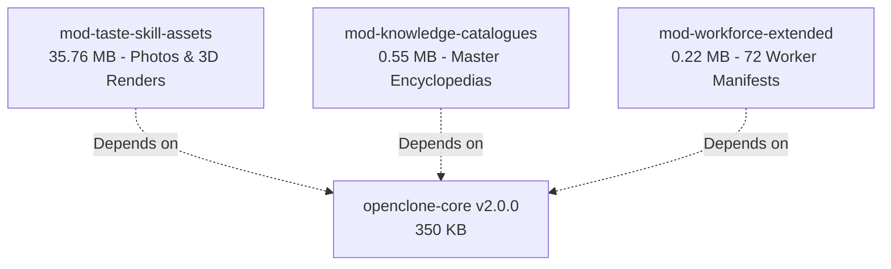
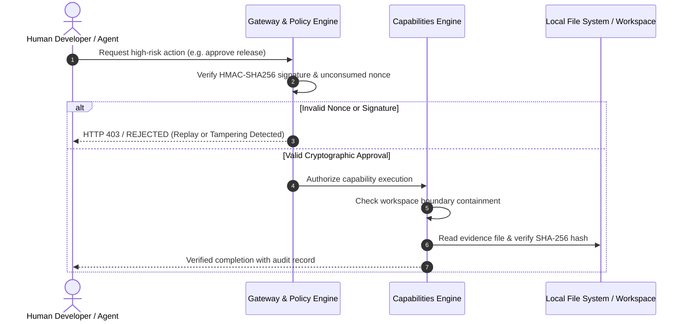

# OpenClone 2.0 Target System Architecture

**Document ID:** `ARCH-OC-2.0-SYSTEM-v2.0.0`  
**Product:** OpenClone 2.0 Universal AI Software Engineering Platform  
**Standard:** AISDF Standard 1.0.0 (Independently Versioned)  
**Status:** `NORMATIVE SPECIFICATION`  
**Author:** Principal Platform Architect  

---

## 1. Architectural Vision & Core Principles

OpenClone 2.0 is designed as a **lean, provider-neutral, modular AI software engineering platform** governed by a single deterministic engineering standard. It decouples the full development repository from the end-user distribution, ensuring that AI coding assistants receive fast, focused, low-token capabilities while retaining enterprise-grade governance.

```text
                  OPENCLONE 2.0
                        |
        +---------------+---------------+
        |                               |
   DISTRIBUTION                    SOURCE REPO
        |                               |
   Bootstrap Installer            Canonical Core
   (CLI, Host Detect, Doctor)     (Domain Rules, Engines)
        |                               |
   Native Host Adapter            Capability Registry
   (Antigravity, Claude, Codex)   (15 Canonical Tools)
        |                               |
   Minimal Core Package           Engineering Runtime
   (< 350 KB, Live MCP Guidance)  (Gateway, Server, Verifier)
        |                               |
   Optional Modules               Tests & Developer Tools
   (Design Assets, Deep Books)    (110 Automated Tests)
```

### Core Architectural Principles
1. **Separation of Standard and Software:** The OpenClone software release is version `2.0.0`, while the underlying AISDF engineering standard is independently versioned at `1.0.0`.
2. **Deterministic Governance:** LLMs propose changes; deterministic Python engines and cryptographic human approvals decide.
3. **Zero-Clone End-User Distribution:** Developers and AI agents install OpenClone via the global installer CLI (`openclone install`) without manually cloning repositories or managing submodules.
4. **Progressive Context Disclosure:** Live context injection uses compact (< 12 KB) guidance files, deferring 1,000+ topic encyclopedias and heavy design media to on-demand modules.
5. **Fail-Closed Security Boundaries:** Unsafe commands, unverified evidence, path traversals, and unauthorized production deployments are rejected deterministically.

---

## 2. Component Boundaries & Responsibilities

### 2.1 Distribution Layer (Client Side)
- **Bootstrap Installer Engine (`src/openclone/installer/engine.py`):**
  - Manages the full lifecycle: `install`, `status`, `doctor`, `update`, `rollback`, and `uninstall`.
  - Performs host environment discovery across Windows, macOS, and Linux.
  - Creates timestamped configuration backups (`.bak.<timestamp>`) before modifying any host settings.
  - Guarantees idempotent installations and safe rollback on interrupted writes.
- **Native Host Adapters (`adapters/`):**
  - Maps OpenClone capabilities to host-native configuration structures (e.g., Antigravity `plugin.json` and rules, Claude Code global tools, Codex instructions, Cursor `.cursorrules`).
  - Ensures clean removal of OpenClone-owned configuration blocks during uninstallation without disturbing unrelated user settings.
- **Minimal Core Package:**
  - Contains only essential runtime files: `src/openclone/`, `openclone.manifest.json`, `openclone.manifest.json`, and live guidance files in `docs/knowledge/`.
  - Installed payload footprint: **< 350 KB**.

### 2.2 Source & Runtime Layer (Core Side)
- **Shared MCP Service (`src/openclone/mcp/server.py`):**
  - Standards-compliant JSON-RPC 2.0 server supporting both `stdio` and `sse` transports.
  - Dynamically calculates real-time test counts and repository health metrics for `openclone_get_status`.
- **Capability Engine (`src/openclone/integrations/capabilities.py`):**
  - Implements 15 canonical engineering capabilities across project intelligence, lifecycle orchestration, verification, and governance.
  - Enforces physical workspace boundary containment (`_check_boundary`) and verifies evidence files with real-time SHA-256 hashing.
- **Gateway & Approvals Engine (`src/openclone/integrations/gateway.py`):**
  - Provides cryptographic human approval verification for high-risk operations (e.g., release approvals, schema migrations).
  - Enforces single-use nonce consumption to guarantee strict replay protection.

---

## 3. Host Adapter Architecture

OpenClone provides native adapters for supported AI coding environments, translating a unified capability set into host-specific extension formats:



### Host Contract Details
| Host Environment | Integration Mechanism | Configuration Target | Scope | Verification Status |
|---|---|---|---|---|
| **Google Antigravity** | Native Global Plugin + MCP | `~/.gemini/antigravity/plugins/openclone` | Global User | `VERIFIED` |
| **Claude Code** | Global Tool Registration | `~/.claude.json` / Claude Config | Global User | `VERIFIED` |
| **OpenAI Codex** | System Prompt Scaffolding | `~/.codex/config.json` | Global / Workspace | `VERIFIED` |
| **Cursor** | MCP Server Config | `~/.cursor/mcp.json` | Global User | `VERIFIED` |
| **Generic MCP** | Stdio Protocol | Standard stdin/stdout | Client-defined | `VERIFIED` |

---

## 4. Module Dependency Model

Modular capability packs are defined declaratively in [`modules/modules.manifest.json`](../../modules/modules.manifest.json):



- **Default Installation:** Installs only `openclone-core` (< 350 KB).
- **On-Demand Activation:** Additional capability packs are installed dynamically via:
  ```bash
  openclone modules install mod-knowledge-catalogues
  openclone modules install mod-taste-skill-assets
  ```

---

## 5. Trust Boundaries & Security Architecture

OpenClone enforces five explicit security boundaries:



1. **Workspace Boundary Containment:** `_check_boundary(path)` prevents path traversal (`../`) attacks by validating that all operations remain within the project root.
2. **Cryptographic Approval Nonces:** High-risk actions (deployment, release approval) require a cryptographically signed approval record containing a single-use nonce. Replayed nonces are rejected.
3. **Deterministic Evidence Verification:** Verification requests compute real SHA-256 digests over physical disk files, rejecting fabricated claims.
4. **Least-Privilege Installer Operations:** The installer only modifies OpenClone-owned keys in host configuration files, creating automated backups prior to modification.

---

## 6. Architectural Decision Records (ADRs) & Alternatives

### ADR-001: Independent Software vs. Standard Versioning
- **Decision:** OpenClone software adopts Semantic Versioning `2.0.0`. The AISDF engineering standard remains independently versioned at `1.0.0`.
- **Rationale:** Decoupling platform software releases from the underlying standard allows the software platform, CLI, and MCP servers to iterate rapidly without creating artificial major versions of the standard.

### ADR-002: Modularization of Heavy Taste Skill Media Assets
- **Decision:** Exclude 35.76 MB of image/3D scene assets from the core installation package, packaging them as `mod-taste-skill-assets`.
- **Rationale:** Preserves sub-second download and installation times for AI agents while keeping token usage minimal.

### ADR-003: Pure Python Runtime with Zero-Dependency CLI
- **Decision:** Retain the pure Python 3.10+ runtime utilizing only the standard library (`json`, `hashlib`, `hmac`, `http`, `sys`, `pathlib`).
- **Rejected Alternative:** Rewriting the runtime in Node.js/TypeScript. Python provides universal cross-platform portability without native build toolchains.
