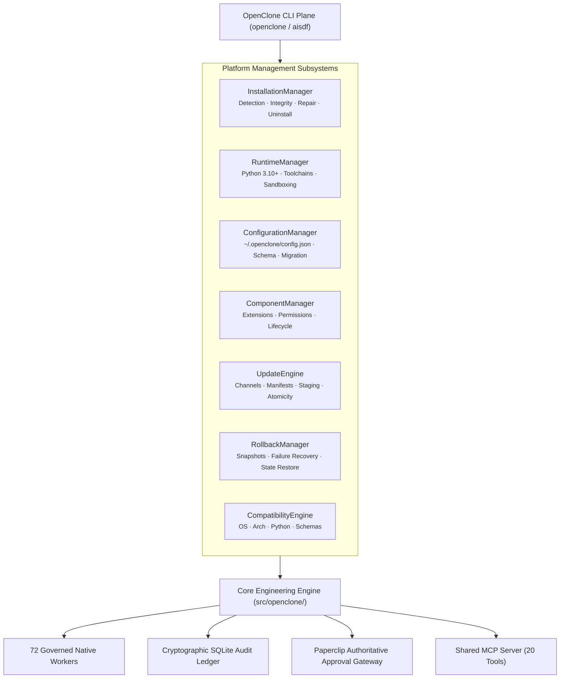

# Platform Management Architecture — OpenClone
## Universal AI Engineering Platform (AIEF)

**Canonical Package:** `openclone`  
**Primary CLI:** `openclone`  
**Legacy Alias:** `aisdf`  
**Version:** 1.0.0  
**Status:** `SPECIFIED & IN_IMPLEMENTATION`  

---

## 1. Architectural Overview

OpenClone establishes a modular, cohesive platform management ecosystem designed around the existing core engine assets. Rather than rewriting working capabilities, the Platform Management Layer coordinates:
1. **Installation Management:** Detects installation modes, validates file integrity, and manages repair/uninstallation.
2. **Runtime Management:** Evaluates Python runtime versions, isolates environments, detects external developer toolchains (Git, Node.js, ADB, SQLite3), and resolves resources.
3. **Configuration Management:** Separates application binaries from user configuration, validates schemas, executes atomic migrations, and preserves settings across updates.
4. **Package & Component Management:** Discovers, installs, enables, disables, updates, and removes optional extension components.
5. **Update & Lifecycle Management:** Orchestrates remote version discovery, release channel subscriptions (`stable`, `beta`, `nightly`), manifest validation, atomic staging, and rollback triggers.
6. **Rollback & Recovery:** Protects application state, snapshots configuration before migrations, and restores working state upon interrupted or failed operations.
7. **Compatibility Management:** Evaluates multi-dimensional compatibility matrices (OS, CPU architecture, Python version, platform version, schema version).



---

## 2. Subsystem Specifications

### 2.1 Installation Manager (`src/openclone/platform/installation/`)
- **Installation Method Detector:** Inspects `sys.executable`, package manifests, and environment markers to classify installation type:
  - `python-pip`: Installed via `pip install openclone`
  - `python-pipx`: Installed via `pipx install openclone`
  - `python-venv`: Installed in local virtual environment
  - `standalone-binary`: Single-file compiled binary (`openclone.exe` / `openclone-linux`)
  - `windows-installer`: Installed via Inno Setup Windows native installer
  - `portable`: Portable mode running with local `./data/` directory
  - `source-checkout`: Running from Git repository checkout
- **Integrity Verifier:** Compares installed files against package metadata or release manifests.
- **Repair Engine:** Re-downloads or restores corrupted templates, worker definitions, or entrypoints.
- **Safe Uninstaller:** Removes application files without modifying user data or unassociated PATH entries.

### 2.2 Runtime Manager (`src/openclone/platform/runtime/`)
- **Python Runtime Validation:** Enforces Python $\ge$ 3.10; warns on deprecated or untested minor versions.
- **External Toolchain Detection:** Checks presence, version, and execution status of:
  - `git` (Version control and release tagging)
  - `node` / `npm` (Taste Skill anti-slop engine and PULSE dashboard)
  - `adb` (Mobile compliance and device lab testing)
  - `sqlite3` (Audit ledger and nonce persistence)
- **Execution Isolation:** Executes commands with strict argument arrays (`argv`), `stdin=DEVNULL`, path containment, and real-time regex credential redaction.

### 2.3 Configuration Manager (`src/openclone/platform/config/`)
- **Path Resolution:**
  - Standard Mode: `~/.openclone/config.json` (or `%APPDATA%\OpenClone\config.json` on Windows)
  - Portable Mode: `./data/config.json`
- **Schema Validation:** Enforces strict validation against `openclone-config.schema.json`.
- **Precedence Hierarchy:**
  1. CLI Flags (`--config`, `--debug`)
  2. Environment Variables (`OPENCLONE_*`, `openclone_*`)
  3. User Configuration File (`~/.openclone/config.json`)
  4. Framework Defaults
- **Migration & Backup:** Before any configuration migration, a timestamped snapshot (`config.json.bak-<timestamp>`) is created.

### 2.4 Component & Extension Manager (`src/openclone/platform/components/`)
- **Component Manifest:** Standardized `component.json` contract defining ID, version, publisher, permissions, minimum platform version, and entrypoints.
- **Lifecycle Operations:** `discover`, `inspect`, `install`, `enable`, `disable`, `update`, `remove`.
- **Security Invariant:** Components execute under least-privilege boundaries and cannot bypass human workforce approval gates or modify audit ledgers.

---

## 3. Directory Layout

The new platform management layer is organized non-intrusively under `src/openclone/platform/`:

```text
src/openclone/platform/
├── __init__.py
├── installation/
│   ├── __init__.py
│   ├── detector.py
│   └── manager.py
├── runtime/
│   ├── __init__.py
│   ├── manager.py
│   └── toolchains.py
├── config/
│   ├── __init__.py
│   ├── manager.py
│   ├── schema.py
│   └── migrations.py
├── updates/
│   ├── __init__.py
│   ├── engine.py
│   ├── channels.py
│   └── manifest.py
├── rollback/
│   ├── __init__.py
│   └── manager.py
├── compatibility/
│   ├── __init__.py
│   └── engine.py
├── components/
│   ├── __init__.py
│   ├── manager.py
│   └── manifest.py
└── diagnostics/
    ├── __init__.py
    └── doctor.py
```
