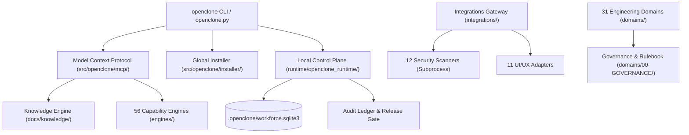

# OpenClone — Target Repository Architecture

## Architectural Layers
1. **Presentation & Interoperability:** `src/openclone/cli.py`, `src/openclone/mcp/server.py`, `adapters/`.
2. **Deterministic Control Plane:** `runtime/openclone_runtime/` (Python stdlib + SQLite).
3. **Integration Gateway:** `integrations/adapters/`, `integrations/manifests/`, `integrations/registry/`.
4. **Engineering Knowledge Engine:** `domains/` (31 domains), `engines/` (56 engine specs), `docs/knowledge/`.
5. **Quality & Anti-Slop Governance:** `skills/taste-skill/`, `security/`, `tests/`.
