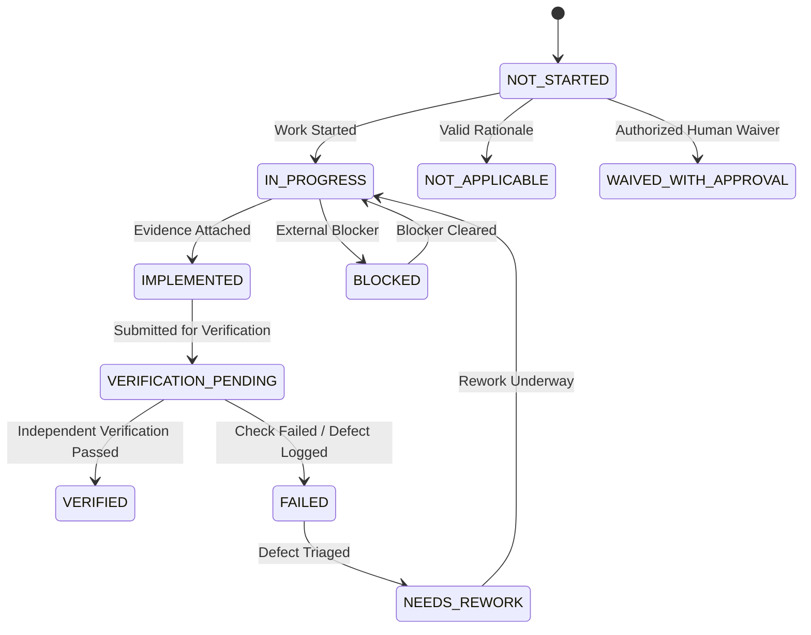

# OpenClone Status Transitions & Quality Gates
**Version:** 1.0.0  
**Scope:** Controlled lifecycle state machine and phase quality gate rules.

---

## 1. Controlled State Lifecycle

---

## 2. Transition Guard Rules

1. **`VERIFIED` Requires Evidence:**
   - Attempting to transition to `VERIFIED` without attached evidence raises `ValueError`.
   - All child verification checks must have outcome `PASS` or `WAIVED`.
2. **`WAIVED_WITH_APPROVAL` Requires Justification:**
   - Requires explicit human approval and documented risk assessment.
3. **`NOT_APPLICABLE` Requires Rationale:**
   - Non-applicable tasks must record an architectural reason (e.g. static website has no database).
4. **`FAILED` Creates Defects:**
   - A verification failure automatically generates a `DefectRecord` with steps and severity.

---

## 3. Phase Quality Gate Rules

Every phase maintains an automated quality gate:
- **Mandatory Tasks:** All tasks with `applicability == REQUIRED` must reach `VERIFIED` or `WAIVED_WITH_APPROVAL`.
- **Zero Open Critical/High Defects:** Unresolved high/critical defects block the gate.
- **Gate Status:**
  - `PASSED`: All mandatory items verified and zero blocking defects.
  - `BLOCKED`: Lists specific unverified items and open defects.
