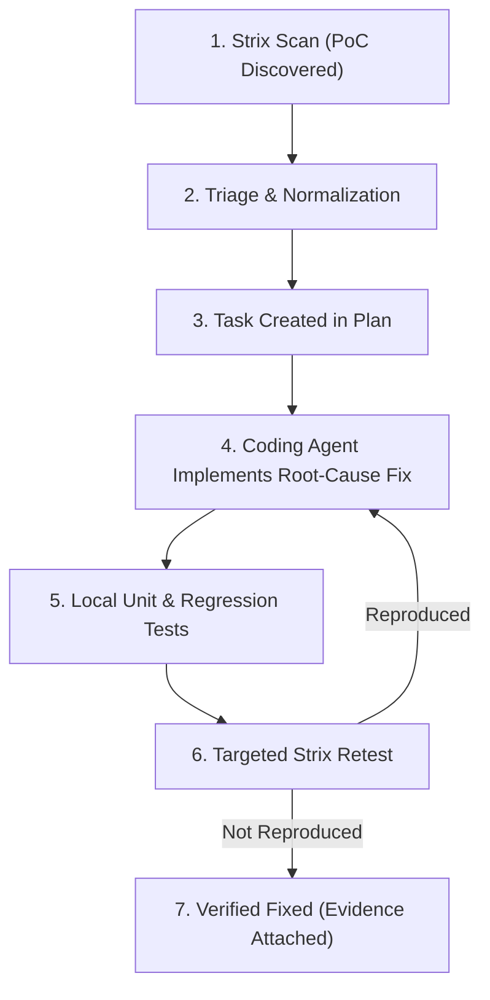

# Strix Dynamic AI Penetration Testing Integration
**Feasibility, Boundary Policies, and Finding-to-Retest Lifecycle**  
**Specification:** v1.0.0 | **Authority:** Security Integration Standard

---

## 1. Executive Verdict & Feasibility

Strix (`usestrix/strix`) is an open-source autonomous AI penetration-testing engine. OpenClone integrates Strix as an **optional, first-class dynamic security adapter** within the Project Execution Engine and Security Orchestrator.

### Integration Boundaries
- **Upstream Separation**: Strix is maintained as an independent upstream CLI tool; OpenClone does not vendor or duplicate Strix source code.
- **Opt-in Only**: Strix dynamic penetration testing is **disabled by default**. It is invoked only when explicitly configured for dynamic web/API targets.
- **Strict Target Authorization**: Scans are rejected unless the target host is explicitly declared in `security/authorized_targets.json`.
- **Bounded Resource Caps**: Every automated scan must declare an immutable `--max-budget` and timeout ceiling.

---

## 2. Prerequisite Verification

Before dispatching Strix, OpenClone checks three prerequisites:
1. **Docker Runtime**: Verified via `docker info` (required for local sandbox execution).
2. **Strix CLI**: Verified via `strix --version`.
3. **LLM Provider Configuration**: Verified presence of `STRIX_LLM` and `LLM_API_KEY` (credentials remain in environment variables; never logged).

---

## 3. Finding-to-Remediation Lifecycle

OpenClone enforces an immutable loop from vulnerability discovery to verified remediation:

---

## 4. Normalized Finding Schema Mapping

Strix findings are mapped into OpenClone's standard schema:
- `finding_id`: `SEC-STRIX-<UUID>`
- `source_tool`: `strix`
- `source_finding_id`: Upstream Strix vulnerability identifier
- `severity_original`: Upstream severity (`CRITICAL`, `HIGH`, `MEDIUM`, `LOW`)
- `severity_normalized`: Normalized OpenClone severity
- `proof_of_concept_reference`: Path to isolated reproduction curl/script
- `remediation_guidance`: Specific code guidance
- `retest_status`: `PENDING` | `VERIFIED_FIXED` | `REOPENED`
