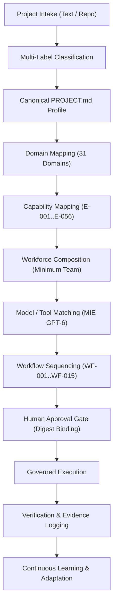

# Universal Project Intelligence Architecture & Specification

**Module:** `src/openclone/intelligence/`  
**Status:** `OPERATIONAL & VERIFIED`  
**Version:** `1.0.0`  
**Registry:** [`framework/registries/project-taxonomy.json`](../../framework/registries/project-taxonomy.json)  
**Schemas:** [`framework/schemas/project-taxonomy.schema.json`](../../framework/schemas/project-taxonomy.schema.json), [`framework/schemas/project-profile.schema.json`](../../framework/schemas/project-profile.schema.json), [`framework/schemas/project-routing.schema.json`](../../framework/schemas/project-routing.schema.json)  
**Blueprints:** [`blueprints/README.md`](../../blueprints/README.md)

---

## 1. Executive Overview & Mission

OpenClone transforms from a single-archetype framework into a modular, project-aware **Universal AI Engineering Intelligence Platform**.

> *"Understand any project. Assemble the right engineering intelligence. Activate the right specialists. Execute through one governed engineering standard."*

OpenClone natively supports diverse engineering disciplines—from mini websites, SaaS platforms, and mobile apps to Linux distributions, embedded firmware, robotics, machine learning, data science, and scientific computing. It handles complex hybrid systems (e.g. Mobile + Local RAG Agent + Backend API) without forcing irrelevant stages or duplicate architectures.

---

## 2. Core Execution Flow



---

## 3. Universal Project Taxonomy (12 Families)

The taxonomy is versioned, machine-readable, and defined in [`framework/registries/project-taxonomy.json`](../../framework/registries/project-taxonomy.json):

| Family ID | Family Name | Canonical Types | Default Delivery | Status |
|---|---|---|---|---|
| `web_engineering` | Web Engineering | `mini_website`, `saas_web_app`, `enterprise_platform` | `web_browser`, `containers_cloud` | `OPERATIONAL` |
| `mobile_engineering` | Mobile Engineering | `native_android`, `native_ios`, `cross_platform_mobile` | `android`, `ios` | `OPERATIONAL` |
| `desktop_engineering` | Desktop Engineering | `cross_platform_desktop`, `native_desktop_tool` | `windows`, `macos`, `linux` | `OPERATIONAL` |
| `ai_engineering` | AI Engineering | `rag_knowledge_system`, `autonomous_agent_system` | `containers_cloud`, `web_browser` | `OPERATIONAL` |
| `machine_learning` | Machine Learning Engineering | `classical_ml_pipeline`, `deep_learning_cv_nlp` | `containers_cloud`, `edge_devices` | `IMPLEMENTED` |
| `data_engineering_and_data_science` | Data Engineering & Data Science | `etl_pipeline`, `data_science_study` | `containers_cloud`, `web_browser` | `OPERATIONAL` |
| `backend_and_distributed_systems` | Backend & Distributed Systems | `microservices_platform`, `event_driven_stream` | `containers_cloud`, `on_premises` | `OPERATIONAL` |
| `operating_systems_and_systems` | Operating Systems & Systems | `linux_distribution`, `kernel_driver_module` | `bootable_media_iso`, `virtual_machines` | `SPECIFIED` |
| `embedded_hardware_and_robotics` | Embedded Systems & Robotics | `rtos_firmware`, `robotics_platform` | `embedded_hardware`, `edge_devices` | `SPECIFIED` |
| `game_and_simulation` | Game & Simulation Engineering | `game_application` | `web_browser`, `windows`, `linux` | `SPECIFIED` |
| `developer_tools_and_languages` | Developer Tools & Compilers | `cli_developer_tool`, `compiler_toolchain` | `linux`, `windows`, `macos` | `OPERATIONAL` |
| `research_and_scientific_computing` | Research & Scientific Software | `computational_model` | `linux`, `containers_cloud` | `SPECIFIED` |

---

## 4. Independent Complexity & Delivery Targets

### Complexity Levels
Complexity is derived from component count, regulatory boundaries, state mutability, and hardware integration—never solely from lines of code:
- **`MINI`**: Minimal state, static layout, zero backend or database (e.g. landing page, portfolio).
- **`SMALL`**: Single service, local database, basic CRUD.
- **`MEDIUM`**: Multi-tier architecture, authentication, persistent database, standard APIs.
- **`LARGE`**: High-concurrency distributed systems, mobile cross-platform, kernel/firmware, or multi-domain hybrid applications.
- **`ENTERPRISE`**: Multi-region, regulatory compliance (SOC2/HIPAA), strict RBAC, tamper-evident audit ledgers.
- **`RESEARCH_EXPERIMENTAL`**: Numerical algorithms, mathematical simulations, exploratory data science.

### Delivery Targets
- `web_browser`
- `android`
- `ios`
- `windows`
- `macos`
- `linux`
- `containers_cloud`
- `on_premises`
- `embedded_hardware`
- `edge_devices`
- `virtual_machines`
- `bootable_media_iso`

---

## 5. Canonical PROJECT.md Contract & Conditional Profiles

[`PROJECT.md`](../../PROJECT.md) remains the sole human-readable and machine-verifiable source of truth. It incorporates:
1. **Multi-label classification header:** Primary family/type, secondary types, supporting types, confidence score, ambiguity flags.
2. **Delivery targets & independent complexity:** With explicit rationale.
3. **Universal Domain & Capability mapping:** Declaring mandatory, conditional, and excluded domains.
4. **Conditional Profiles:** Included only when relevant:
   - `ai`: Model family, RAG pipeline, tool permissions, safety evals.
   - `ml`: Data provenance, leakage controls, baseline model, drift monitoring.
   - `data_science`: Hypotheses, statistical tests, EDA reproducibility seed.
   - `data_engineering`: Idempotent pipelines, schema evolution, dead-letter queues.
   - `os_systems`: Target architecture, kernel base, bootloader, init system, ISO builder.
   - `embedded_hardware`: Target MCU, RTOS, memory limits, watchdog loop, OTA update.
   - `mobile`: Lifecycle, deep linking, push notifications, offline caching.
   - `desktop`: Native windowing, code signing, auto-update verification.
   - `game_simulation`: Game loop, ECS, asset pipeline, physics/graphics.
   - `developer_tools`: CLI argument parsing, strict type stubs, POSIX exit codes.
   - `scientific_research`: Floating point precision, convergence criteria, reproducible datasets.

---

## 6. Deterministic Domain & Capability Routing

Routing is implemented in [`src/openclone/intelligence/router.py`](../../src/openclone/intelligence/router.py). For every project:
- **Domain Mapping:** Partitions OpenClone's 31 canonical domains (`00-GOVERNANCE` through `30-AGENT-RULES-AND-VERIFICATION`). Mini websites exclude heavy database and migration domains; AI projects mandate `29-AI-GOVERNANCE` and `30-AGENT-RULES-AND-VERIFICATION`.
- **Capability Mapping:** Selects specific execution engines from `E-001` through `E-056` with status and selection rationale.
- **Minimum Effective Workforce:** Avoids agent inflation. Categorizes workers into:
  - `native_agents`: Built-in OpenClone worker roles.
  - `external_agents`: Agency Agents 14 divisions.
  - `ide_agents`: IDE-hosted agents (Google Antigravity, Claude Code, Cursor).
  - `human_specialists`: Mandatory human approvals and specialized domain advisors.
  - `missing_specialists`: Explicitly reported gaps with human fallback.

---

## 7. Model Intelligence Engine (MIE) Matching

The router queries the Model Intelligence Engine to pair task requirements with verified model capabilities:
- **`gpt-6.2-astra`**: Complex architecture, multi-tenant database isolation, kernel/firmware planning, high-reasoning tasks.
- **`gpt-6.2-sol`**: Core business logic, fullstack implementation, general agent workflows.
- **`gpt-6.1-terra`**: Computer vision, visual layout auditing, responsive design verification.
- **`claude-3-7-sonnet` / `gemini-2.5-pro`**: Cross-provider fallback chains.
- **`ollama:qwen2.5-coder`**: Zero-cost, privacy-preserving offline local verification.

---

## 8. Canonical Project-Family Blueprints

All 14 project families have dedicated blueprints in [`blueprints/`](../../blueprints/README.md):
- [`01-MINI-WEBSITE.md`](../../blueprints/01-MINI-WEBSITE.md)
- [`02-SAAS-WEB-APP.md`](../../blueprints/02-SAAS-WEB-APP.md)
- [`03-MOBILE-APP.md`](../../blueprints/03-MOBILE-APP.md)
- [`04-DESKTOP-APP.md`](../../blueprints/04-DESKTOP-APP.md)
- [`05-AI-AGENT-RAG.md`](../../blueprints/05-AI-AGENT-RAG.md)
- [`06-MACHINE-LEARNING.md`](../../blueprints/06-MACHINE-LEARNING.md)
- [`07-DATA-SCIENCE.md`](../../blueprints/07-DATA-SCIENCE.md)
- [`08-DATA-ENGINEERING.md`](../../blueprints/08-DATA-ENGINEERING.md)
- [`09-BACKEND-DISTRIBUTED.md`](../../blueprints/09-BACKEND-DISTRIBUTED.md)
- [`10-LINUX-OS.md`](../../blueprints/10-LINUX-OS.md)
- [`11-EMBEDDED-IOT.md`](../../blueprints/11-EMBEDDED-IOT.md)
- [`12-GAME-SIMULATION.md`](../../blueprints/12-GAME-SIMULATION.md)
- [`13-DEVELOPER-TOOLS-COMPILER.md`](../../blueprints/13-DEVELOPER-TOOLS-COMPILER.md)
- [`14-RESEARCH-SCIENTIFIC.md`](../../blueprints/14-RESEARCH-SCIENTIFIC.md)

---

## 9. MCP Server Tools & CLI Commands

### Model Context Protocol (MCP) Tools
The OpenClone MCP server exposes 4 dedicated tools for Universal Project Intelligence:
- `openclone_classify_project(text, project_name)`: Returns structured `ProjectProfile`.
- `openclone_route_project(text, project_name)`: Returns complete `RoutingDecision`.
- `openclone_get_blueprint(blueprint_id)`: Fetches blueprint markdown.
- `openclone_project_intelligence_status()`: Summarizes supported families and blueprints.

### CLI Commands
```bash
# Display intelligence status & supported families
openclone intelligence status

# Classify natural language requirements
openclone intelligence classify "Building an offline Flutter app with local RAG and FastAPI"

# Classify an existing repository
openclone intelligence classify --repo ./my-app

# Route requirements to domains, capabilities, workforce, and models
openclone intelligence route "Building an enterprise microservices platform with Kafka"

# List all 14 project family blueprints
openclone intelligence blueprint --list

# View a specific blueprint
openclone intelligence blueprint 10-LINUX-OS
```
