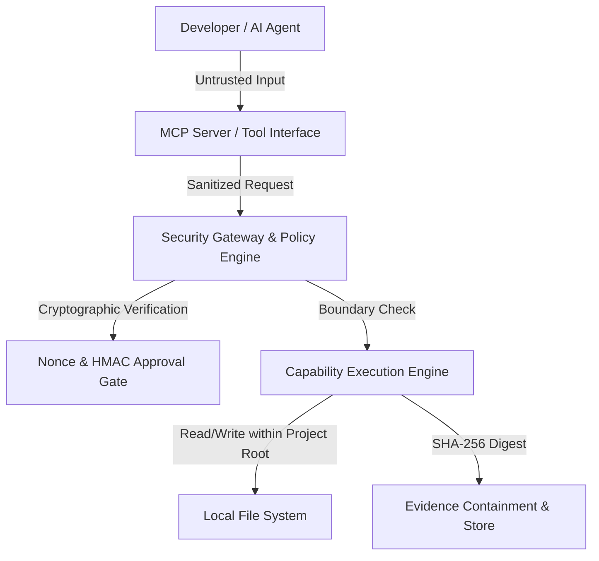

# OpenClone 2.0 Security Architecture & Threat Model

**Document ID:** `SEC-OC-2.0-THREAT-MODEL-v2.0.0`  
**Product:** OpenClone 2.0 Universal AI Software Engineering Platform  
**Standard:** AISDF Standard 1.0.0  
**Status:** `NORMATIVE SECURITY SPECIFICATION`  
**Author:** Principal Security Architect  

---

## 1. System Overview & Trust Assumptions

OpenClone 2.0 operates as an engineering intelligence layer and MCP service embedded inside developer IDEs and AI coding tools. Because it interacts with file systems, execution boundaries, and human approval workflows, it enforces rigorous security boundaries:



### Trust Assumptions
- **The LLM is Untrusted:** Model outputs, generated plans, and autonomous tool requests are treated as untrusted data.
- **The Host Environment is Trusted to Execute Python:** The host OS running Python is assumed to provide basic memory safety and process isolation.
- **Project Boundary is Strict:** No tool operation may read or write outside the designated workspace root unless explicitly authorized by the user.

---

## 2. STRIDE Threat Analysis & Implemented Mitigations

| Threat Category | Target Component | Threat Scenario | Concrete Mitigation in OpenClone 2.0 |
|---|---|---|---|
| **Spoofing** | Approval Gateway | Attacker or malicious script forges a human approval to deploy code. | **HMAC-SHA256 Signatures:** Approvals are cryptographically verified using `payload_digest` and secret key in `gateway.py`. |
| **Tampering** | Host Configurations | Installer corrupts or overwrites user's existing IDE configs. | **Pre-modification Backups:** Automated `.bak.<timestamp>` creation and key-isolated JSON updates in `engine.py`. |
| **Repudiation** | Audit & Verification | Agent claims a test passed or task completed without running it. | **Deterministic Evidence Verification:** `openclone_submit_evidence` computes real SHA-256 digests over disk files; simulated passes are rejected. |
| **Information Disclosure** | Live MCP Guidance | Secrets, credentials, or private keys leak into tool outputs or logs. | **Secret Redaction Filter:** Automatic regex scrubbing of API keys, bearer tokens, and credentials in `gateway.py`. |
| **Denial of Service** | Installer / Update | Corrupted or massive module downloads exhaust disk or memory. | **Size Limits & Checksums:** Strict file size checks and SHA-256 integrity verification before unpack in `engine.py`. |
| **Elevation of Privilege** | Capability Engine | Path traversal (`../../etc/passwd`) escapes project directory. | **Boundary Containment:** Strict `_check_boundary()` path normalization and directory anchoring in `capabilities.py`. |

---

## 3. Detailed Security Controls

### 3.1 Workspace Boundary Containment
All file operations performed by `src/openclone/integrations/capabilities.py` resolve candidate paths through `os.path.realpath` and assert that the target resides strictly within `project_root`:
```python
def _check_boundary(self, target_path: str) -> bool:
    resolved_target = os.path.realpath(target_path)
    resolved_root = os.path.realpath(self.project_root)
    return (
        resolved_target == resolved_root or
        resolved_target.startswith(resolved_root + os.sep)
    )
```
Any operation attempting to access parent directories, external volumes, or sensitive system files fails closed immediately.

### 3.2 Cryptographic Replay Protection
High-risk operations (such as `openclone_approve_release_deployment`) require a signed approval record. To prevent replay attacks, the gateway enforces single-use nonces:
```python
# Extract and verify single-use nonce
nonce = approval_record.get("nonce")
if not nonce or nonce in self._consumed_nonces:
    return {"status": "REJECTED", "error": "Replay detected: nonce has already been consumed"}

self._consumed_nonces.add(nonce)
```

### 3.3 Zero Unauthenticated Remote Execution
OpenClone 2.0 contains **no remote listeners**, **no hidden telemetry**, and **no unauthenticated network ports**. The MCP server communicates strictly over local standard I/O (`stdio`) or local-only SSE transport bound to `127.0.0.1`.

### 3.4 Safe Installer Uninstallation
When `openclone uninstall` is executed, the installer removes only the OpenClone-owned keys from the host configuration files. If an error occurs, it restores the previous state from the timestamped backup file, ensuring complete reversibility.

---

## 4. Vulnerability Disclosure & Incident Response

Vulnerabilities must be reported privately via the instructions in [`SECURITY.md`](../../SECURITY.md). The security team commits to:
- Initial response within 24 hours.
- Triage and severity classification within 48 hours.
- Fix delivery and patch release within 7 days for critical vulnerabilities.
