# OpenClone Engineering Domains Directory
## The 31 Canonical Knowledge and Specification Domains

This directory houses the 31 foundational engineering domains of OpenClone (canonical framework: AISDF). Each domain represents a distinct, bounded engineering responsibility covering governance, requirements, architecture, platform operations, AI model engineering, UI/UX, security, and verification.

---

## 1. Governance & Policy Rules

- **Canonical Home**: `domains/` is the single canonical home for all numbered engineering domains (`00` through `30`).
- **Domain Independence**: Domains define knowledge, policy, and capability boundaries. They are not independent microservices; they feed deterministic engines (`engines/`) and workflows (`workflows/`).
- **Extension Policy**: Adding or modifying a domain requires an Architecture Decision Record (ADR) approved by human governance in `domains/00-GOVERNANCE/`.

---

## 2. Canonical Domain Index

| Domain | Name | Scope & Purpose | Primary Owner | Key Output |
|---|---|---|---|---|
| [`00`](00-GOVERNANCE/README.md) | **Governance & Rules** | Repository rulebook, instruction precedence, evidence policies, and exception registers. | Human Governance Board | Rulebook & Policies |
| [`01`](01-METHODOLOGY/README.md) | **Methodology** | MK-Framework principles, AI software development lifecycle, and quality foundations. | Chief Architect | Methodology Standard |
| [`02`](02-PROJECT-INTELLIGENCE/README.md) | **Project Intelligence** | Codebase ingestion, context bounding, AST dependency indexing, and structural reconnaissance. | Principal Architect | Intelligence Indexes |
| [`03`](03-REQUIREMENTS-ENGINEERING/README.md) | **Requirements Engineering** | Feature inventory, user stories, NFRs, traceability matrices, and PRDs. | Requirements Engineer | Requirements Spec |
| [`04`](04-PRODUCT-ENGINEERING/README.md) | **Product Engineering** | Product vision, milestone definitions, MVP scoping, and stakeholder alignment. | Product Manager | Product Blueprint |
| [`05`](05-UX-UI-ENGINEERING/README.md) | **UX/UI Engineering** | Anti-AI-slop design governance, Taste Skill integration, user-choice morphism, and design tokens. | UI/UX Design Lead | Human-Crafted Design System |
| [`06`](06-TECHNOLOGY-INTELLIGENCE/README.md) | **Technology Intelligence** | Stack research, vendor evaluation, open-source library audits, and tech debt analysis. | Solutions Architect | Tech Feasibility Matrix |
| [`07`](07-ENGINEERING-KNOWLEDGE/README.md) | **Engineering Knowledge** | Ubiquitous language, domain modeling, best practices, and pattern repositories. | Lead Architect | Knowledge Maps |
| [`08`](08-SOFTWARE-ARCHITECTURE/README.md) | **Software Architecture** | System component topology, data flow, communication patterns, and ADR authoring. | System Architect | Architecture Blueprints |
| [`09`](09-PLATFORM-ENGINEERING/README.md) | **Platform Engineering** | Cloud topology, containerization, infrastructure-as-code, and developer tooling. | Cloud Engineer | Platform Specs |
| [`10`](10-AI-AND-MODEL-ENGINEERING/README.md) | **AI & Model Engineering** | LLM model selection, routing policies, prompt engineering, and multimodal pipelines. | AI/ML Lead | Model Routing Policies |
| [`11`](11-AGENT-ENGINEERING/README.md) | **Agent Engineering** | Specialist agent workforce contracts, tool permissions, and role boundary enforcement. | Agent Systems Engineer | Role Manifests |
| [`12`](12-ORCHESTRATION-AND-CONTEXT/README.md) | **Orchestration & Context** | Dynamic context window management, task dispatching, and state machines. | Orchestration Architect | Task Graphs & DAGs |
| [`13`](13-HARNESS-AND-EXECUTION/README.md) | **Harness & Execution** | Governed local command execution, credential redaction, and sandbox isolation. | Runtime Engineer | Execution Evidence |
| [`14`](14-SECURITY-AND-PRIVACY/README.md) | **Security & Privacy** | Threat modeling (STRIDE), scanner locking, secret management, and compliance checks. | Security Architect | Security Threat Models |
| [`15`](15-DATA-AND-DATABASE-ENGINEERING/README.md) | **Data & Database Engineering** | Relational schemas, NoSQL models, migrations, query optimization, and data governance. | Database Architect | Database Schemas |
| [`16`](16-API-AND-INTEGRATION-ENGINEERING/README.md) | **API & Integration Engineering** | REST/gRPC/GraphQL contracts, webhook interfaces, and OpenAPI specifications. | API Architect | API Contracts |
| [`17`](17-TESTING-AND-VERIFICATION/README.md) | **Testing & Verification** | Test strategy pyramid, automated unit/integration suites, and release readiness gates. | QA Lead | Test Suites & Reports |
| [`18`](18-DEVOPS-AND-CLOUD-ENGINEERING/README.md) | **DevOps & Cloud Engineering** | CI/CD pipelines, automated build verification, environment provisioning, and IaC. | DevOps Engineer | CI/CD Workflows |
| [`19`](19-DEPLOYMENT-AND-OPERATIONS/README.md) | **Deployment & Operations** | Canary rollouts, blue-green deployments, health probes, and rollback procedures. | Release Engineer | Deployment Runbooks |
| [`20`](20-RELIABILITY-AND-OBSERVABILITY/README.md) | **Reliability & Observability** | SRE standards, distributed tracing, metrics telemetry, alerting, and incident response. | Site Reliability Engineer | Observability Dashboards |
| [`21`](21-DISTRIBUTED-SYSTEMS-AND-SCALABILITY/README.md) | **Distributed Systems** | Sharding, consensus protocols, cache topologies, and horizontal scalability patterns. | Distributed Systems Engineer | Scalability Specifications |
| [`22`](22-COST-AND-RESOURCE-GOVERNANCE/README.md) | **Cost & Resource Governance** | Cloud FinOps, LLM token budget management, compute quotas, and idle resource reclamation. | FinOps Specialist | Cost & Token Budgets |
| [`23`](23-LEGAL-AND-COMPLIANCE/README.md) | **Legal & Compliance** | Open-source license attribution, intellectual property audits, and regulatory conformance. | Compliance Officer | License Audits |
| [`24`](24-PRODUCT-ANALYTICS-AND-SUPPORT/README.md) | **Product Analytics & Support** | Usage telemetry schemas, user behavior tracking, error capture, and customer support runbooks. | Product Analyst | Analytics Telemetry |
| [`25`](25-FRAMEWORK-MAINTENANCE/README.md) | **Framework Maintenance** | OpenClone versioning, deprecation policies, framework self-audits, and migrations. | Framework Maintainer | Release Notes & Guides |
| [`26`](26-DISTRIBUTION-AND-EXTENSIONS/README.md) | **Distribution & Extensions** | Plugin packaging, reusable skill specifications, and marketplace distribution formats. | Extension Architect | Plugin Packages |
| [`27`](27-STANDARDS-AND-COMPATIBILITY/README.md) | **Standards & Compatibility** | Multi-IDE conformance tests, provider compatibility matrices, and protocol standards. | Standards Engineer | Conformance Matrices |
| [`28`](28-TEMPLATES-AND-EXAMPLES/README.md) | **Templates & Examples** | Project templates, work-unit templates, reference applications, and agent rule starters. | Technical Writer | Project Starters |
| [`29`](29-BENCHMARKS-AND-EVALUATION/README.md) | **Benchmarks & Evaluation** | SWE-bench reproduction, agent capability evaluations, and quality benchmarking rubrics. | Evaluation Specialist | Benchmark Reports |
| [`30`](30-AGENT-RULES-AND-VERIFICATION/README.md) | **Agent Rules & Verification** | Deterministic rule checking, hallucination mitigation, prompt defense, and audit ledgers. | Verification Auditor | Verification Checks |

---

## 3. Cross-Domain Dependency Architecture

```mermaid
flowchart TD
    subgraph StrategyAndGovernance["Governance & Product"]
        D00["00-Governance"]
        D01["01-Methodology"]
        D03["03-Requirements"]
        D04["04-Product"]
    end

    subgraph ArchitectureAndDesign["Architecture & Experience"]
        D05["05-UX/UI Engineering (Taste Skill)"]
        D07["07-Knowledge"]
        D08["08-Architecture"]
        D15["15-Data"]
        D16["16-APIs"]
    end

    subgraph ExecutionAndIntelligence["Intelligence & Execution"]
        D02["02-Project Intelligence"]
        D10["10-AI & Models"]
        D11["11-Agent Workforce"]
        D12["12-Orchestration"]
        D13["13-Harness & Sandbox"]
    end

    subgraph QualityAndOperations["Quality & Operations"]
        D14["14-Security & Privacy"]
        D17["17-Testing & Verification"]
        D18["18-DevOps"]
        D19["19-Deployment"]
        D20["20-Observability"]
        D22["22-Cost Governance"]
    end

    subgraph StandardsAndEcosystem["Ecosystem & Compliance"]
        D23["23-Legal"]
        D25["25-Maintenance"]
        D26["26-Distribution"]
        D27["27-Standards"]
        D30["30-Agent Verification"]
    end

    StrategyAndGovernance --> ArchitectureAndDesign
    ArchitectureAndDesign --> ExecutionAndIntelligence
    ExecutionAndIntelligence --> QualityAndOperations
    QualityAndOperations --> StandardsAndEcosystem
```

