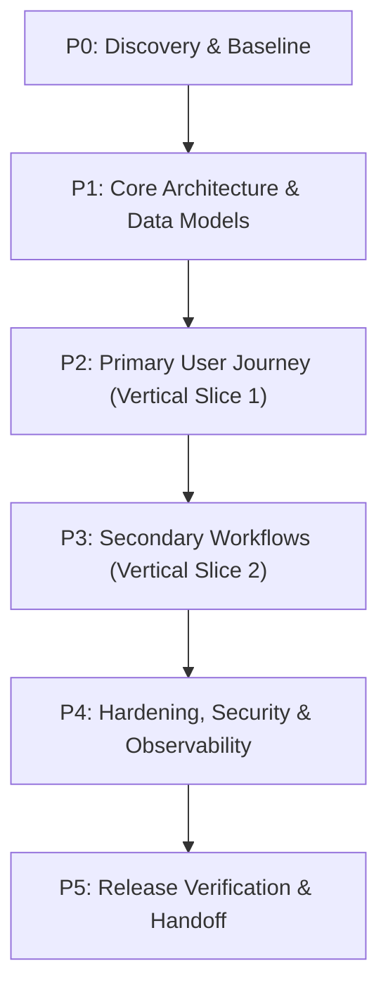

# Implementation Plan: [Project Name]
**Phased Vertical Slice Execution Plan**  
**Version:** 1.0.0 | **Status:** PROPOSED / APPROVED

---

## 1. Plan Overview & Dependency Ordering

---

## 2. Execution Phases

### Phase 0: Discovery & Environment Baseline
- **Goal**: Establish project working tree, package manifests, and development toolchain.
- **Tasks**:
  - `TASK-001`: Inspect git status and dependency lockfiles.
  - `TASK-002`: Initialize test runner and format/lint pre-commit checks.
- **Verification Gate**: Clean local build and passing smoke test.

### Phase 1: Core Architecture & Data Models
- **Goal**: Implement persistent data schemas, tenant boundaries, and authentication models.
- **Tasks**:
  - `TASK-101`: Database migrations and table schemas (`FR-001`, `FR-002`).
  - `TASK-102`: Secret configuration and environment loaders.
- **Verification Gate**: Unit tests passing for migrations and models.

### Phase 2: Primary User Journey (Vertical Slice 1)
- **Goal**: Implement complete, end-to-end user workflow.
- **Tasks**:
  - `TASK-201`: UI input forms and client validation.
  - `TASK-202`: Server route handlers and authorization checks.
  - `TASK-203`: Business logic execution and database persistence.
- **Verification Gate**: End-to-end integration test passes.

### Phase 3: Secondary Workflows & Integrations
- **Goal**: Implement remaining features, external integrations, and background workers.
- **Tasks**:
  - `TASK-301`: Background job processors and error handling.
  - `TASK-302`: External webhook and third-party API integration.
- **Verification Gate**: Integration tests with mocked external services.

### Phase 4: Hardening, Security & Observability
- **Goal**: Verify security profiles, run vulnerability checks, and audit UX accessibility.
- **Tasks**:
  - `TASK-401`: Execute SAST (`Semgrep`) and secrets detection (`TruffleHog`).
  - `TASK-402`: Keyboard navigation, focus indicators, and WCAG 2.2 AA contrast checks.
- **Verification Gate**: Security findings triaged and zero unresolved blocking defects.

### Phase 5: Release Verification & Handoff
- **Goal**: Verify final build, smoke tests, and deployability.
- **Tasks**:
  - `TASK-501`: Full test suite run (`PASS` recorded).
  - `TASK-502`: Final git diff review and documentation synchronization.
- **Verification Gate**: All acceptance criteria satisfied in `ACCEPTANCE_MATRIX.md`.
