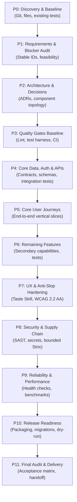

# Workflow WF-015: Portable Project Specification to Build
**Zero-Install Specification-to-Execution Workflow for Any AI Coding IDE**  
**Specification:** v2.1.0 | **Category:** Project Orchestration

---

## 1. Purpose & Core Contract

`WF-015` formalizes OpenClone's portable specification-to-build workflow. It enables developers to begin with **only a single `PROJECT.md` file** in any environment (ChatGPT, Claude, or local IDEs) without cloning the OpenClone repository or installing framework dependencies in their application.

---

## 2. Twelve-Phase Project Delivery Lifecycle

---

## 3. Required Portable Artifacts

When executing `WF-015`, the engine generates or synchronizes portable, self-contained files:

1. **`PROJECT.md`**: Approved requirements with stable identifiers (`FR-XXX`, `NFR-XXX`, `SEC-XXX`, `UX-XXX`, `BR-XXX`, `DATA-XXX`, `OPS-XXX`).
2. **`BUILD_PROMPT.md`**: Master prompt provided to the target IDE coding agent.
3. **`AGENT_INSTRUCTIONS.md`**: Execution contract and coding standards.
4. **`IMPLEMENTATION_PLAN.md`**: Milestone sequence and dependency ordering.
5. **`ACCEPTANCE_MATRIX.md`**: 10-column traceable requirement-to-test mapping.
6. **`SECURITY_PLAN.md`**: Baseline threat model, static scanner checkpoints, and optional Strix dynamic testing.
7. **`PROGRESS.md`**: Real-time milestone and task progress ledger.
8. **`HANDOFF.md`**: Inter-session context continuation protocol.
9. **`ARCHITECTURE.md` / `DATA_LIFECYCLE.md` / `DECISIONS.md`**: Conditional system, data, and decision records.

---

## 4. Change-Impact Management

When an approved requirement, architecture decision, or dependency changes during execution:
1. Identify affected requirement IDs and architecture documents.
2. Trace impacted implementation tasks, code files, and automated tests.
3. Classify impact (`LOW`, `MEDIUM`, `HIGH`).
4. Seek explicit human approval before altering approved scope, security boundaries, or costs.
5. Propagate changes atomically across all affected specification and tracking documents.

---

## 5. Traceability & Evidence Status Rules

In `ACCEPTANCE_MATRIX.md`, statuses are strictly limited to:
- `PASS`: Requirement implemented with observable test output and zero exit code.
- `FAIL`: Test failed or requirement not met.
- `BLOCKED`: Blocked by external dependency or technical impediment.
- `NOT_RUN`: Test planned but not yet executed.
- `NOT_APPLICABLE`: Requirement formally excluded with rationale.
- `ACCEPTED_RISK`: Human-authorized exception recorded in `DECISIONS.md`.

> ⚠️ Never mark `NOT_RUN`, `BLOCKED`, or `ACCEPTED_RISK` as `PASS`.

---

## 6. Completion Standard

A project executed under `WF-015` is declared complete only when:
- Every in-scope requirement has observable verification evidence in `ACCEPTANCE_MATRIX.md`.
- Zero open critical/high security vulnerabilities exist.
- Anti-slop UX governance (Taste Skill) is verified.
- The working tree diff has been reviewed with zero unintended changes.
- Final completion audit independently reviews original requirements against implementation.
