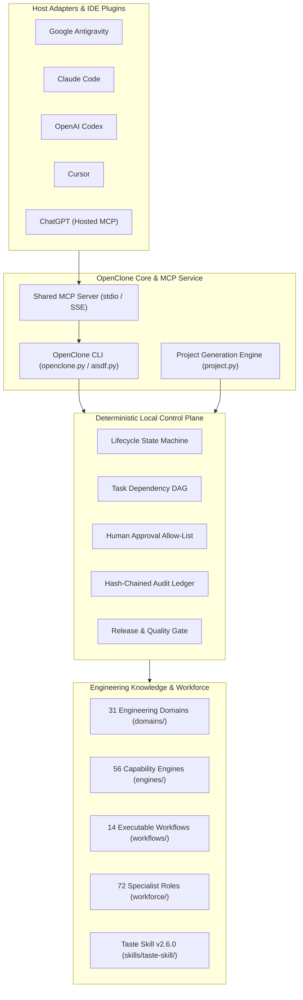

# PROJECT.md — OpenClone Framework Product Source of Truth
## Universal AI Software Engineering Framework (AISDF)

- **Product Name:** OpenClone
- **Framework Standard:** AI Software Development Framework (AISDF)
- **Canonical Repository:** https://github.com/MK-1603/OpenClone
- **Version: 2.0.0**
- **Project Type:** `OPEN_SOURCE_FRAMEWORK_AND_LOCAL_CONTROL_PLANE`
- **Maturity Status:** `GOVERNED_LOCAL_CONTROL_PLANE` (Interfaces and deterministic gates verified; production execution requires container isolation)
- **License:** MIT License
- **Technical Lead:** MK-1603 & Antigravity Principal Engineering Agent

---

## 1. Executive Summary & Problem Statement

Modern AI coding agents (Claude Code, Cursor, Antigravity, Codex, ChatGPT) generate code at rapid speeds. However, autonomous generation without engineering governance results in **AI Slope**: scope bloat, unverified completions, hallucinated passes, prompt injection vulnerabilities, unmonitored tool privileges, and missing audit trails.

**OpenClone** provides a self-hostable, provider-independent, and IDE-neutral control plane that decouples software engineering governance, requirements traceability, task DAG enforcement, and release gates from underlying LLMs or execution environments.

---

## 2. Product Mission & Boundaries

### 2.1 Mission
Provide a unified, reproducible software engineering operating system governed by one deterministic standard:
> *"Build with Any AI. Governed by One Engineering Standard."*

### 2.2 Scope Boundaries & Exclusions
- **What OpenClone Is:** A deterministic control plane enforcing permissions, cycle-free task DAGs, human approval digest binding, tamper-evident SQLite ledgers, multi-IDE MCP interoperability, and 31-domain engineering standards.
- **What OpenClone Is Not:** OpenClone is not a proprietary LLM model, does not bundle model weights, does not execute unverified shell code without containment, and does not claim automatic production passes without verifiable test evidence.

---

## 3. Users, Personas & Stakeholders

1. **Individual Developers & Open-Source Maintainers:** Require disciplined AI code generation, clean architecture, and reproducible PR verification.
2. **Enterprise Engineering Teams:** Require least-privilege tool execution, independent code review gates (Goldfish context), and deterministic approval chains.
3. **Security & DevSecOps Teams:** Require strict scanner locking (12 pinned scanners), schema-validated findings, and denial-of-default permissions.
4. **AI Coding Agents (Claude, Cursor, Codex, Antigravity):** Require unambiguous operating boundaries, machine-readable worker contracts, and stable task handoffs.

---

## 4. Formal Functional Requirements

Requirements adhere to the OpenClone Requirements Engineering Standard (`fol.md`):

| Req ID | Title | Statement | Priority | Status | Knowledge State | Verification Method | Traceability |
|---|---|---|---|---|---|---|---|
| `REQ-CORE-001` | Deterministic Local Runtime | The system SHALL enforce task states (`DRAFT`->`PLANNED`->`APPROVED`->`READY`->`RUNNING`->`SUCCEEDED`) without external dependencies. | `MUST` | `IMPLEMENTED` | `VERIFIED_FACT` | Unit Test | `runtime/aisdf_runtime/workforce.py`, `tests/test_runtime_hardening.py` |
| `REQ-CORE-002` | Cycle-Free Task Dependency DAG | The system SHALL reject circular task dependencies and ensure prerequisite completion before marking tasks `READY`. | `MUST` | `IMPLEMENTED` | `VERIFIED_FACT` | Unit Test | `workforce.py`, `tests/test_workforce_runtime.py` |
| `REQ-CORE-003` | Human Approval Digest Binding | The system SHALL bind task approval to an immutable SHA-256 digest of task parameters and reject unapproved modifications. | `MUST` | `IMPLEMENTED` | `VERIFIED_FACT` | Unit Test | `workforce.py`, `ApprovalTests` |
| `REQ-CORE-004` | Hash-Chained Audit Ledger | The system SHALL record all task transitions, approvals, and execution hashes in a tamper-evident SQLite ledger. | `MUST` | `IMPLEMENTED` | `VERIFIED_FACT` | Unit Test | `workforce.py`, `ReadinessTests.test_ledger_tampering_detected` |
| `REQ-CORE-005` | Governed Subprocess Execution | The system SHALL redact sensitive tokens and credentials from command execution logs and enforce execution allow-lists. | `MUST` | `IMPLEMENTED` | `VERIFIED_FACT` | Unit Test | `ExecutionTests.test_run_records_evidence_and_redacts` |
| `REQ-MCP-001` | Shared MCP Tool Service | The system SHALL provide a standard Model Context Protocol (MCP) server exposing 7 core inspection, knowledge, and workflow tools. | `MUST` | `IMPLEMENTED` | `VERIFIED_FACT` | Unit Test | `src/openclone/mcp/server.py`, `tests/test_mcp_server.py` |
| `REQ-UX-001` | Anti-AI-Slop Visual Governance | The system SHALL halt generic visual clichés using Taste Skill v2.6.0 before UI code generation occurs. | `MUST` | `INTEGRATED` | `VERIFIED_FACT` | Automated Test | `skills/taste-skill/tests/test-governance.mjs` |
| `REQ-UX-002` | User-Choice Design Morphism | The system SHALL provide token sets and WCAG 2.2 AA scrims for Glassmorphism, Neumorphism, Swiss, and Brutalism when requested. | `MUST` | `INTEGRATED` | `VERIFIED_FACT` | Inspection | `domains/05-UX-UI-ENGINEERING/USER-CHOICE-DESIGN-PATTERNS.md` |
| `REQ-DEP-001` | Application Deployment Automation | The system SHALL manage user application build, preview verification, and deployment across 6 cloud adapters. | `MUST` | `IMPLEMENTED` | `VERIFIED_FACT` | Schema Test | `workflows/WF-014-APPLICATION-BUILD-TO-DEPLOYMENT.md`, `schemas/deployment-profile.schema.json` |
| `REQ-IDE-001` | Multi-IDE Host Adaptability | The system SHALL provide native configuration packages for Antigravity, Claude Code, Codex, Cursor, and ChatGPT. | `MUST` | `IMPLEMENTED` | `VERIFIED_FACT` | Matrix Inspection | `adapters/`, `adapters/INTEGRATION-MATRIX.md` |

---

## 5. Non-Functional Requirements & Measurable Invariants

- **NFR-001: Zero Core Dependencies:** Local reference runtime (`aisdf.py`, `workforce.py`, `openclone.py`) MUST execute on Python 3.10+ standard library without mandatory pip packages.
- **NFR-002: Fast Validation:** Repository validation (`validate_repository.py`) MUST execute in `< 3.0 seconds`.
- **NFR-003: Strict Schema Conformance:** All schemas in `schemas/` MUST conform to JSON Schema Draft 2020-12.
- **NFR-004: Secret Redaction:** API keys, AWS keys, GitHub tokens, and private credentials MUST be redacted before ledger or log persistence.
- **NFR-005: Clean Encoding:** All text files across OpenClone MUST be valid UTF-8 without byte-order marks.

---

## 6. Architecture & System Topology

---

## 7. Workforce & Domain Specifications

1. **31 Engineering Domains:** Consolidated under [`domains/`](file:///domains) covering `00-GOVERNANCE` through `30-AGENT-RULES-AND-VERIFICATION`.
2. **56 Capability Engines:** Documented execution contracts in [`engines/`](file:///engines) (`E-001` through `E-056`).
3. **14 Executable Workflows:** Complete lifecycle procedures in [`workflows/`](file:///workflows) (`WF-001` through `WF-014`).
4. **72 Specialist Roles Across 12 Teams:** Concrete role contracts in [`workforce/teams/`](file:///workforce/teams) with JSON manifests in [`workforce/registry/workers/`](file:///workforce/registry/workers).

---

## 8. Acceptance Criteria & Definition of Done

OpenClone releases require all conditions met:
- [x] Repository validator (`tools/validate_repository.py`) reports 0 errors and 0 warnings.
- [x] All 50 Python unit tests pass cleanly.
- [x] Taste Skill governance and anti-slop test suites pass cleanly.
- [x] All 12 security scanners remain pinned with SHA-256 integrity locks in `security/scanners.lock.json`.
- [x] All 31 domains reside exclusively within `domains/`.
- [x] Shared MCP server operates with validated input schemas and permission controls.
- [x] Working tree is clean and committed on branch `main`.
