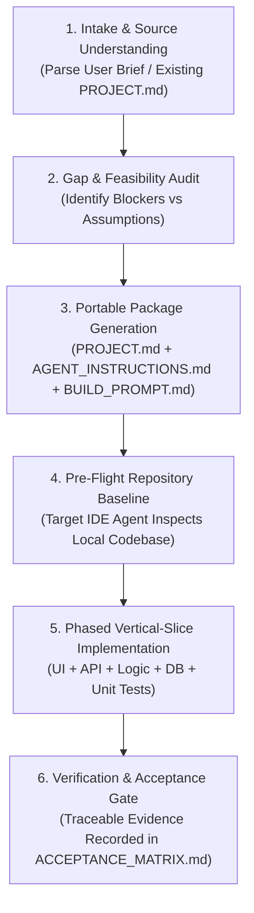

# Workflow WF-015: Portable Project Specification to Build
**Zero-Install Specification-to-Execution Workflow for Any AI Coding IDE**  
**Specification:** v1.0.0 | **Category:** Project Orchestration

---

## 1. Purpose & Core Contract

`WF-015` formalizes OpenClone's portable specification-to-build workflow. It enables developers to begin with **only a single `PROJECT.md` file** in any environment (ChatGPT, Claude, or local IDEs) without cloning the OpenClone repository or installing framework dependencies in their application.

---

## 2. Six-Phase Portable Lifecycle

---

## 3. Required Portable Artifacts

When executing `WF-015`, the engine generates or synchronizes six self-contained files:

1. **`PROJECT.md`**: Approved requirements with stable identifiers (`FR-XXX`, `NFR-XXX`, `SEC-XXX`, `UX-XXX`).
2. **`BUILD_PROMPT.md`**: Master prompt provided to the target IDE coding agent.
3. **`AGENT_INSTRUCTIONS.md`**: Execution contract and coding standards.
4. **`IMPLEMENTATION_PLAN.md`**: Milestone sequence and dependency ordering.
5. **`SECURITY_PLAN.md`**: Baseline threat model, static scanner checkpoints, and optional Strix dynamic testing.
6. **`ACCEPTANCE_MATRIX.md`**: Traceable requirement-to-test mapping.

---

## 4. Completion Standard

A project executed under `WF-015` is declared complete only when:
- Every in-scope requirement has observable verification evidence.
- Zero open critical/high vulnerabilities exist.
- Anti-slop UX governance is verified.
- The working tree diff has been reviewed with zero unintended changes.
